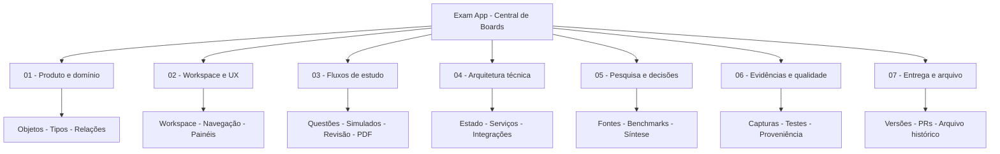
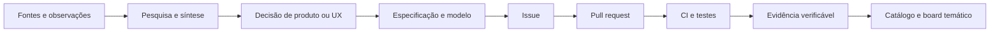

# 00 — Mapa geral dos boards

> Hub de navegação para encontrar especificações, documentos, decisões e evidências sem percorrer o canvas inteiro.

## Boards temáticos

| Board | Use quando precisar... |
| --- | --- |
| [01 — Produto e domínio](01-produto-e-dominio.md) | entender entidades, tipos, propriedades e relações |
| [02 — Workspace e UX](02-workspace-e-ux.md) | entender navegação, layout, painéis, grafo e padrões |
| [03 — Fluxos de estudo](03-fluxos-de-estudo.md) | seguir questões, simulados, revisão ou leitura |
| [04 — Arquitetura técnica](04-arquitetura-tecnica.md) | entender estado, serviços, IA e integrações |
| [05 — Pesquisa e decisões](05-pesquisa-e-decisoes.md) | encontrar benchmarks, fontes e decisões |
| [06 — Evidências e qualidade](06-evidencias-e-qualidade.md) | localizar capturas, testes e rastreabilidade |
| [07 — Entrega e arquivo](07-entrega-e-arquivo.md) | consultar versões e recuperar ideias históricas |

## Como a informação se conecta

## Fontes canônicas

- [Central de boards](docs__board__README.md)
- [Fontes de verdade](FONTES.md)
- [Canvas original](BOARD.md)
- [Dados do canvas](board.json)
- [Catálogo de evidências](CATALOG.md)
