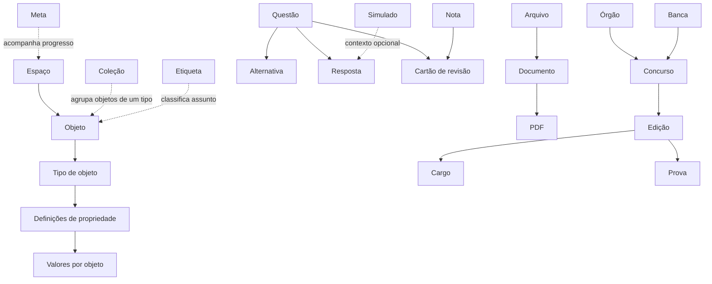

# 01 — Produto e domínio

> Explica o que existe no domínio. Não confunda tipo de objeto, etiqueta, coleção e jornada de usuário.

## Regras de leitura

- Espaço isola objetos e relações.
- Cada objeto pertence a um tipo específico; o tipo define sua estrutura.
- Arquivo → Documento → PDF é uma hierarquia de tipos.
- Etiqueta classifica assunto; coleção agrupa manualmente objetos de um tipo.
- Resposta pode existir sem simulado. Cartão pode nascer de questão ou nota.
- O diagrama sintetiza o modelo do canvas; confirme detalhes na fonte canônica.

## Documentos

- [BOARD.md — conteúdo completo](BOARD.md)
- [Pesquisa Capacities — tipos e propriedades](capacities-issue-32-2026-11-15.md)
- [Arquitetura da informação](arquitetura-informacao-navegacao.md)

## Blocos originais

- [e52 — Espaço, Objeto e Tipo](board-exam-app__index.html#e52)
- [e104 — Tipos e relações](board-exam-app__index.html#e104)
- [e99 — Hierarquia de tipos](board-exam-app__index.html#e99)
- [e95 — Glossário](board-exam-app__index.html#e95)
- [e152 — Decisões de modelagem](board-exam-app__index.html#e152)
- [e1150 — Matriz de decisões](board-exam-app__index.html#e1150)
