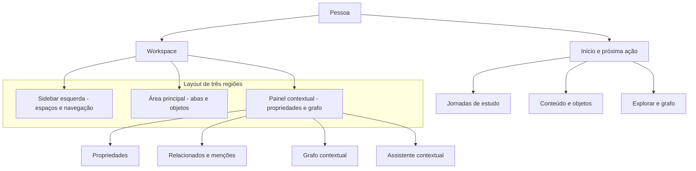

# 02 — Workspace e UX

> Organiza a experiência em superfícies e tarefas. O painel contextual complementa a área principal; não substitui a navegação primária.

## Princípios de composição

- Sidebar é navegação global; área principal contém a tarefa; painel direito é contextual e opcional.
- Questões e Simulados são jornadas; Questão e Simulado também são tipos de objeto.
- Abas representam contextos independentes; não duplique abas sem regra explícita.
- Propriedades, aliases, etiquetas, coleções, links e menções têm semânticas próprias.
- Busca e filtros preservam contexto e estados de vazio, erro e recuperação.
- Grafo e gráficos precisam de controles, filtros, legenda, teclado e movimento reduzido.

## Documentos

- [Arquitetura da informação](arquitetura-informacao-navegacao.md)
- [Leis e princípios UX/UI](ux-ui-principles.md)
- [Padrões de componentes UI](componentes-ui-padroes-2026.md)
- [Taxonomia de dialogs](taxonomia-componentes-e-dialogs-2026.md)
- [Data Visualization e dashboards](data-visualization-dashboards-2026.md)
- [Pesquisa UX — 20 fontes](pesquisa-20-fontes-2026-11.md)
- [Auditoria Material 3 e Apple](231-skills-m3-apple.md)

## Blocos originais

- [e500 — Workspace de três painéis](board-exam-app__index.html#e500)
- [e162 — Diretrizes UI/UX](board-exam-app__index.html#e162)
- [e504 — Painel de propriedades](board-exam-app__index.html#e504)
- [e506 — Dashboard central](board-exam-app__index.html#e506)
- [e510 — Explorar e grafo](board-exam-app__index.html#e510)
- [e600 — Auditoria UI/UX](board-exam-app__index.html#e600)
- [e700 — Comparativo Capacities/branches](board-exam-app__index.html#e700)
- [e800 — Painel direito e grafo](board-exam-app__index.html#e800)
- [e1228 — Tema e seletores](board-exam-app__index.html#e1228)
- [e1339 — Responsividade](board-exam-app__index.html#e1339)
- [e1351 — Movimento reduzido](board-exam-app__index.html#e1351)
- [e1361 — Exportação PNG](board-exam-app__index.html#e1361)
- [e1385 — SpaceSwitcher](board-exam-app__index.html#e1385)
- [e1397 — Atalhos e comandos](board-exam-app__index.html#e1397)
