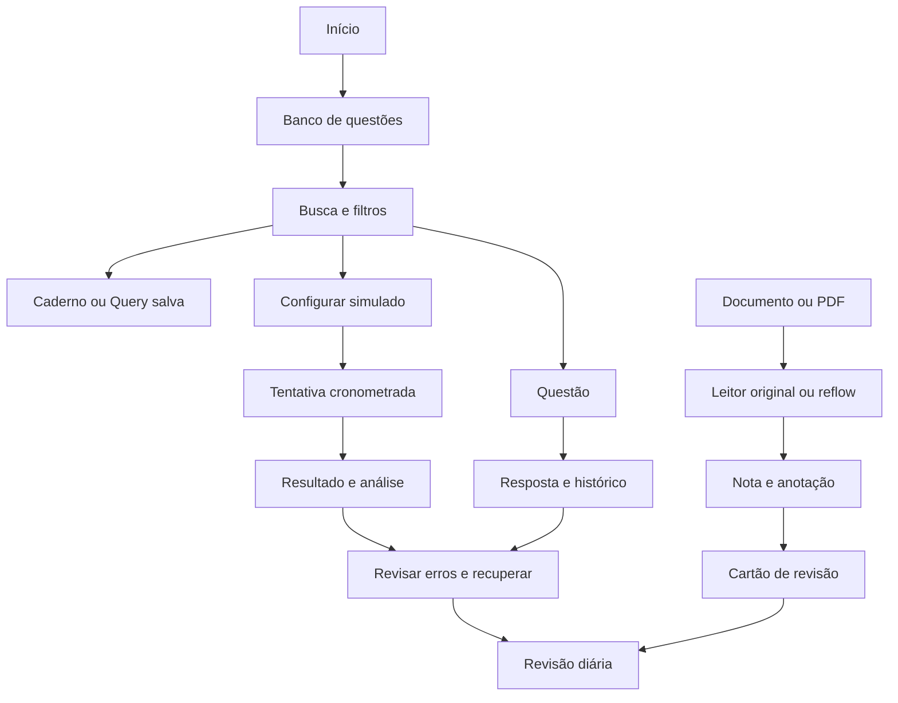

# 03 — Fluxos de estudo

> As setas representam o fluxo de produto modelado. Consulte as fontes para distinguir implementação, parcialidade e pendências.

## Invariantes

- A mesma questão é reutilizada em prática, caderno, simulado e revisão.
- Filtros preservam critérios e exclusões ao salvar query ou gerar caderno/simulado.
- Resposta avulsa não depende de simulado.
- Revisão revela a resposta sob demanda e registra o agendamento.
- Leitor PDF preserva posição, busca, notas e marcações.

## Documentos

- [Evidências ExamTopics × dev](evidencias-examtopics-2026-11-17.md) — Questões, gabarito, paginação, modalidades e limites comprovados/pendentes reunidos no Board 06.

- [Auditoria ExamTopics × dev — 17/11/2026](examtopics-auditoria-2026-11-17.md) — Matriz funcional verificada; diferencia código, proposta e acesso público.

- [Estratégia de questões — #230](docs__research__pesquisas__230-estrategia-questoes__README.md)
- [Pesquisa QConcursos — #31](qconcursos-issue-31-2026-11-15.md)
- [Inventário ExamTopics](examtopics-inventory.md)
- [Gran Questões — #62](gran-questoes-issue-62-2026-11-15.md)
- [Análise QConcursos](analise-qconcursos.md)
- [Análise ExamTopics](analise-examtopics.md)
- [Dossiê Readwise Reader e SRS](READWISE_DOSSIER.md)

## Blocos originais

- [e508 — Navegação, grade e relatório](board-exam-app__index.html#e508)
- [e1155 — Questões e simulados](board-exam-app__index.html#e1155)
- [e1177 — Diagnóstico PDF.js](board-exam-app__index.html#e1177)
- [e1188 — Cadernos e queries](board-exam-app__index.html#e1188)
- [e1208 — Filtros avançados](board-exam-app__index.html#e1208)
- [e1381 — Questões contextuais](board-exam-app__index.html#e1381)
- [e1453 — Recuperação](board-exam-app__index.html#e1453)
- [e1465 — Revisão diária](board-exam-app__index.html#e1465)
- [e1477 — PDF Reader](board-exam-app__index.html#e1477)
