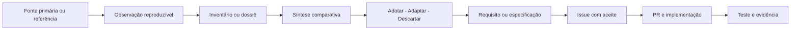

# 05 — Pesquisa e decisões

> Separa o que foi observado em fontes externas daquilo que foi decidido para o Exam App. Benchmark não prova implementação no nosso produto.

## Proveniência

- Priorize documentação oficial e fontes primárias.
- Registre data, rota, autenticação, ambiente e limites da observação.
- Separe fato, inferência, hipótese e decisão de produto.
- Não trate captura antiga ou branch arquivada como prova de comportamento atual.
- Decisão de produto deve apontar para evidência e requisito.

## Documentos

- **Fonte central das evidências ExamTopics:** [Board 06 / dossiê integral](evidencias-examtopics-2026-11-17.md) e [canvas `e17000`](board-exam-app__index.html#e17000). A pesquisa abaixo é referência e síntese; todos os 57 achados e imagens estão no Board de Evidências.

- [Auditoria ExamTopics × dev — 17/11/2026](examtopics-auditoria-2026-11-17.md) — Fontes oficiais, controles DOM, limitações, decisões e gaps.
- [Manifesto de evidências ExamTopics — 17/11/2026](examtopics-auditoria-evidencias-2026-11-17.json) — URLs observadas e cinco capturas anteriores (sem mídia nova).

- [Capacities — #32](capacities-issue-32-2026-11-15.md)
- [ExamTopics — inventário](examtopics-inventory.md)
- [QConcursos — #31](qconcursos-issue-31-2026-11-15.md)
- [Gran Questões — #62](gran-questoes-issue-62-2026-11-15.md)
- [Auditoria UI skills — #156](issue-156-ui-skills-audit-2026-11-15.md)
- [Pesquisa UX — 20 fontes](pesquisa-20-fontes-2026-11.md)
- [Análise QConcursos](analise-qconcursos.md)
- [Análise ExamTopics](analise-examtopics.md)

## Blocos originais

- [e107 — Fontes e referências](board-exam-app__index.html#e107)
- [e108 — QConcursos](board-exam-app__index.html#e108)
- [e116 — ExamTopics](board-exam-app__index.html#e116)
- [e119 — Readwise](board-exam-app__index.html#e119)
- [e190 — Análise ExamTopics](board-exam-app__index.html#e190)
- [e400 — Análise QConcursos](board-exam-app__index.html#e400)
- [e900 — Dossiê comparativo](board-exam-app__index.html#e900)
- [e1090 — Dossiê Readwise](board-exam-app__index.html#e1090)
