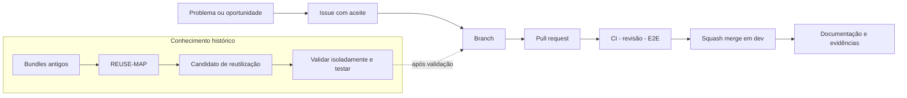

# 07 — Entrega e arquivo

> Separa o ciclo atual de engenharia do material histórico. Branches antigas ajudam a recuperar ideias, mas não provam que o comportamento continua correto na dev.

## Regras

- GitHub é a fonte do estado atual de issues, PRs, branches e CI.
- Feito, Em andamento e Pendente são snapshots antigos, não status atuais.
- Roadmap do canvas é histórico até ser reconciliado com issues e código da dev.
- Não copie código de bundle diretamente: extraia isoladamente, inspecione, teste e registre proveniência.

## Documentos

- [README de protótipos](README.md)
- [Índice de branches arquivadas](docs__archives__README.md)
- [Mapa de reutilização](REUSE-MAP.md)
- [Fontes de verdade](FONTES.md)
- [Relatório da reestruturação](RELATORIO-REESTRUTURACAO.md)

## Blocos originais

- [e47 — Feito (histórico)](board-exam-app__index.html#e47)
- [e48 — Em andamento (histórico)](board-exam-app__index.html#e48)
- [e49 — Pendente (histórico)](board-exam-app__index.html#e49)
- [e4 — Versão 0.1.0](board-exam-app__index.html#e4)
- [e149 — Versão 0.1.1](board-exam-app__index.html#e149)
- [e154 — Roadmap original](board-exam-app__index.html#e154)
- [e363 — Arquivos do projeto](board-exam-app__index.html#e363)
