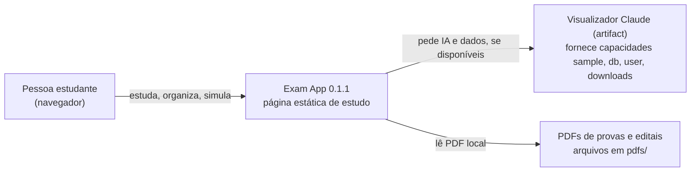
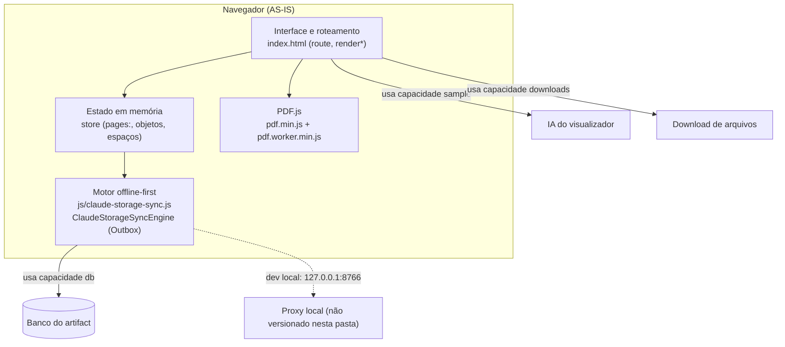

# C4 do runtime atual (AS-IS)

Fonte: `prototype/exam-app-0.1.1__index.html` (9.248 linhas) e `prototype/claude-storage-sync.js`, SHA `9beadadd8be27c7d99d3ecdf5b5cf099137e23cc`, 2026-11-16.

## Nível 1: Contexto

Fronteira: o app de estudo como um único sistema. Fora dela: a pessoa estudante, o visualizador do Claude (artifact) e os PDFs de provas.

Legenda: setas indicam quem inicia a chamada. Quando o artifact não oferece uma capacidade, a função fica indisponível e a interface mostra a dica correspondente (ver issue/PR de IA na [planilha de features](docs__features__README.md)).

## Nível 2: Containers

Fronteira: o arquivo `index.html` e seus arquivos vizinhos, todos servidos como estáticos.

Pontos verificados no código:
- `window.claude.use` é chamado com `sample` (IA, liga classes `ai-on`), `db` (via o motor de sincronização) e `downloads`.
- O motor escolhe entre o artifact e o proxy local por detecção de ambiente.
- Não há servidor de aplicação, banco próprio nem build no repositório para esta versão.

## Lacunas (não são fatos)

- O endpoint `127.0.0.1:8766` aparece como alternativa no código; o repositório não contém o proxy correspondente nesta pasta. Não o descreva como componente existente sem verificar.
- A capacidade `user` e `downloads` são referidas nas instruções de publicação; apenas `downloads` aparece como chamada direta no código inspecionado.

## TO-BE (proposta, não implementado)

Separado do AS-IS para não confundir. Hoje não existe módulo de dados separado, modelo de API nem backend. Qualquer evolução (ex.: API própria, separação em módulos) deve ser registrada como ADR proposto antes de virar diagrama.

## Histórico

A versão 0.1.0 (`prototype/exam-app-0.1.0__*`) é congelada e não é runtime atual. Veja a pasta `prototype/docs__archives__*` para branches antigas, que são referência e não código vigente.
