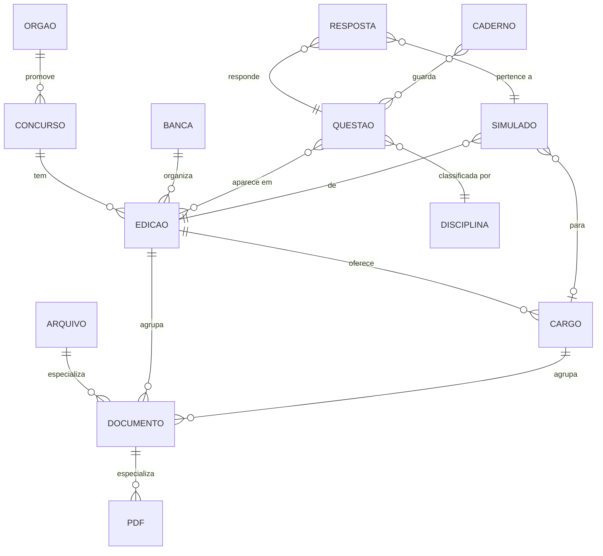

# Modelo de domínio (AS-IS)

Fonte: constante `TYPES` em `prototype/exam-app-0.1.1__index.html` (linha 2918), SHA `9beadadd8be27c7d99d3ecdf5b5cf099137e23cc`. Os nomes em português são os exibidos no app.

| Tipo | Herda de | Propriedades próprias |
| --- | --- | --- |
| Concurso | — | órgão |
| Órgão | — | — |
| Banca | — | — |
| Edição | — | concurso, ano, banca |
| Cargo | — | edição |
| Arquivo | — | formato |
| Documento | Arquivo | classe, categoria, edição, cargo |
| PDF | Documento | páginas |
| Questão | — | disciplina, ano, banca, órgão, edição, cargo |
| Caderno | — | — |
| Disciplina | — | — |
| Simulado | — | edição, cargo, ano |
| Resposta | — | questão, simulado, data, alternativa, resultado |

## Diagrama

Notas:
- O diagrama mostra relações que o código declara por propriedade (`own`) e herança (`parent`). Relações de uso que não estão em `TYPES` (ex.: caderno guardando questões) vêm de telas, não de tipos; por isso estão marcadas como inferidas no texto abaixo.
- Caderno e Resposta são tipos declarados; a relação `CADERNO → QUESTAO` é inferida da tela de caderno de erros e deve ser confirmada no código antes de ser tratada como regra.
- Espaço é um isolamento de conta, não um tipo do `TYPES`. Não aparece no diagrama.
