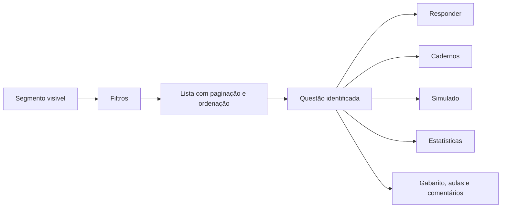

# Pesquisa verificável do QConcursos — Issue #31

**Data da coleta:** 15/11/2026. **Estado:** pesquisa parcial; a issue não deve ser fechada. Foram consultadas páginas públicas pelo mecanismo de busca/navegação web e os arquivos internos remotos da branch `dev`. Não houve sessão autenticada, instalação do app, execução de fluxos, captura de screenshots ou inspeção visual. HTML extraído mostra rótulos/estados acessíveis ao crawler, não prova a interação visual nem a persistência.

## Síntese e proveniência

A rota pública de questões expõe navegação por Concursos, Editais, Provas, Questões, Cursos, Bancas, Cargos, Carreiras, segmentos OAB/ENEM/Vestibular/concursos militares, e lista extensa de filtros. Itens de questão mostram identificador, ano, banca, órgão, prova, disciplina, alternativas, botão Responder, referências de gabarito oficial e ações para comentários, aulas, estatísticas, cadernos, anotações e notificação de erro. Isto é **observado no HTML público da rota** em 15/11/2026; não equivale a teste da UI.

Os Termos de Uso oficiais (atualização declarada em 31/10/2025) descrevem Visitante, Cadastrado e Assinante, serviços de questões, filtros, simulados, comentários, cadernos e estatísticas, e afirmam que o app não tem as mesmas funcionalidades do desktop. Como os termos incluem planos antigos/descontinuados, não servem como catálogo de planos e preços atuais. Listings de lojas descrevem funcionalidades do app, mas são **declarações promocionais**, não observações de funcionamento. Reclame Aqui agrega índices da empresa e relatos individuais; estes são **relatos**, não comprovação independente de falha.

## Fontes consultadas

| Fonte/URL | Evidência consultada em 15/11/2026 | Natureza e limite |
|---|---|---|
| [QConcursos: questões](https://www.qconcursos.com/questoes-de-concursos/questoes) | Navegação, filtros, opções, questão e ações listadas a seguir. | Observação pública do HTML extraído; sem clique, screenshot ou login. |
| [QConcursos: Termos de Uso](https://www.qconcursos.com/termos-de-uso/) | Data de atualização 31/10/2025; perfis de usuário, serviços incluídos, diferenças de plano/app e direitos sobre conteúdo. | Declaração oficial, com nomes de planos legados. |
| [QConcursos: Política de Privacidade](https://www.qconcursos.com/politica-de-privacidade) | Página aberta. | Não analisada em profundidade nesta coleta. |
| [Google Play: Qconcursos](https://play.google.com/store/apps/details?id=com.qconcursos.QCX) | Listing consultado; mostra 4,8 estrelas, 159 mil avaliações, 1M+ downloads, última atualização indicada em 09/11/2026. Descreve questões, videoaulas, cadernos, comentários e uso offline. | Métricas mutáveis e descrição do fornecedor; app não instalado. |
| [Apple App Store: Qconcursos](https://apps.apple.com/br/app/qconcursos/id1470271696) | Listing declara 1,5M+ questões, 10 mil+ videoaulas, downloads, filtros, cadernos, metas, comentários e relatórios; nota 4,9/85 mil classificações no conteúdo lido. | Declaração promocional e avaliações de usuários. |
| [Reclame Aqui: perfil Qconcursos](https://www.reclameaqui.com.br/empresa/qconcursos/) | Métricas da janela 01/05–31/10/2026: 8,6/10, 3.151 reclamações, 99,7% respondidas, 91,6% resolvidas, 78,4% voltariam, 7,7 nota do consumidor, média de resposta 4 dias e 6 horas. | Agregado da plataforma, janela delimitada; não medida objetiva de UX. |
| [Relato: qualidade e filtros](https://www.reclameaqui.com.br/qconcursos/insatisfacao-com-a-qualidade-do-servico-qconcursos-erros-em-questoes-gabaritos-incorretos-e-filtros-de-busca-inoperantes_vT_E1IgFCtgFGXZh/) | Usuário relata erros/gabaritos e filtros inoperantes. | Reclamação individual; causa e desfecho não verificados. |
| [Relato: comentários, cadernos e estatísticas](https://www.reclameaqui.com.br/qconcursos/comentarios-nao-abre-caderno-nao-abre-estatistica-nao-abre-nada-funciona-mas-se-nao-pagar-nao-usa_iA7zcYkK1iTdDYwl/) | Relato recente de travamentos ao acessar recursos. | Relato individual; não reproduzido. |
| [Relato: comentários e IA](https://www.reclameaqui.com.br/qconcursos/qconcursos-quedas-na-qualidade-ausencia-de-comentarios-de-professores-e-uso-de-ia_rjBtw6T0hbGDOB2n/) | Usuário alega desaparecimento de comentários docentes e conteúdo que identifica como IA. | Alegação do usuário; não prova uso de IA nem mudança da plataforma. |
| [Google Play: avaliação](https://play.google.com/store/apps/details?id=com.qconcursos.QCX) | Avaliação de 2021 critica quantidade de questões grátis. | Opinião individual, antiga e não representativa. |
| [Apple App Store: avaliação](https://apps.apple.com/br/app/qconcursos/id1470271696) | Avaliação “Consertem a quantidade gigante de questões repetidas!”, de 3 de fevereiro (ano não exposto no trecho). | Opinião individual; duplicação não verificada. |

Não consultei fonte verificável de Reddit, fóruns, vídeos tutoriais ou comparação funcional independente com TEC/Gran nesta coleta.

## Observações da rota pública

### Navegação e segmento
A página lista segmentos Concursos Públicos, Concursos Militares, OAB, ENEM e Vestibular. Navegação visível inclui Concursos, Editais (abertos, inscrições abertas, autorizados, previstos), Provas, Questões, Guias de estudo, Cursos, Videoaulas, aulas em texto, YouTube, Disciplinas, Bancas, Cargos, Carreiras e Notícias. A tela apresenta alerta de que alterar segmento limpa campos do filtro. Não testei o efeito do botão nem abri todos os destinos; portanto este não é um sitemap integral.

### Filtros, listagem e ordenação
A extração pública mostrou: Disciplina; Assunto; Banca; Instituição; Ano; Cargo; Nível; Área de Formação; Área de Atuação; Modalidade; Dificuldade. Valores textualmente expostos incluem níveis Fundamental/Médio/Superior; modalidades Múltipla-Escolha/Certo ou Errado; dificuldade Muito Fácil/Fácil/Médio/Difícil/Muito Difícil. Também aparecem exclusões “Dos meus cadernos”, “Dos meus simulados”, “Inéditas”, “Anuladas”, “Desatualizadas” e inclusão de “Gabarito Comentado”, “Comentários”, “Meus Comentários”, “Aulas”, “Minhas Anotações”.

Os controles visíveis incluem filtro simples/avançado, Salvar Filtros, Filtrar e Limpar. O resultado exibia 2.949.119 questões no instante consultado, seleção por página 5/10/15/20 e ordenação por data de prova recente/antiga, adição recente, dificuldade, relevância de palavras-chave e gabarito comentado. Esses valores podem mudar. Não testei busca textual global, execução da ordenação, contagens por opção, seleção múltipla, AND/OR, dependências, chips, exclusões padrão, persistência, URL ou comportamento após mudar segmento.

### Questão e ações
Um item visível tinha identificador `Q4446061`, metadados Ano/Banca/Órgão/Prova e disciplina, enunciado, alternativas e botão Responder. A página extraída também continha estados de “Incorreta. Gabarito oficial da banca” e “Parabéns! Você acertou!”, além de chamadas contextuais e links/abas Gabarito Comentado, Aulas, Comentários, Estatísticas, Cadernos, Criar anotações e Notificar Erro. Há exemplos de múltipla escolha e itens V/F agrupados. Não fiz submissão, não confirmei regra de correção, histórico ou conteúdo protegido.

### Ações de produto, semântica e domínio
“Adicionar a um caderno” e “Criar simulado” aparecem como chamadas relacionadas a questões; os Termos incluem cadernos e simulados personalizados. “Meus Filtros”/“Salvar Filtros” aparecem na tela de busca. Nada disso confirma ciclo de vida: coleção fixa/dinâmica, CRUD, permissões, compartilhamento, tempo, retomada, reset, correção ou métrica permanecem por testar. Questão apresenta relações de navegação a prova, banca e órgão, mas isto não revela esquema de banco nem cardinalidade.

Diagrama representa agrupamentos de ações vistos na página, não um fluxo testado nem arquitetura interna.

## Perfis, plano, política e aplicativo

Termos oficiais descrevem Visitante, Cadastrado (ferramentas restritas e quantidade diária limitada de resolução) e Assinante (ferramentas do plano contratado). Também listam conteúdo de concursos/provas/questões, filtros e pesquisa, resolução, simulados personalizados, comentários, cadernos, relacionamento e estatísticas. Outras funcionalidades variam por plano, e os próprios termos citam planos antigos que já não são ofertados. Preço, limites exatos, plano atual e acesso por ação não foram determinados. Os termos dizem expressamente que o app não possui as mesmas funcionalidades que o desktop. Google Play declara uso offline; a capacidade não foi testada. Termos tratam propriedade intelectual do conteúdo e organização do banco, proíbem reprodução não autorizada e apontam o portal de suporte [suporte.qconcursos.com/pt-BR](https://suporte.qconcursos.com/pt-BR/).

## Comparação com Exam App `dev`

Arquivos remotos consultados: `prototype/exam-app-0.1.1__index.html` (blob `965037384264ed43eeffc363ba513877cc0f71dd`) e `prototype/exam-app-0.1.1__data__dataprev-2026-tipo1.json` (70 questões). A análise do protótipo não é evidência sobre QConcursos.

- O `renderPractice()` interno usa `qfHTML('study', ...)`; `qfHTML` tem campo de busca, chips, contador e lista; lista permite paginação e estados de resposta.
- As categorias internas `QF_CATS` incluem Disciplina, Assunto, Banca, Cargo, Ano, Órgão, Modalidade, Dificuldade, Concurso, Edição, Origem e Situação. O painel avançado inclui exclusões e inclusões por dados locais. A rota pública externa, por sua vez, mostrou Área de Formação e Área de Atuação e não mostrou Concurso/Edição como facetas simples na extração observada.
- O código interno separa filtros salvos e cadernos: `sfCreate` persiste consulta (critérios); `nbCreate` recebe IDs únicos de questões. Isso dá base local para a distinção, mas não valida semântica externa.
- Dataset é restrito a 70 questões da prova Dataprev 2026 tipo 1. Não oferece prova de cobertura real dos filtros ausentes.
- Termos públicos e listings externos anunciam ações de cadernos, filtros, simulados e métricas. Comparar comportamento com o protótipo exigiria fluxo autenticado e visual que não foi feito.

**Inferência/proposta para o app:** proteger proveniência e revisão do gabarito (preliminar/definitivo/retificado), oferecer ordenação com estado estável, renderizar facetas apenas quando dados as suportam, preservar a distinção consulta salva vs. conjunto de IDs vs. tentativa de simulado. Isso é recomendação para Exam App, não descrição do concorrente.

## Relatórios internos prévios e divergência

Na branch `dev`, [`analise-qconcursos.md`](https://github.com/ianmaciel7/exams-app/blob/dev/prototype/analise-qconcursos.md) e [`analise-examtopics.md`](https://github.com/ianmaciel7/exams-app/blob/dev/prototype/analise-examtopics.md) estão datados de 13/11/2026. A análise QConcursos relata conteúdo de suporte oficial consultado então, inclusive filtro cumulativo E, exclusões padrão, aplicar último filtro, caderno/filtro/simulado e limites. **Nesta coleta essas regras antigas não foram reconfirmadas.** A rota pública extraída em 15/11 expõe mais dimensões de filtro que a análise anterior resumia. Portanto a diferença deve ser tratada como mudança possível ou diferença de tela/segmento; não declarar comportamento atual contraditório sem executar teste.

## Matriz de cobertura e lacunas específicas

| Requisito da issue | Cobertura desta pesquisa | Falta para aceite integral |
|---|---|---|
| História, posicionamento, público/ecossistema | Segmentos e ligações de navegação observados; listing e Termos consultados. | História, marcas/subprodutos e segmentação profunda por produto. |
| Mapa de rotas e telas | Uma URL de questões aberta e links listados. | Abrir e mapear rotas de concurso, edital, prova, disciplina, banca, cargo, cursos, simulados, conta e configurações; query strings e redirects. |
| Desktop/tablet/mobile, screenshots, visual system | Rótulos HTML parciais. | Capturas reais conferidas, viewport e CSS/layout, estados responsivos, cores/tipos/componentes. **Nenhuma screenshot existe.** |
| Perfis/plano/preço/limites | Declarações nos Termos e listings. | Conta autorizada gratuita e plano atual; preço, limite por ação, paywall e diferenças desktop/mobile, sem inferir a partir de plano legado. |
| Questão/prova/resposta | Metadados e componentes textuais visíveis. | Fluxo completo com mudança de resposta, repetição, comentário, correção de gabarito e versões antigas. |
| Filtros e facetas | Labels, opções, paginação, ordenação e total observados. | Busca real, AND/OR, cardinalidade, contagens, dependências, defaults, URL, limpar, chips, salvar/editar/excluir/aplicar, último filtro e limites. |
| Cadernos | Ação contextual visível; loja/termos declaram funcionalidade. | Criação e edição reais, inclusão isolada/conjunto, ordem, deduplicação, pasta, compartilhamento, exportação, snapshot/dinâmica, permissões e questão anulada. |
| Simulados | Link e chamada visíveis, Termos declaram simulados personalizados. | Configuração, quantidade, timer, pausa, retomada, submissão, revisão, relatório, histórico, regras e planos. |
| Desempenho/estatística | Links/convites contextuais na questão. | Métricas, fórmulas, agrupamentos, períodos, tentativas, reset e validação de resultados. |
| Acessibilidade | Não medida. | Teclado, foco, leitura por screen reader, contraste, zoom, feedback sem cor, imagens/fórmulas. |
| Domínio/tecnologia/infra | Campos/labels públicos somente. | ER exige evidência adicional; API, banco, autenticação/infra não observados e não devem ser afirmados. |
| Comunidade e reputação | App stores e Reclame Aqui, com ressalva de fonte. | Amostra de respostas/desfechos, Reddit/fóruns/vídeos e comparação independente. |
| QConcursos × ExamTopics × Exam App | Comparação parcial com app e relatórios internos do ExamTopics. | Fonte atual do ExamTopics e comparações de produto com evidência equivalente, sem reaproveitar conclusões sem reconfirmação. |
| Board e evidência visual | Regras de governança consultadas. | Não atualizei `board.json`/`BOARD.md`: não houve screenshot nem geração local viável nesta execução; registrar isso como limitação. Nenhuma evidência visual fictícia adicionada. |

## Critérios de aceite ainda não atendidos

Relatório exaustivo e integral, sitemap completo, inventário desktop/mobile com screenshots, matriz UI por componente e estados, semântica operacional completa de filtros, fluxos completos e diferenças reais por perfil/plano, ciclo de vida de cadernos/simulados/histórico, ER sustentado por evidência, comparação ampla com ExamTopics/concorrentes, pesquisa externa multidimensional, métricas de acessibilidade, análise de privacidade/cancelamento/portabilidade, evidência visual no board e critérios de aceite/recomendações por todos os recursos. Os itens acima seguem explicitamente abertos; não concluir a issue.

## Próximas coletas necessárias

1. Abrir rotas públicas vinculadas e registrar URL e estados de erro/redirect.
2. Fazer inspeção real de desktop e viewport móvel e guardar screenshots após confirmação visual da UI.
3. Com acesso de conta autorizado, diferenciar visitante/cadastrado/assinante e documentar paywall e limites atuais por ação.
4. Exercitar filtros e verificar estado no URL, contagens, dependências, seleção múltipla e semântica.
5. Completar ciclo de vida de caderno, filtro salvo e simulado, incluindo tentativas, alteração de questão e histórico.
6. Avaliar acessibilidade e reunir fontes de comunidade externas com data e ressalva.
7. Extrair e analisar detalhes pertinentes da Política de Privacidade e termos de cancelamento/dados.
8. Atualizar `board.json` somente com evidência textual/visual real; regenerar `BOARD.md` pelo fluxo do repositório quando houver ambiente de execução.

## Registro de limites

A página QConcursos declara JavaScript necessário para o app. A extração pública permite examinar labels e conteúdo, mas não é navegador controlado nem produz screenshot. Login, paywall e loja instalada não estavam disponíveis nesta coleta; não simulei esses estados. Scope de pesquisa continua parcial. Board não foi gerado. Não houve tentativa de API interna ou scraping privado.
