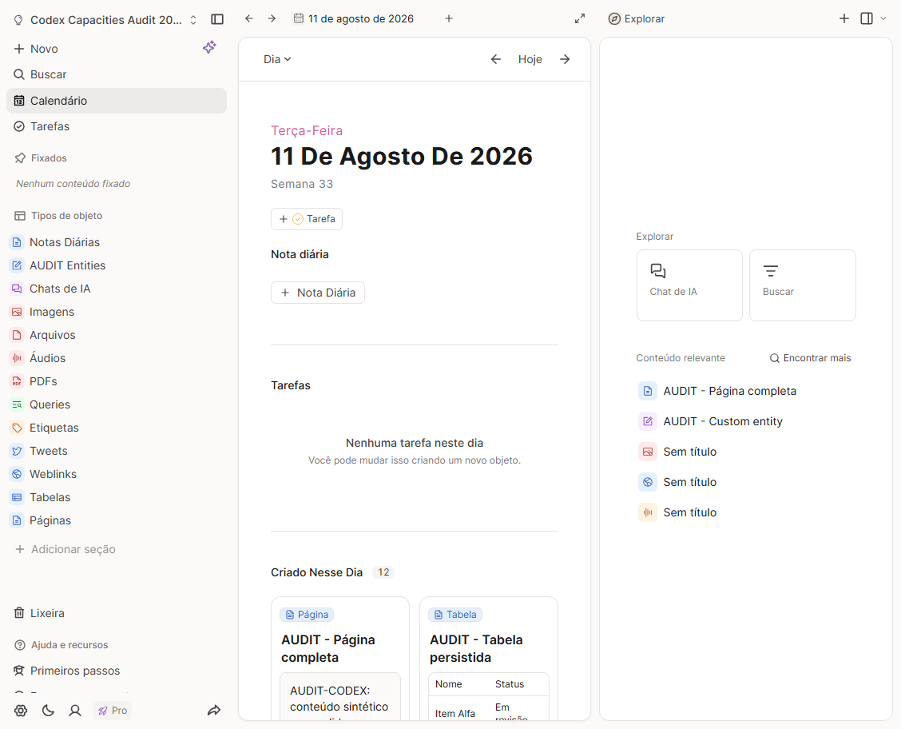
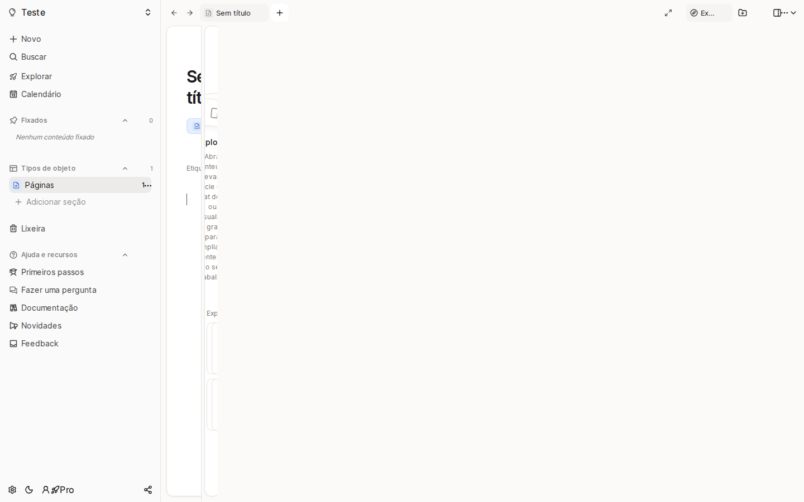
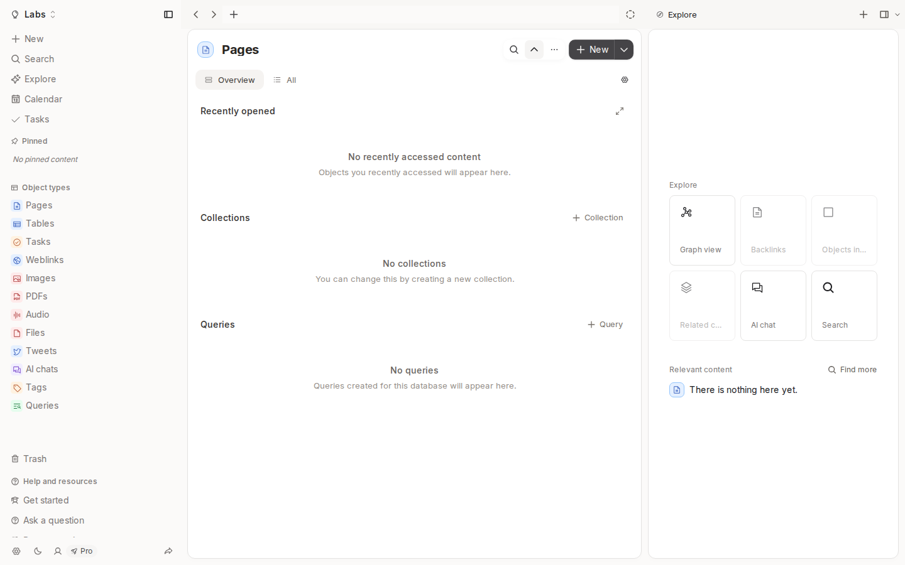
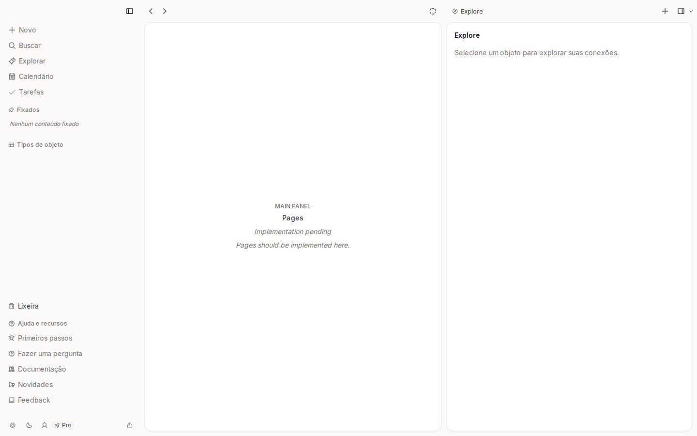
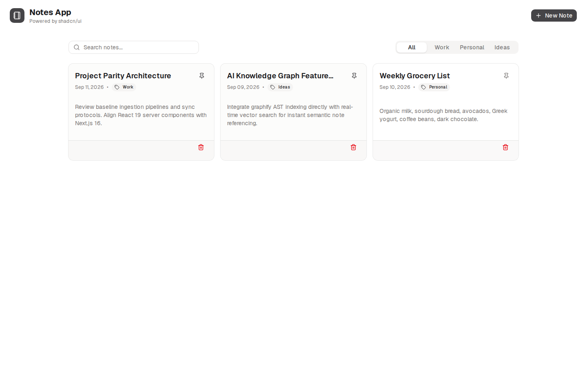
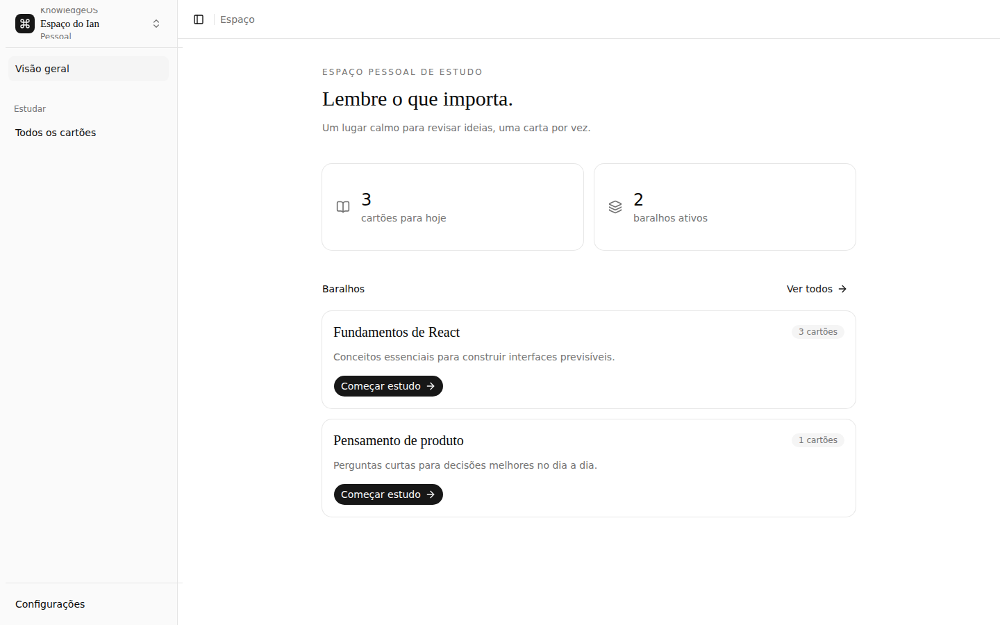
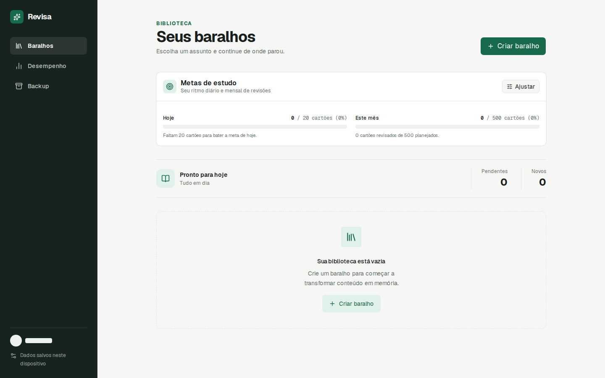
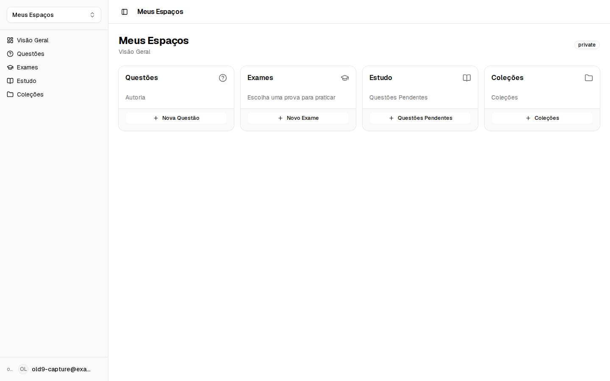
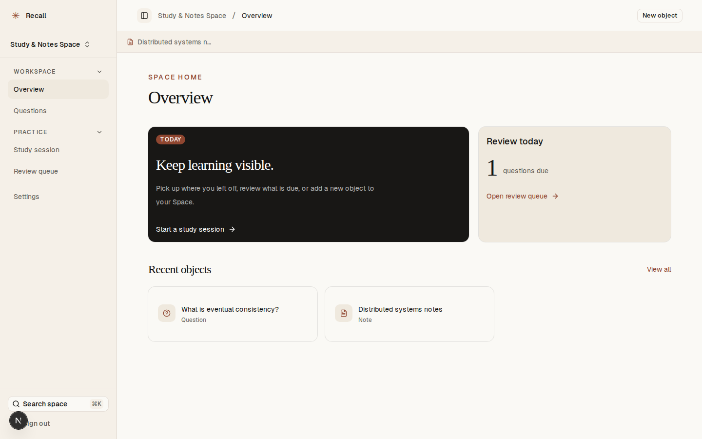
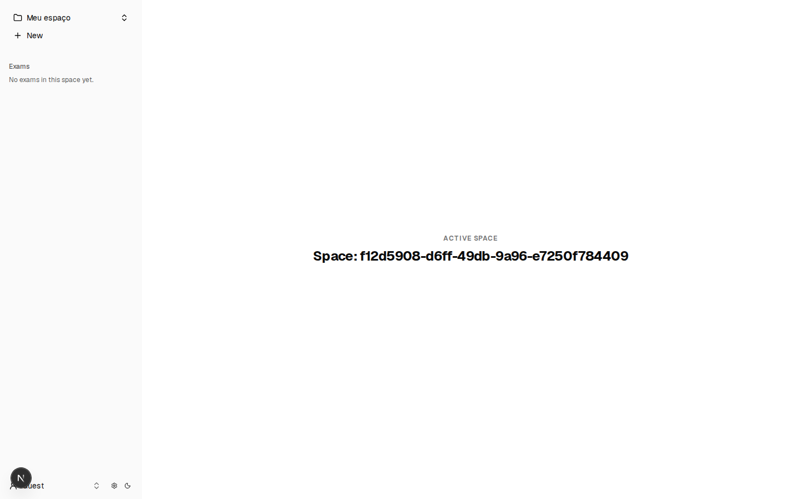

# Notes App — histórico de versões

Galeria visual das versões históricas do **Notes App**. Cada branch `old-*` representa um snapshot independente, com diferentes layouts, tecnologias e funcionalidades.

As imagens mostram a tela inicial (**Home**) de cada versão e são capturas do projeto original. Não representam necessariamente todas as páginas nem garantem que a branch ainda seja executável sem ajustes.

## Versões e capturas

### [old-1](https://github.com/ianmaciel7/notes-app/tree/old-1)

Estrutura inicial de documentação e instruções para agentes de IA; neste snapshot não há aplicação Next.js executável.

_Sem captura disponível: esta versão contém documentação e instruções para agentes, mas não uma aplicação Next.js executável._

---

### [old-2](https://github.com/ianmaciel7/notes-app/tree/old-2)

Protótipo de workspace inspirado no Capacities, com sidebar, ícones, tipos de objetos e materiais de engenharia reversa.

[Ver captura em tamanho original](screenshots/old-2-home.png)

---

### [old-3](https://github.com/ianmaciel7/notes-app/tree/old-3)

Variação do layout e da sidebar inspirados no Capacities, com componentes shadcn/ui + Base UI e testes Vitest.

[Ver captura em tamanho original](screenshots/old-3-home.png)

---

### [old-4](https://github.com/ianmaciel7/notes-app/tree/old-4)

Workspace mais completo: sidebar, painéis e visualizações de objetos, editor TipTap, internacionalização e testes Playwright.

[Ver captura em tamanho original](screenshots/old-4-home.png)

---

### [old-5](https://github.com/ianmaciel7/notes-app/tree/old-5)

Plataforma local-first de notas e estudos: Dexie, leitura de documentos, flashcards FSRS, geração de cartões com IA e integração Firebase.

[Ver captura em tamanho original](screenshots/old-5-home.png)

---

### [old-6](https://github.com/ianmaciel7/notes-app/tree/old-6)

Workspace de Spaces e objetos com persistência local Dexie, editor Plate/Slate e catálogo de componentes Ladle.

[Ver captura em tamanho original](screenshots/old-6-home.png)

---

### [old-7](https://github.com/ianmaciel7/notes-app/tree/old-7)

KnowledgeOS: ambiente privado de estudos com login Google/Firebase, revisão de cartões, objetos e mensagens localizadas.

[Ver captura em tamanho original](screenshots/old-7-home.png)

---

### [old-8](https://github.com/ianmaciel7/notes-app/tree/old-8)

Revisa: baralhos e cartões frente/verso, repetição espaçada FSRS, dados no IndexedDB e backup/restauração em JSON.

[Ver captura em tamanho original](screenshots/old-8-home.png)

---

### [old-9](https://github.com/ianmaciel7/notes-app/tree/old-9)

Base Next.js/shadcn/ui com autenticação Firebase, i18n inglês/português, estrutura para revisão FSRS e componentes no Ladle.

[Ver captura em tamanho original](screenshots/old-9-home.png)

---

### [old-10](https://github.com/ianmaciel7/notes-app/tree/old-10)

Recall: preparação para provas por Spaces e grafo de objetos, questões/exames, agendamento SM-2 e servidor MCP de leitura.

[Ver captura em tamanho original](screenshots/old-10-home.png)

---

### [old-11](https://github.com/ianmaciel7/notes-app/tree/old-11)

Fundação com Firebase Auth/Firestore, criação e troca de Spaces, rotas protegidas e Ladle; o domínio completo de notas ainda não estava implementado.

[Ver captura em tamanho original](screenshots/old-11-home.png)

---

## Sobre as capturas

As imagens originais estão na pasta [`screenshots/`](screenshots/). Selecione uma imagem para ampliá-la ou clique no nome de uma branch para navegar pelo código daquela versão.
