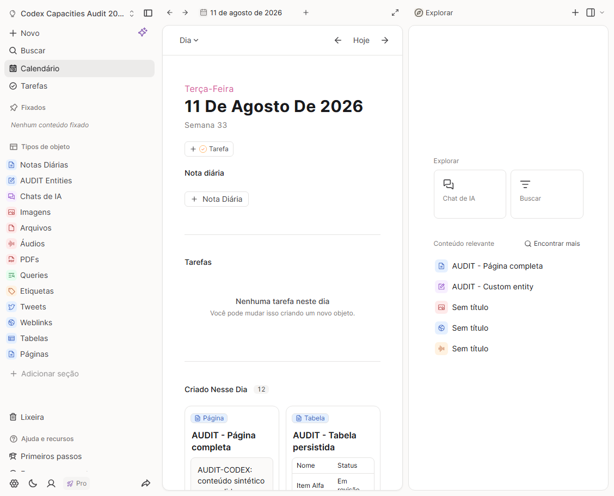
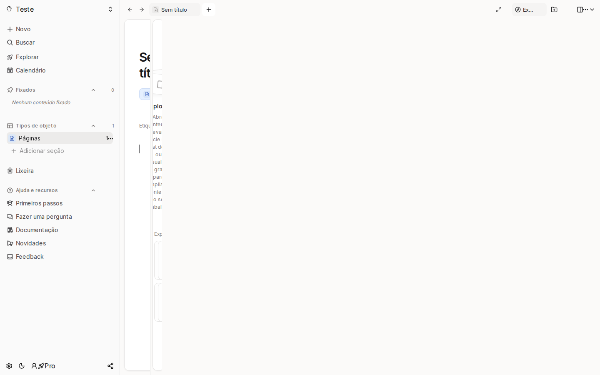
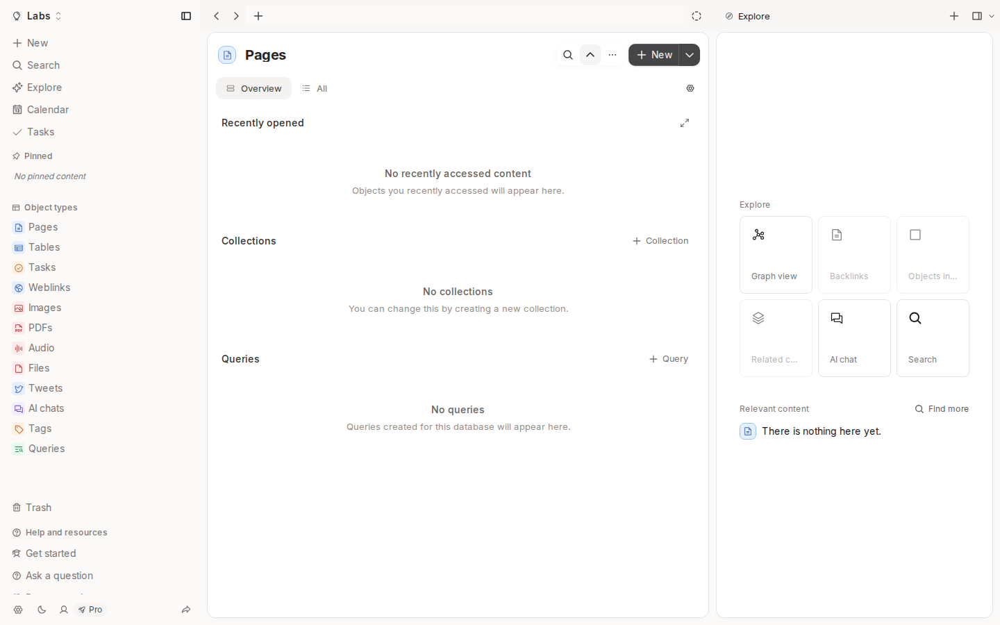
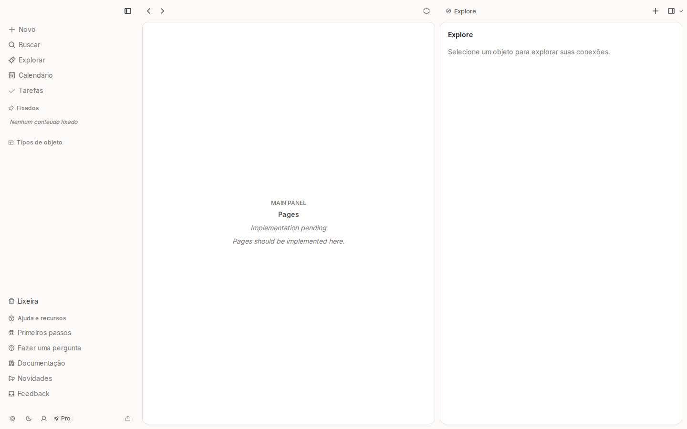
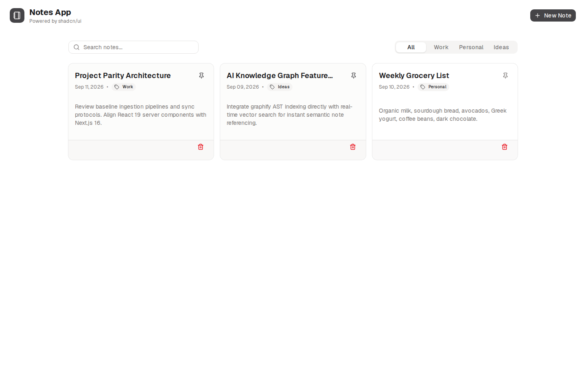
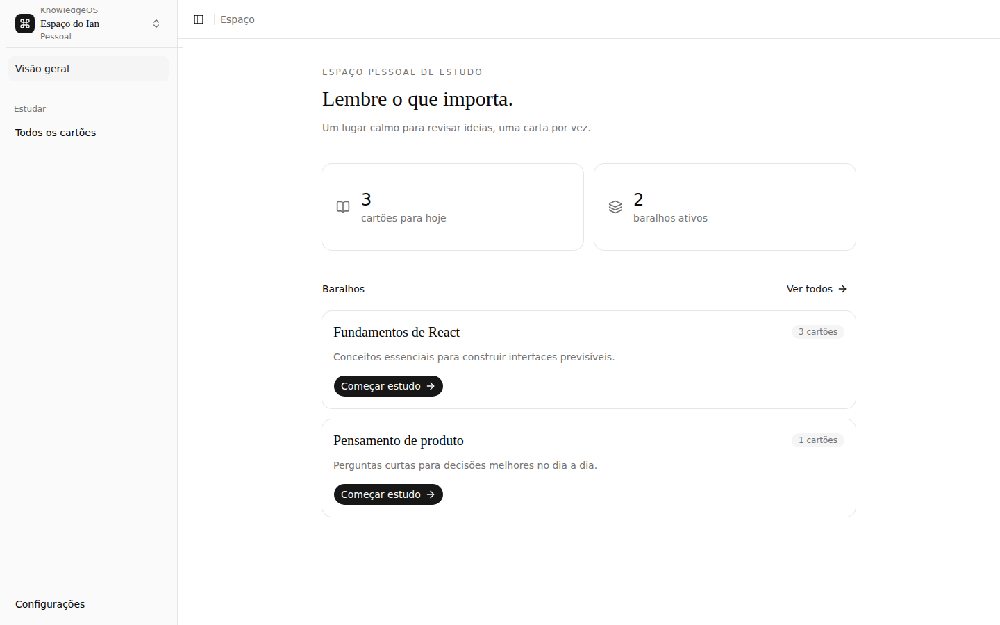
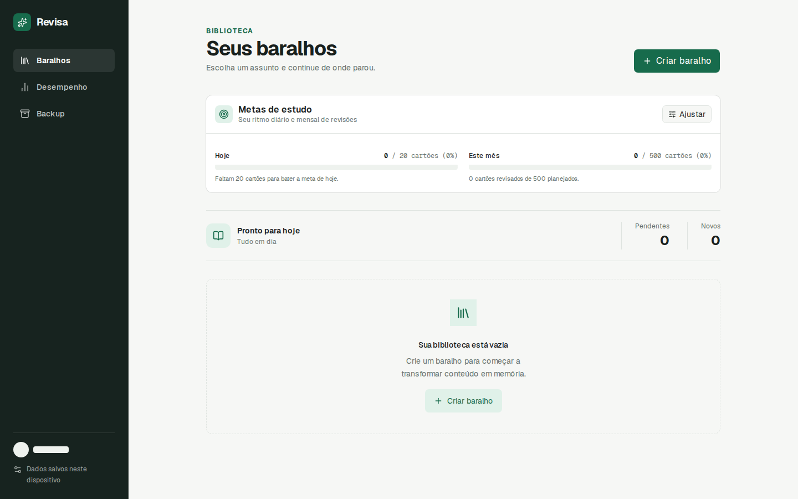
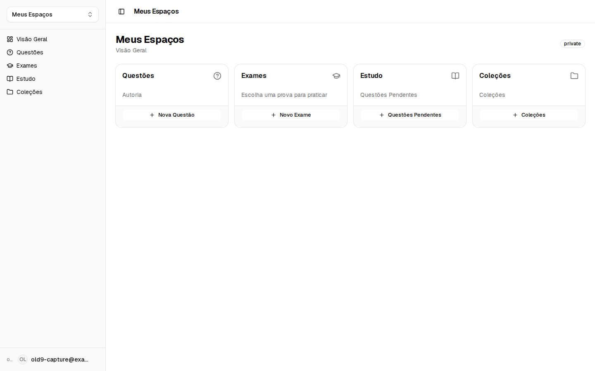
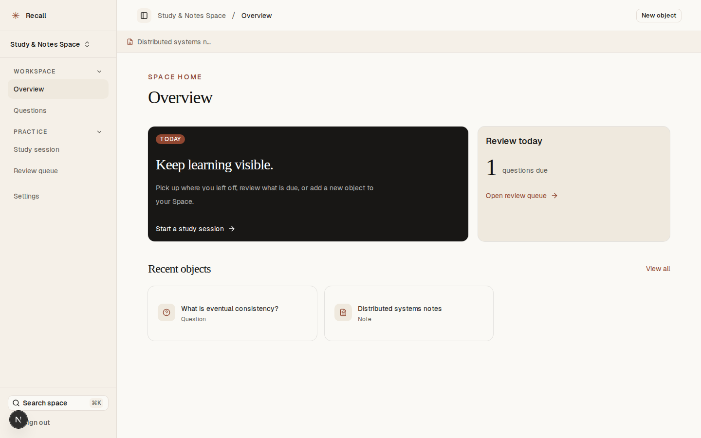
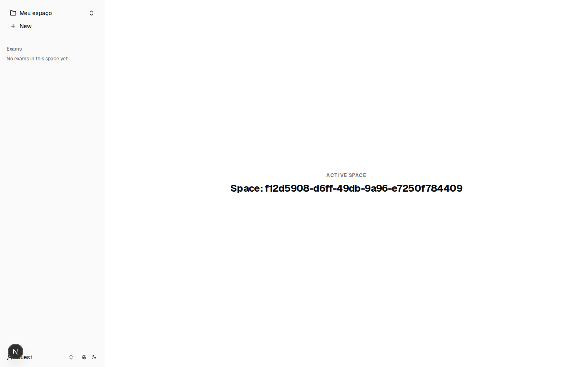

# Catálogo Histórico de Branches e Versões Arquivadas

Este diretório reúne o catálogo histórico das versões e branches legadas dos projetos **Notes App** e **Exams App Old**, consolidadas no repositório principal `ianmaciel7/exams-app`.

Cada versão está preservada por meio de um arquivo Git Bundle (`.bundle`) independente e autossuficiente, acompanhado de sua captura de tela original (`.png`, quando existente), metadados de commit, tecnologias utilizadas e descrição objetiva das funcionalidades implementadas.

---

## Propósito dos Arquivos

1. **Preservação de Histórico Sem Poluição:** Manter acessível toda a evolução arquitetural e funcional sem sobrecarregar a árvore de branches ativas do repositório principal.
2. **Recuperabilidade Total:** Permitir restaurar qualquer branch ou commit histórico em um repositório Git local para auditoria, inspeção ou resgate de código.
3. **Consulta por IA e Engenharia de Software:** Oferecer referências consolidadas para modelos de linguagem e agentes analisarem decisões anteriores, padrões de interface e caminhos de evolução do produto.

---

## Índice Navegável

### Notes App (`ianmaciel7/notes-app`)
- [old — Exploração Visual de Workspace e Grafo](#notes-app--old)
- [old-1 — Estrutura Inicial e Instruções para Agentes](#notes-app--old-1)
- [old-2 — Protótipo Capacities-like com Objetos](#notes-app--old-2)
- [old-3 — Layout Shadcn/UI + Base UI](#notes-app--old-3)
- [old-4 — Workspace TipTap e Internacionalização](#notes-app--old-4)
- [old-5 — Local-first com Dexie e FSRS](#notes-app--old-5)
- [old-6 — Spaces, Dexie, Plate/Slate e Ladle](#notes-app--old-6)
- [old-7 — KnowledgeOS com Auth Firebase](#notes-app--old-7)
- [old-8 — Revisa: Baralhos e Repetição Espaçada FSRS](#notes-app--old-8)
- [old-9 — Base Next.js/Shadcn com Firebase e Ladle](#notes-app--old-9)
- [old-10 — Recall: Spaces, Grafo, Questões e MCP](#notes-app--old-10)
- [old-11 — Fundação Firebase Auth/Firestore e Exam Features](#notes-app--old-11)

### Exams App Old (`ianmaciel7/exams-app-old`)
- [backup/old-1 — Bootstrap Next.js, Auth, Testes e ADRs](#exams-app-old--backupold-1)
- [backup/dev-before-adr2 — Refatorações de Lib, OpenTelemetry e CSP](#exams-app-old--backupdev-before-adr2)
- [backup/dev-20261111-1903 — Tooling MDX, Vitest, Playwright e Skills](#exams-app-old--backupdev-20261111-1903)

---

## Seção: Notes App

### Notes App — old

- **Repositório de origem:** `https://github.com/ianmaciel7/notes-app`
- **Branch original:** `old`
- **SHA do commit:** `e2234be59ba61a717884f829037cb8be268e5c6c`
- **Referência remota:** [Commit e2234be no GitHub](https://github.com/ianmaciel7/notes-app/tree/old)
- **Bundle Git:** [notes-app-old.bundle](notes-app-old.bundle)
- **Resumo do propósito:** Exploração e refinamento de interface de workspace visual com suporte a visualização em grafo de objetos e barra lateral alinhada.
- **Principais funcionalidades implementadas:**
  - Componentes de exploração visual do espaço de trabalho.
  - Alinhamento de interações entre sidebar e grafo de objetos.
  - Estrutura base Next.js App Router com `@base-ui/react` e `@shadcn/react`.
  - Suporte a comandos via `cmdk`, carrossel (`embla-carousel-react`) e `input-otp`.
- **Tecnologias relevantes:** Next.js (App Router), React 19, Tailwind CSS v4, Base UI, Shadcn UI, Biome, Vitest / Testing Library.
- **Diferenças em relação a outras versões:** Foco em testes de navegação visual e integração refinada entre grafo e workspace, servindo como checkpoint de interface antes da consolidação de outros protótipos.
- **Captura de tela:**
  _Sem captura disponível: esta versão serviu como checkpoint interno de alinhamento visual e de grafo, sem imagem de home catalogada._

---

### Notes App — old-1

- **Repositório de origem:** `https://github.com/ianmaciel7/notes-app`
- **Branch original:** `old-1`
- **SHA do commit:** `c2fca6232c45ce4d64d0088036e1ddd0742944d4`
- **Referência remota:** [Commit c2fca62 no GitHub](https://github.com/ianmaciel7/notes-app/tree/old-1)
- **Bundle Git:** [notes-app-old-1.bundle](notes-app-old-1.bundle)
- **Resumo do propósito:** Estrutura inicial de documentação de arquitetura, padrões do projeto e instruções para agentes de IA.
- **Principais funcionalidades implementadas:**
  - Conjunto de instruções para agentes e habilidades de planejamento (como a skill `grill-me`).
  - Documentação inicial de repositório e diretrizes de trabalho em worktrees.
  - Não possui aplicação executável configurada.
- **Tecnologias relevantes:** Markdown, especificações de agentes e documentação técnica.
- **Diferenças em relação a outras versões:** É uma versão puramente documental e de instrumentação de agentes, sem código-fonte de aplicação frontend.
- **Captura de tela:**
  _Sem captura disponível: esta versão contém documentação e instruções para agentes, mas não uma aplicação executável._

---

### Notes App — old-2

- **Repositório de origem:** `https://github.com/ianmaciel7/notes-app`
- **Branch original:** `old-2`
- **SHA do commit:** `7d14209252e47bf4449ec953928c2ef711f0642e`
- **Referência remota:** [Commit 7d14209 no GitHub](https://github.com/ianmaciel7/notes-app/tree/old-2)
- **Bundle Git:** [notes-app-old-2.bundle](notes-app-old-2.bundle)
- **Resumo do propósito:** Protótipo de workspace fortemente inspirado no Capacities, com navegação estruturada por tipos de objetos e barra lateral colapsável.
- **Principais funcionalidades implementadas:**
  - Barra lateral com ícones e categorias de objetos (notas, coleções, materiais).
  - Componentes de navegação baseados em Radix UI (`dropdown-menu`, `scroll-area`, `separator`, `tooltip`).
  - Scripts de engenharia reversa e extração de assets visuais do Capacities.
  - Artefatos e reflexões de grafo (`graphify`).
- **Tecnologias relevantes:** Next.js, React 19, Radix UI primitives, Lucide React, Tailwind CSS v4, Biome.
- **Diferenças em relação a outras versões:** Utiliza primitivos diretos do Radix UI em vez do ecossistema `@base-ui/react`, com scripts dedicados à análise visual de referências externas.
- **Captura de tela:**



---

### Notes App — old-3

- **Repositório de origem:** `https://github.com/ianmaciel7/notes-app`
- **Branch original:** `old-3`
- **SHA do commit:** `19105d011c84fe7bf9b5cea4bb75f4fd4b94ea34`
- **Referência remota:** [Commit 19105d0 no GitHub](https://github.com/ianmaciel7/notes-app/tree/old-3)
- **Bundle Git:** [notes-app-old-3.bundle](notes-app-old-3.bundle)
- **Resumo do propósito:** Variação do layout de workspace e sidebar inspirados no Capacities, migrando para componentes shadcn/ui em conjunto com Base UI.
- **Principais funcionalidades implementadas:**
  - Sidebar retrátil com persistência de estado e suporte a migração.
  - Layout principal unificado e context sidebar.
  - Estilização global com design system refinado.
  - Testes unitários com Vitest e Testing Library.
- **Tecnologias relevantes:** Next.js, React 19, `@base-ui/react`, `@shadcn/react`, Biome, Tailwind CSS v4.
- **Diferenças em relação a outras versões:** Marca a transição técnica do Radix UI puro para `@base-ui/react` e componentes `@shadcn/react`.
- **Captura de tela:**



---

### Notes App — old-4

- **Repositório de origem:** `https://github.com/ianmaciel7/notes-app`
- **Branch original:** `old-4`
- **SHA do commit:** `2839f410e3f696cfcf1d92a48849275c1016776b`
- **Referência remota:** [Commit 2839f41 no GitHub](https://github.com/ianmaciel7/notes-app/tree/old-4)
- **Bundle Git:** [notes-app-old-4.bundle](notes-app-old-4.bundle)
- **Resumo do propósito:** Workspace de notas completo com editor rico TipTap, suporte a internacionalização e testes ponta a ponta.
- **Principais funcionalidades implementadas:**
  - Editor de texto estruturado com TipTap (`bubble-menu`, `drag-handle`, `placeholder`).
  - Visualizações detalhadas de páginas de objetos e painéis laterais.
  - Ícones fornecidos por `@phosphor-icons/react` e posicionamento por `@floating-ui/dom`.
  - Internacionalização (i18n) e suíte de testes E2E com Playwright.
- **Tecnologias relevantes:** Next.js, TipTap 3, Phosphor Icons, Floating UI, Playwright, Tailwind CSS v4.
- **Diferenças em relação a outras versões:** Introduz o editor TipTap com alças de arrasto (drag handle) e testes E2E com Playwright no ciclo de vida de objetos.
- **Captura de tela:**



---

### Notes App — old-5

- **Repositório de origem:** `https://github.com/ianmaciel7/notes-app`
- **Branch original:** `old-5`
- **SHA do commit:** `0857a9977d1f66f1ba2b26d46bb6084344d489c8`
- **Referência remota:** [Commit 0857a99 no GitHub](https://github.com/ianmaciel7/notes-app/tree/old-5)
- **Bundle Git:** [notes-app-old-5.bundle](notes-app-old-5.bundle)
- **Resumo do propósito:** Plataforma de notas e estudos local-first com banco IndexedDB, leitura de documentos e repetição espaçada com FSRS.
- **Principais funcionalidades implementadas:**
  - Persistência no cliente com Dexie.js (IndexedDB).
  - Algoritmo de repetição espaçada FSRS (Free Spaced Repetition Scheduler) para flashcards.
  - Leitor de documentos e materiais de apoio.
  - Geração de cartões de estudo com auxílio de IA e integração com Firebase.
- **Tecnologias relevantes:** Dexie, Dexie-React-Hooks, FSRS, Firebase, Next.js, Shadcn UI.
- **Diferenças em relação a outras versões:** Primeira arquitetura local-first com banco Dexie.js no navegador combinada a agendamento FSRS e geração de flashcards.
- **Captura de tela:**



---

### Notes App — old-6

- **Repositório de origem:** `https://github.com/ianmaciel7/notes-app`
- **Branch original:** `old-6`
- **SHA do commit:** `f336db18e2149040707c453814cbb16e388cde37`
- **Referência remota:** [Commit f336db1 no GitHub](https://github.com/ianmaciel7/notes-app/tree/old-6)
- **Bundle Git:** [notes-app-old-6.bundle](notes-app-old-6.bundle)
- **Resumo do propósito:** Workspace estruturado em Spaces e Objetos, com editor Slate/Plate e catálogo de componentes com Ladle.
- **Principais funcionalidades implementadas:**
  - Separação lógica de conteúdos em múltiplos Spaces independentes.
  - Armazenamento local com Dexie.js.
  - Editor de rich text baseado no ecossistema Plate / Slate.
  - Catálogo de componentes isolados com Ladle para prototipagem rápida.
- **Tecnologias relevantes:** Dexie, Plate / Slate, Ladle, Next.js, Tailwind CSS v4.
- **Diferenças em relação a outras versões:** Substitui o TipTap pelo editor Plate/Slate e adota o Ladle como ambiente de desenvolvimento de UI em isolamento.
- **Captura de tela:**



---

### Notes App — old-7

- **Repositório de origem:** `https://github.com/ianmaciel7/notes-app`
- **Branch original:** `old-7`
- **SHA do commit:** `e5d9048aabb480605e357c2d2a00e82fc4c24c3d`
- **Referência remota:** [Commit e5d9048 no GitHub](https://github.com/ianmaciel7/notes-app/tree/old-7)
- **Bundle Git:** [notes-app-old-7.bundle](notes-app-old-7.bundle)
- **Resumo do propósito:** "KnowledgeOS" — Ambiente privativo de estudos com autenticação Google/Firebase, objetos de conhecimento e revisão de cartões.
- **Principais funcionalidades implementadas:**
  - Fluxo de autenticação completo com Firebase Auth (Google Sign-In).
  - Telas e rotas protegidas de estudo e gestão de cartões.
  - Sistema de mensagens localizadas.
  - Organização de entidades em grafos de conhecimento.
- **Tecnologias relevantes:** Firebase Auth, Firestore, Next.js App Router, Shadcn UI, Base UI.
- **Diferenças em relação a outras versões:** Integração direta com Firebase na camada de autenticação e proteção de dados com regras de segurança na nuvem.
- **Captura de tela:**



---

### Notes App — old-8

- **Repositório de origem:** `https://github.com/ianmaciel7/notes-app`
- **Branch original:** `old-8`
- **SHA do commit:** `d930d7a7391b231c1888bb5b2fb271f8d9f2f5be`
- **Referência remota:** [Commit d930d7a no GitHub](https://github.com/ianmaciel7/notes-app/tree/old-8)
- **Bundle Git:** [notes-app-old-8.bundle](notes-app-old-8.bundle)
- **Resumo do propósito:** "Revisa" — Sistema focado na criação e gestão de baralhos, cartões frente/verso e repetição espaçada com FSRS.
- **Principais funcionalidades implementadas:**
  - Gerenciamento de decks e cartões com interface voltada para sessões de memorização.
  - Implementação completa do algoritmo FSRS.
  - Persistência estruturada em IndexedDB (Dexie).
  - Rotinas de exportação e importação de dados em JSON.
- **Tecnologias relevantes:** Dexie, FSRS scheduler, Next.js, Shadcn UI, Playwright.
- **Diferenças em relação a outras versões:** Especialização completa do produto como aplicativo de flashcards (Revisa), focando em exportação/backup local em JSON.
- **Captura de tela:**



---

### Notes App — old-9

- **Repositório de origem:** `https://github.com/ianmaciel7/notes-app`
- **Branch original:** `old-9`
- **SHA do commit:** `dae844270e7ebc80c6a307c49e0f830630e70cb0`
- **Referência remota:** [Commit dae8442 no GitHub](https://github.com/ianmaciel7/notes-app/tree/old-9)
- **Bundle Git:** [notes-app-old-9.bundle](notes-app-old-9.bundle)
- **Resumo do propósito:** Base moderna Next.js/Shadcn com autenticação Firebase, internacionalização inglês/português e emuladores locais.
- **Principais funcionalidades implementadas:**
  - Integração com `@firebase-oss/ui-react` e `@firebase-oss/ui-core`.
  - Scripts para emuladores locais do Firebase (Auth e Firestore).
  - Componentes de avaliação e testes com Ladle e Testing Library.
  - Estrutura de internacionalização (en / pt-BR).
- **Tecnologias relevantes:** Firebase OSS UI, Firebase Emulators, Ladle, Next.js, React Hook Form.
- **Diferenças em relação a outras versões:** Uso de emuladores do Firebase integrados com comando concorrente (`dev:all`) e `@firebase-oss/ui-react`.
- **Captura de tela:**



---

### Notes App — old-10

- **Repositório de origem:** `https://github.com/ianmaciel7/notes-app`
- **Branch original:** `old-10`
- **SHA do commit:** `cabcec2e8227fc7f06aa5c9c5afcc0e8944802c6`
- **Referência remota:** [Commit cabcec2 no GitHub](https://github.com/ianmaciel7/notes-app/tree/old-10)
- **Bundle Git:** [notes-app-old-10.bundle](notes-app-old-10.bundle)
- **Resumo do propósito:** "Recall" — Plataforma de preparação para provas organizada por Spaces e grafo de objetos relacionados.
- **Principais funcionalidades implementadas:**
  - Módulos de questões e exames simulados.
  - Organização por Spaces e grafo de objetos relacionados.
  - Agendamento de revisão com algoritmo SM-2.
  - Servidor MCP (Model Context Protocol) de leitura para permitir interação com agentes de IA.
  - Editor TipTap e testes automatizados de ponta a ponta com Playwright e acessibilidade (`@axe-core/playwright`).
- **Tecnologias relevantes:** Firebase Emulators, TipTap, SM-2, MCP Server, Playwright, Axe-core, React Compiler.
- **Diferenças em relação a outras versões:** Introdução do modelo de exames/questões, algoritmo SM-2 e servidor MCP integrado para ferramentas de inteligência artificial.
- **Captura de tela:**



---

### Notes App — old-11

- **Repositório de origem:** `https://github.com/ianmaciel7/notes-app`
- **Branch original:** `old-11`
- **SHA do commit:** `f513fc91cdebd0adf8ba708d8108f9808af698c6`
- **Referência remota:** [Commit f513fc9 no GitHub](https://github.com/ianmaciel7/notes-app/tree/old-11)
- **Bundle Git:** [notes-app-old-11.bundle](notes-app-old-11.bundle)
- **Resumo do propósito:** Fundação com Firebase Auth/Firestore, componentes de questões para exames com drag-and-drop e testes rigorosos.
- **Principais funcionalidades implementadas:**
  - Criação e alternância de Spaces com rotas protegidas.
  - Componentes de questões com ordenação e arrasto via `@dnd-kit/core` e `@dnd-kit/sortable`.
  - Testes de mutação com Stryker (`@stryker-mutator/core`), testes de performance com Lighthouse CI (`@lhci/cli`).
  - Histórico de sementes (.firebase/seeds) para inicialização rápida de emuladores.
- **Tecnologias relevantes:** Dnd-kit, Firebase Auth/Firestore, Ladle, Stryker Mutator, Lighthouse CI, Commitlint.
- **Diferenças em relação a outras versões:** Foco específico na suíte de componentes de questões interativas com dnd-kit e ferramentas avançadas de qualidade de software (Stryker e LHCI).
- **Captura de tela:**



---

## Seção: Exams App Old

### Exams App Old — backup/old-1

- **Repositório de origem:** `https://github.com/ianmaciel7/exams-app-old`
- **Branch original:** `backup/old-1`
- **SHA do commit:** `cc43fb998824101d68da7fad237fd5457986e1cb`
- **Referência remota:** [Commit cc43fb9 no GitHub](https://github.com/ianmaciel7/exams-app-old/tree/backup/old-1)
- **Bundle Git:** [exams-app-old-backup-old-1.bundle](exams-app-old-backup-old-1.bundle)
- **Resumo do propósito:** Bootstrap da aplicação Exams App com Next.js App Router, autenticação Firebase, testes, infraestrutura Terraform e ADRs 0001 a 0012.
- **Principais funcionalidades implementadas:**
  - Estrutura completa de Next.js App Router com TypeScript, React Compiler e shadcn/ui.
  - Camada de acesso a dados (DAL) e autenticação com Firebase (rotas `/sign-in`, `/register`, `/forgot-password`, `/profile`).
  - Internacionalização com `next-intl` (`en`, `pt-BR`, `es`).
  - Pipeline de CI/CD, infraestrutura declarada em Terraform e suíte completa de testes (Vitest e Playwright).
  - 12 registros de decisões arquiteturais (ADRs).
- **Tecnologias relevantes:** Next.js 16, React 19, Firebase SDK, next-intl, Terraform, Playwright, Vitest, Biome, pnpm 12.
- **Diferenças em relação a outras versões:** Ponto inicial de transição entre os protótipos do notes-app e o nascimento da arquitetura formal do Exams App com ADRs e infraestrutura como código.
- **Captura de tela:**
  _Sem captura disponível: esta versão possui apenas testes visuais sintéticos de baseline em ambiente de CI (Playwright snapshots), sem captura home real catalogada._

---

### Exams App Old — backup/dev-before-adr2

- **Repositório de origem:** `https://github.com/ianmaciel7/exams-app-old`
- **Branch original:** `backup/dev-before-adr2`
- **SHA do commit:** `1db80ad136bbab8720637fbd33315d08bf6a5def`
- **Referência remota:** [Commit 1db80ad no GitHub](https://github.com/ianmaciel7/exams-app-old/tree/backup/dev-before-adr2)
- **Bundle Git:** [exams-app-old-backup-dev-before-adr2.bundle](exams-app-old-backup-dev-before-adr2.bundle)
- **Resumo do propósito:** Implementação de políticas canônicas de segurança (Content Security Policy - CSP) para Next.js 16, observabilidade e modularização da biblioteca central.
- **Principais funcionalidades implementadas:**
  - Configuração de CSP canônica e cabeçalhos de segurança HTTP.
  - Registro central de status HTTP, guards e helpers de resposta do servidor.
  - Integração de observabilidade com OpenTelemetry SDK, correlação de traces e registro de logs isomórficos.
  - Tipagens estritas de rotas, fronteiras de erro (error boundaries) e página 404.
  - Atualização do Next.js para 16.4.6 com correções de regras Turbopack para Tailwind CSS.
- **Tecnologias relevantes:** Next.js 16.4.6, OpenTelemetry (`@opentelemetry/api`, `@vercel/otel`), Turbopack, Tailwind CSS v4, Zod, Vitest.
- **Diferenças em relação a outras versões:** Foco aprofundado na robustez de runtime HTTP, telemetria e segurança rigorosa com CSP antes da implementação das decisões do ADR 0002.
- **Captura de tela:**
  _Sem captura disponível: versão focada em camada de rede, infraestrutura de lib HTTP e observabilidade, sem alterações visuais de tela inicial._

---

### Exams App Old — backup/dev-20261111-1903

- **Repositório de origem:** `https://github.com/ianmaciel7/exams-app-old`
- **Branch original:** `backup/dev-20261111-1903`
- **SHA do commit:** `a8d9797ed47bd8d2e2987e12d7bb478841c78671`
- **Referência remota:** [Commit a8d9797 no GitHub](https://github.com/ianmaciel7/exams-app-old/tree/backup/dev-20261111-1903)
- **Bundle Git:** [exams-app-old-backup-dev-20261111-1903.bundle](exams-app-old-backup-dev-20261111-1903.bundle)
- **Resumo do propósito:** Consolidação de suporte a MDX, bundle analyzer, sincronização Git/ADRs e ampliação das habilidades de agentes no ecossistema do Exams App.
- **Principais funcionalidades implementadas:**
  - Suporte a conteúdo rico em MDX (`@next/mdx`, `@mdx-js/loader`, `@mdx-js/react`).
  - Análise de tamanho de bundles com `@next/bundle-analyzer` e flags de compilação.
  - Ferramentas de sincronização de ADRs (`git-adr-sync`) e limpeza local de branches.
  - Integração de telemetria estendida (`@opentelemetry/sdk-logs`, `@opentelemetry/api-logs`).
  - Ecossistema de habilidades para agentes (`adr-update`, `git-sync-origin`, `grill-with-docs`, `domain-modeling`).
- **Tecnologias relevantes:** Next.js 16.4.6, MDX, OpenTelemetry Logs, Vitest 5, Playwright, Biome, Agents CLI.
- **Diferenças em relação a outras versões:** Estado mais recente da linhagem legada do `exams-app-old`, contendo o ferramental completo de documentação interativa em MDX e automações de agentes de arquitetura.
- **Captura de tela:**
  _Sem captura disponível: versão de infraestrutura de desenvolvimento, documentação MDX e configuração de agentes, sem alterações visuais de tela inicial._

---

## Instruções para Recuperar Bundles

Os arquivos `.bundle` são arquivos Git normais em conformidade com o padrão oficial. Eles preservam commits, árvores de arquivos, metadados de autoria e mensagens.

### 1. Verificar a integridade do bundle

Antes de clonar ou extrair, você pode validar o arquivo com:

```bash
git bundle verify docs/archives/notes-app-old-10.bundle
```

A saída deve confirmar que o bundle é válido e listar a referência contida (`is okay`).

### 2. Inspecionar as referências internas

```bash
git bundle list-heads docs/archives/notes-app-old-10.bundle
```

### 3. Clonar o bundle para um novo repositório

Para extrair e inspecionar os arquivos completos em uma pasta separada:

```bash
git clone docs/archives/notes-app-old-10.bundle -b old-10 ./restaurado-notes-old-10
cd ./restaurado-notes-old-10
git log -n 5 --oneline
```

### 4. Importar uma branch arquivada para um repositório existente

Caso queira trazer a branch arquivada para o seu repositório de trabalho local:

```bash
git fetch docs/archives/notes-app-old-10.bundle old-10:historico/notes-old-10
git checkout historico/notes-old-10
```

---

## Consulta Histórica Usando IA

Este catálogo estruturado foi projetado para potencializar o trabalho com modelos de linguagem (LLMs) e agentes de codificação:

1. **Estudo de Evolução Arquitetural:** Ao projetar novas funcionalidades no `exams-app` (por exemplo, novos tipos de questões, editores de notas ou sincronização offline), você pode orientar o agente a restaurar um bundle relevante em um diretório temporário para estudar como o problema foi atacado no passado (ex.: comparação entre TipTap em `old-4`/`old-10` e Plate em `old-6`).
2. **Resgate de Algoritmos Específicos:** Algoritmos como o FSRS (implementado em `old-5` e `old-8`) e SM-2 (`old-10`) possuem testes e tipagens completas empacotadas no histórico do bundle.
3. **Análise de Decisões e ADRs:** As branches de `exams-app-old` documentam a fundamentação das decisões de segurança (CSP), tipagem de rotas e telemetria com OpenTelemetry, permitindo rastrear o raciocínio por trás de regras de negócio atuais.
