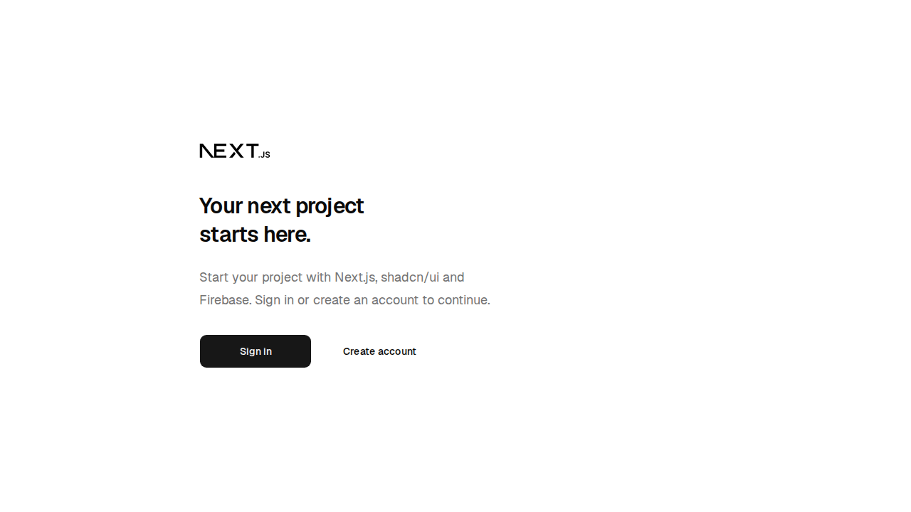
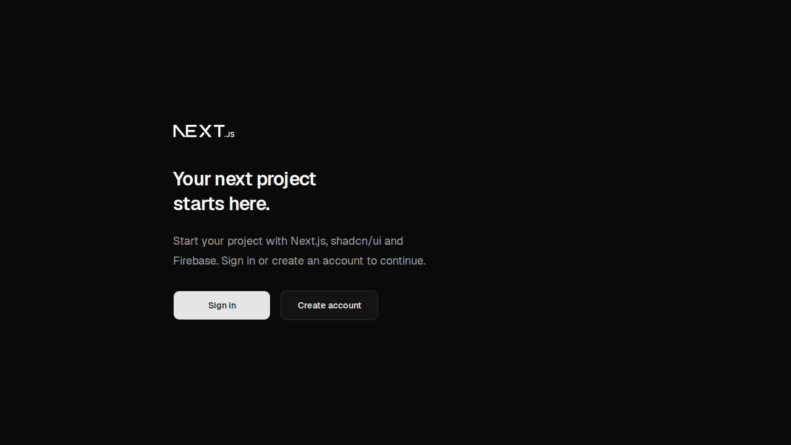

# exams-app-old-backup-old-1

- **Repository:** `https://github.com/ianmaciel7/exams-app-old`
- **Original Branch:** `backup/old-1`
- **Commit SHA:** `cc43fb998824101d68da7fad237fd5457986e1cb`
- **GitHub Reference:** [Commit cc43fb9 on GitHub](https://github.com/ianmaciel7/exams-app-old/tree/backup/old-1)
- **Git Bundle:** [exams-app-old-backup-old-1.bundle](exams-app-old-backup-old-1.bundle)

## Purpose & Summary

The foundational bootstrap of the modern Exams App architecture. Combines Next.js App Router, Firebase authentication with a Server Data Access Layer (DAL), multi-language localization, Terraform infrastructure, comprehensive testing suites, and Architecture Decision Records (ADRs 0001–0012).

## Implemented Features

- Next.js 16 App Router application scaffolded with TypeScript, React Compiler, and Shadcn UI.
- Secure Server Data Access Layer (DAL) and Firebase authentication flow (`/sign-in`, `/register`, `/forgot-password`, `/profile`).
- Multi-language routing via `next-intl` (`en`, `pt-BR`, `es`).
- Complete CI/CD workflows, Terraform cloud infrastructure definitions, and automated testing suites (Vitest unit tests, Playwright E2E and visual tests).
- 12 comprehensive Architecture Decision Records (ADRs) establishing core system standards.

## Tech Stack

- **Framework:** Next.js 16, React 19, React Compiler
- **Backend & Auth:** Firebase SDK, Server DAL
- **Localization:** `next-intl`
- **Infrastructure & Quality:** Terraform, Biome, Vitest, Playwright, pnpm 12

## Screenshot

### Light Mode


### Dark Mode


## Restoration Instructions

```bash
git bundle verify exams-app-old-backup-old-1.bundle
git clone exams-app-old-backup-old-1.bundle -b backup-old-1 ./restored-exams-app-old-backup-old-1
```
