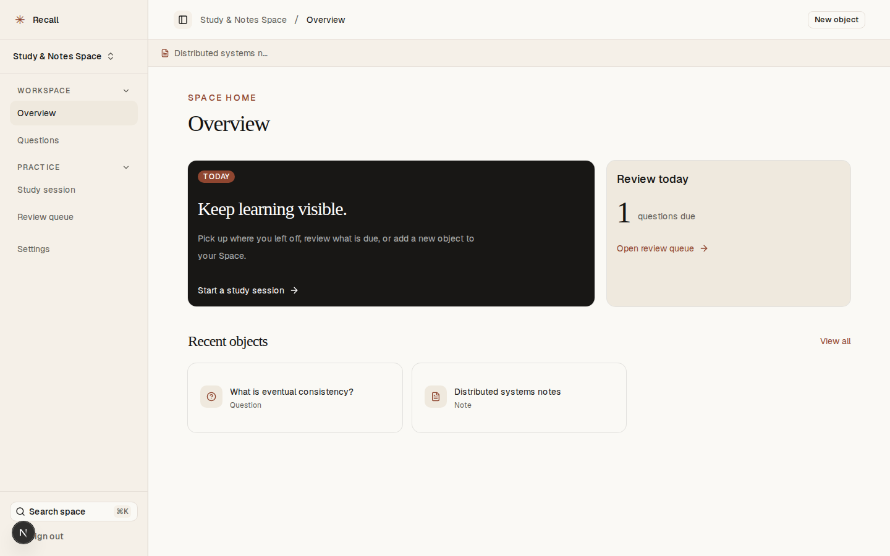

# notes-app-old-10

- **Repository:** `https://github.com/ianmaciel7/notes-app`
- **Original Branch:** `old-10`
- **Commit SHA:** `cabcec2e8227fc7f06aa5c9c5afcc0e8944802c6`
- **GitHub Reference:** [Commit cabcec2 on GitHub](https://github.com/ianmaciel7/notes-app/tree/old-10)
- **Git Bundle:** [notes-app-old-10.bundle](notes-app-old-10.bundle)

## Purpose & Summary

"Recall" — An exam preparation platform organized around Spaces, connected object graphs, mock exams, SM-2 spaced repetition scheduling, and an integrated Model Context Protocol (MCP) read server for external AI tools.

## Implemented Features

- Questions and mock exam creation and evaluation flows.
- Multi-space organization with graph-based object associations.
- Classic SuperMemo SM-2 spaced repetition scheduling.
- Custom Model Context Protocol (MCP) server enabling AI agents to read and search study entities.
- TipTap text editing, React Compiler optimizations, and Playwright accessibility testing (`@axe-core/playwright`).

## Tech Stack

- **Framework:** Next.js, React 19, React Compiler
- **Editor:** TipTap 3
- **Scheduling:** SM-2
- **Agent Integration:** Model Context Protocol (MCP) server
- **Testing:** Playwright, Axe-core

## Screenshot



## Restoration Instructions

```bash
git bundle verify notes-app-old-10.bundle
git clone notes-app-old-10.bundle -b old-10 ./restored-notes-app-old-10
```
