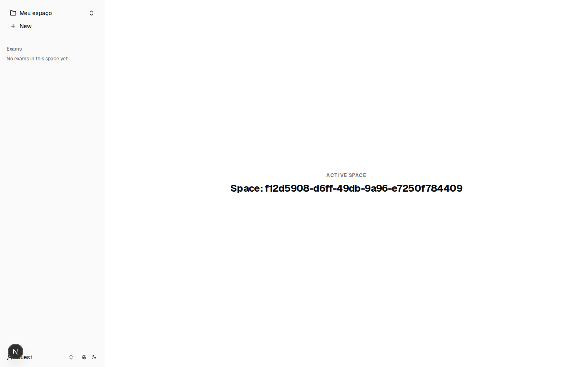

# notes-app-old-11

- **Repository:** `https://github.com/ianmaciel7/notes-app`
- **Original Branch:** `old-11`
- **Commit SHA:** `f513fc91cdebd0adf8ba708d8108f9808af698c6`
- **GitHub Reference:** [Commit f513fc9 on GitHub](https://github.com/ianmaciel7/notes-app/tree/old-11)
- **Git Bundle:** [notes-app-old-11.bundle](notes-app-old-11.bundle)

## Purpose & Summary

A foundation focusing on Firebase Auth and Firestore with Space switching, interactive drag-and-drop exam question components, mutation testing, and performance auditing.

## Implemented Features

- Space creation, persistence, and switching across protected routes.
- Interactive question components with accessible drag-and-drop reordering via `@dnd-kit/core` and `@dnd-kit/sortable`.
- Mutation testing configured with Stryker (`@stryker-mutator/core`).
- Performance and accessibility benchmarking via Lighthouse CI (`@lhci/cli`).
- Database seed management scripts for rapid emulator provisioning.

## Tech Stack

- **Drag & Drop:** `@dnd-kit/core`, `@dnd-kit/sortable`
- **Cloud & Emulation:** Firebase Auth, Cloud Firestore
- **Quality Assurance:** Stryker Mutator, Lighthouse CI, Commitlint
- **Framework & UI:** Next.js, Shadcn UI, Base UI

## Screenshot



## Restoration Instructions

```bash
git bundle verify notes-app-old-11.bundle
git clone notes-app-old-11.bundle -b old-11 ./restored-notes-app-old-11
```
