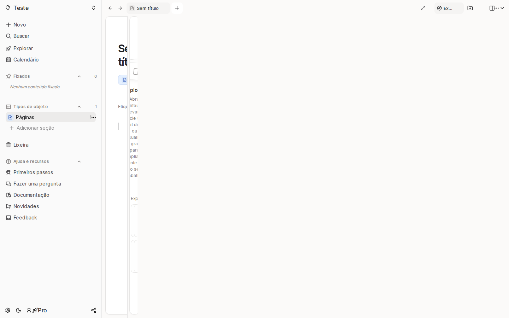

# notes-app-old-3

- **Repository:** `https://github.com/ianmaciel7/notes-app`
- **Original Branch:** `old-3`
- **Commit SHA:** `19105d011c84fe7bf9b5cea4bb75f4fd4b94ea34`
- **GitHub Reference:** [Commit 19105d0 on GitHub](https://github.com/ianmaciel7/notes-app/tree/old-3)
- **Git Bundle:** [notes-app-old-3.bundle](notes-app-old-3.bundle)

## Purpose & Summary

A refactored iteration of the Capacities-inspired workspace, migrating component primitives from raw Radix UI to `@base-ui/react` and `@shadcn/react` with persistent state migration.

## Implemented Features

- Persistent collapsible sidebar with client-side migration utilities.
- Context-aware secondary sidebar and main layout wrapper.
- Standardized styling system based on Tailwind CSS v4 design tokens.
- Vitest unit tests verifying state transitions and sidebar rendering.

## Tech Stack

- **Framework:** Next.js, React 19
- **UI Components:** `@base-ui/react`, `@shadcn/react`, Tailwind CSS v4
- **Tooling:** Biome, Vitest, Testing Library

## Screenshot



## Restoration Instructions

```bash
git bundle verify notes-app-old-3.bundle
git clone notes-app-old-3.bundle -b old-3 ./restored-notes-app-old-3
```
