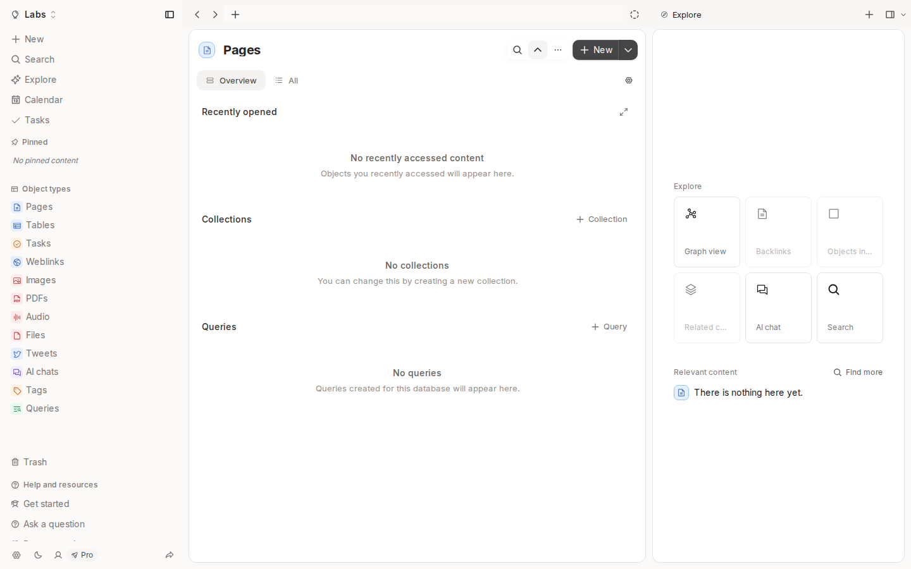

# notes-app-old-4

- **Repository:** `https://github.com/ianmaciel7/notes-app`
- **Original Branch:** `old-4`
- **Commit SHA:** `2839f410e3f696cfcf1d92a48849275c1016776b`
- **GitHub Reference:** [Commit 2839f41 on GitHub](https://github.com/ianmaciel7/notes-app/tree/old-4)
- **Git Bundle:** [notes-app-old-4.bundle](notes-app-old-4.bundle)

## Purpose & Summary

A full-featured notes workspace introducing rich block editing with TipTap, drag handles, object page views, internationalization, and Playwright verification.

## Implemented Features

- Rich text block editor using TipTap 3 (`bubble-menu`, `drag-handle-react`, `placeholder`).
- Detailed object header pages, property inspectors, and floating popovers (`@floating-ui/dom`).
- Icon library integration with `@phosphor-icons/react`.
- Multi-language localization and automated Playwright E2E suites.

## Tech Stack

- **Framework:** Next.js, React 19, TypeScript
- **Editor:** TipTap 3
- **UI & Icons:** Phosphor Icons, Floating UI, Base UI, Shadcn UI
- **Testing:** Playwright, Biome

## Screenshot



## Restoration Instructions

```bash
git bundle verify notes-app-old-4.bundle
git clone notes-app-old-4.bundle -b old-4 ./restored-notes-app-old-4
```
