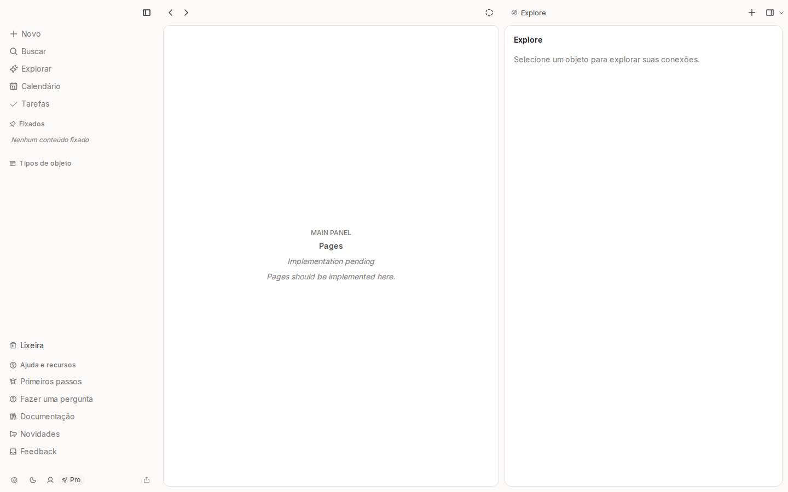

# notes-app-old-5

- **Repository:** `https://github.com/ianmaciel7/notes-app`
- **Original Branch:** `old-5`
- **Commit SHA:** `0857a9977d1f66f1ba2b26d46bb6084344d489c8`
- **GitHub Reference:** [Commit 0857a99 on GitHub](https://github.com/ianmaciel7/notes-app/tree/old-5)
- **Git Bundle:** [notes-app-old-5.bundle](notes-app-old-5.bundle)

## Purpose & Summary

A local-first study and note platform integrating browser IndexedDB persistence via Dexie, document reading features, and Free Spaced Repetition Scheduling (FSRS) for flashcards.

## Implemented Features

- Browser-local reactive data layer using Dexie.js and `dexie-react-hooks`.
- Spaced repetition algorithm (FSRS) scheduling for flashcards.
- Document and reading material viewer.
- AI card generation prompts and cloud backup foundations with Firebase.

## Tech Stack

- **Persistence:** Dexie.js (IndexedDB)
- **Scheduling Algorithm:** FSRS (Free Spaced Repetition Scheduler)
- **Framework & UI:** Next.js, Shadcn UI, Firebase SDK

## Screenshot



## Restoration Instructions

```bash
git bundle verify notes-app-old-5.bundle
git clone notes-app-old-5.bundle -b old-5 ./restored-notes-app-old-5
```
