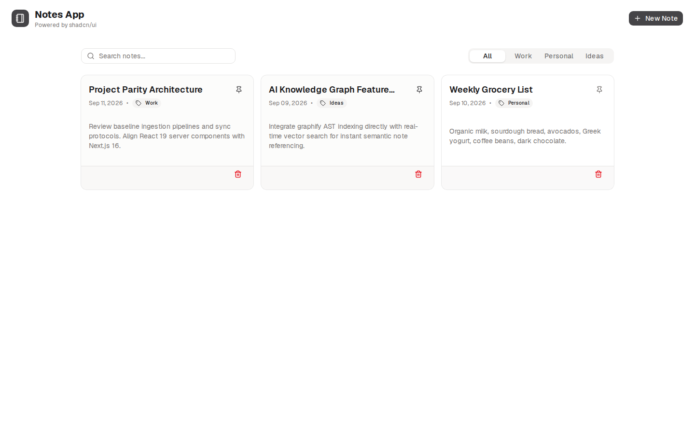

# notes-app-old-6

- **Repository:** `https://github.com/ianmaciel7/notes-app`
- **Original Branch:** `old-6`
- **Commit SHA:** `f336db18e2149040707c453814cbb16e388cde37`
- **GitHub Reference:** [Commit f336db1 on GitHub](https://github.com/ianmaciel7/notes-app/tree/old-6)
- **Git Bundle:** [notes-app-old-6.bundle](notes-app-old-6.bundle)

## Purpose & Summary

A workspace iteration dividing user data into discrete Spaces and Object graphs, adopting the Plate / Slate editor ecosystem and Ladle for isolated component design.

## Implemented Features

- Multi-space logical workspace partitioning.
- Client-side persistence using Dexie.js.
- Modular rich text document editor powered by Plate / Slate.
- Isolated component catalog and development environment with Ladle.

## Tech Stack

- **Editor:** Plate / Slate
- **Component Development:** Ladle
- **Persistence:** Dexie.js (IndexedDB)
- **Framework:** Next.js, Tailwind CSS v4

## Screenshot



## Restoration Instructions

```bash
git bundle verify notes-app-old-6.bundle
git clone notes-app-old-6.bundle -b old-6 ./restored-notes-app-old-6
```
