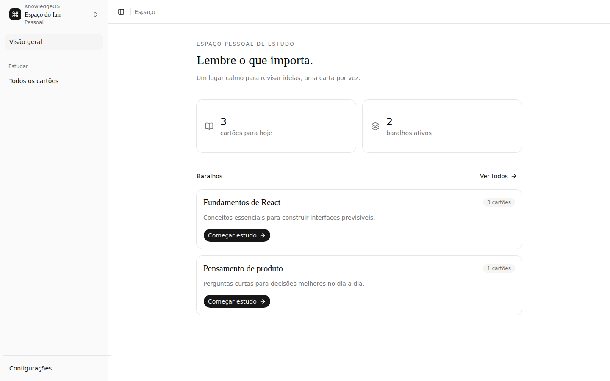

# notes-app-old-7

- **Repository:** `https://github.com/ianmaciel7/notes-app`
- **Original Branch:** `old-7`
- **Commit SHA:** `e5d9048aabb480605e357c2d2a00e82fc4c24c3d`
- **GitHub Reference:** [Commit e5d9048 on GitHub](https://github.com/ianmaciel7/notes-app/tree/old-7)
- **Git Bundle:** [notes-app-old-7.bundle](notes-app-old-7.bundle)

## Purpose & Summary

"KnowledgeOS" — A private study environment featuring direct Firebase Authentication (Google Sign-In), authenticated card review sessions, localized messages, and connected object graphs.

## Implemented Features

- End-to-end authentication flow using Firebase Auth.
- Protected study routes and card review dashboards.
- Localized message bundles and UI strings.
- Cloud Firestore integration with ownership security rules.

## Tech Stack

- **Authentication & Database:** Firebase Auth, Cloud Firestore
- **Framework & UI:** Next.js App Router, `@base-ui/react`, `@shadcn/react`
- **Tooling:** Biome, Vitest

## Screenshot



## Restoration Instructions

```bash
git bundle verify notes-app-old-7.bundle
git clone notes-app-old-7.bundle -b old-7 ./restored-notes-app-old-7
```
