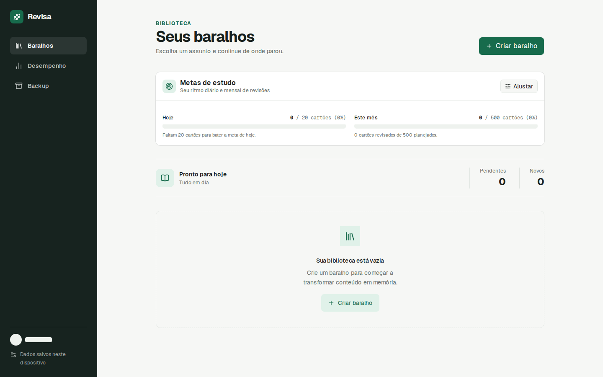

# notes-app-old-8

- **Repository:** `https://github.com/ianmaciel7/notes-app`
- **Original Branch:** `old-8`
- **Commit SHA:** `d930d7a7391b231c1888bb5b2fb271f8d9f2f5be`
- **GitHub Reference:** [Commit d930d7a on GitHub](https://github.com/ianmaciel7/notes-app/tree/old-8)
- **Git Bundle:** [notes-app-old-8.bundle](notes-app-old-8.bundle)

## Purpose & Summary

"Revisa" — A dedicated study application focused on flashcard decks, front/back study cards, FSRS spaced repetition scheduling, and reliable local JSON backup/restore.

## Implemented Features

- Dedicated deck and card management interface optimized for memory retention.
- Full mathematical implementation of the FSRS spaced repetition algorithm.
- Client-side persistence on IndexedDB via Dexie.js.
- One-click JSON export and import routines for database backup and restore.

## Tech Stack

- **Persistence:** Dexie.js (IndexedDB)
- **Algorithm:** FSRS
- **Framework & UI:** Next.js, Shadcn UI, Tailwind CSS v4
- **Testing:** Playwright

## Screenshot



## Restoration Instructions

```bash
git bundle verify notes-app-old-8.bundle
git clone notes-app-old-8.bundle -b old-8 ./restored-notes-app-old-8
```
