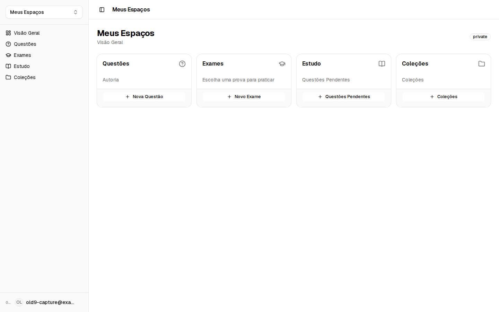

# notes-app-old-9

- **Repository:** `https://github.com/ianmaciel7/notes-app`
- **Original Branch:** `old-9`
- **Commit SHA:** `dae844270e7ebc80c6a307c49e0f830630e70cb0`
- **GitHub Reference:** [Commit dae8442 on GitHub](https://github.com/ianmaciel7/notes-app/tree/old-9)
- **Git Bundle:** [notes-app-old-9.bundle](notes-app-old-9.bundle)

## Purpose & Summary

A modern Next.js baseline integrating `@firebase-oss/ui-react`, local Firebase emulators for offline development, bilingual localization, and Ladle component stories.

## Implemented Features

- User authentication interface driven by `@firebase-oss/ui-react`.
- Local emulation scripts for Auth and Firestore with parallel execution (`pnpm dev:all`).
- Assessment components, server actions, and form validation with React Hook Form.
- Bilingual localization foundation (English and Brazilian Portuguese).

## Tech Stack

- **Authentication & UI:** `@firebase-oss/ui-react`, `@firebase-oss/ui-core`, Shadcn UI
- **Development Tooling:** Firebase Emulators, Ladle, Concurrently
- **Framework:** Next.js (App Router), React 19

## Screenshot



## Restoration Instructions

```bash
git bundle verify notes-app-old-9.bundle
git clone notes-app-old-9.bundle -b old-9 ./restored-notes-app-old-9
```
