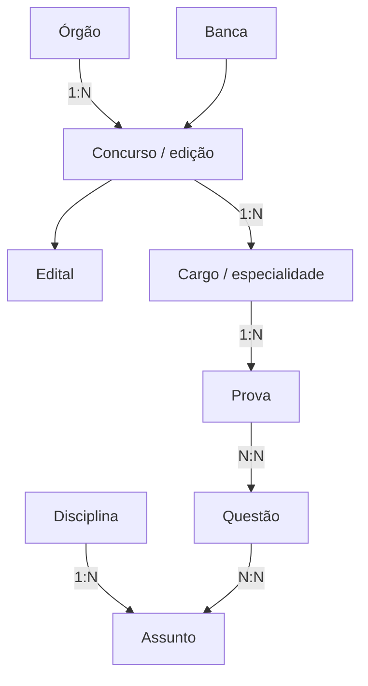
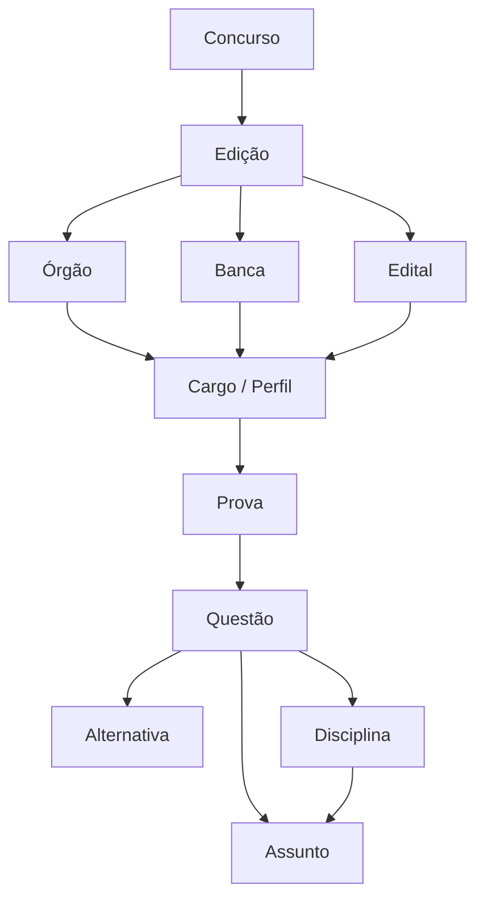
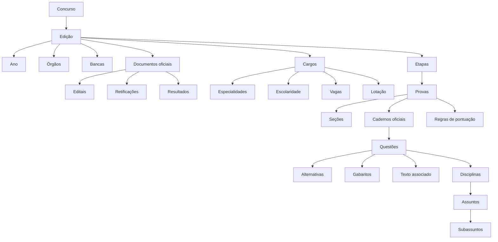
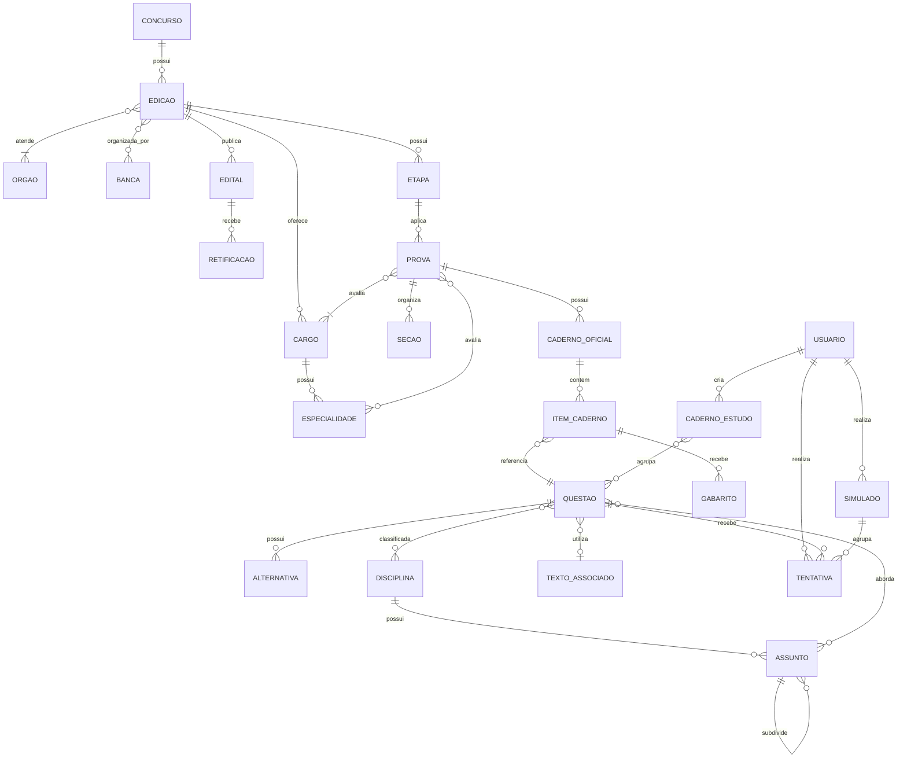
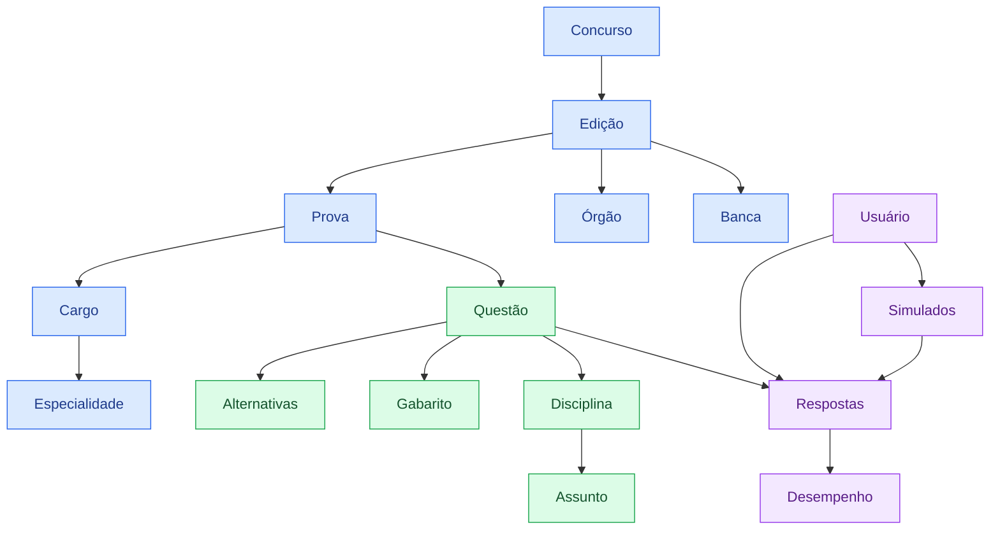
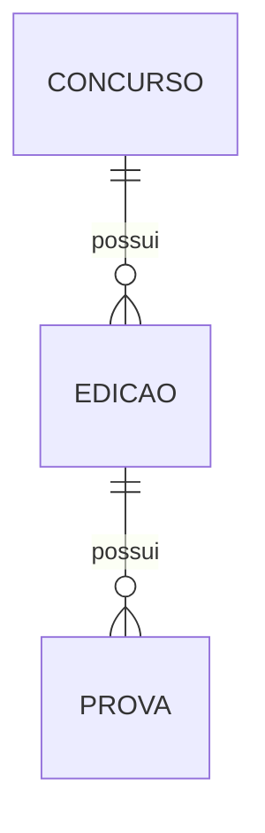
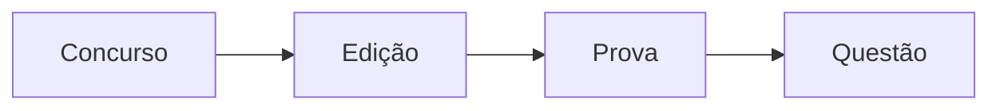

# Brazilian Civil Service Exams — Structure — ChatGPT Conversation

- **Source platform:** ChatGPT (OpenAI)
- **Conversation type:** User–assistant conversation
- **Project:** Exam App / Exams Archive
- **Country scope:** Brazil (BR)
- **Conversation language:** Portuguese (Brazil), pt-BR
- **Document language:** English (metadata, message labels, and editorial notes)
- **Conversation date:** 2026-11-24 (ISO 8601 calendar date; America/Bahia local time)
- **Format:** UTF-8 Markdown, GitHub Flavored Markdown conventions
- **Record type:** Reconstructed conversation transcript
- **Scope:** All visible user and assistant messages through message 39, inclusive (before delivery of this file).

**Export note:** Earlier messages are preserved from the previously reconstructed Markdown record; subsequent messages are transcribed from the visible conversation. Interactive UI elements, citations and download controls are represented as text or Markdown where possible. Original timestamps, message IDs, raw tool logs, and unavailable citation URLs are not reconstructed. Attachments are described rather than embedded. Historical claims and proposed schemas are retained as stated, not independently validated or approved. This is not an official OpenAI export or a Docling-defined conversation schema.

## 01 — User

[$exams-archive](app://plugins_6b04aaa9fd848191a24525011f76e2bb) explique como real esturasra tem concurso este corso tem provas anos o que mais

---

## 02 — Assistant

Para o **Exam App**, precisamos separar o concurso público propriamente dito das suas edições, provas, cargos e questões.

Por exemplo, a DATAPREV pode realizar concursos em diferentes anos. Cada concurso pode oferecer vários cargos, especialidades e tipos de prova.

### 1.1. Hierarquia de um concurso

```text
Órgão — DATAPREV
├── Concurso — edição 2026
│   └── Cargo — Analista de TI
│       └── Especialidade — Desenvolvimento de Software
│           └── Prova objetiva
│               └── Caderno — Tipo 1
│                   ├── Questão 01
│                   ├── Questão 02
│                   ├── ...
│                   └── Questão 70
└── Outras edições do concurso
```

A estrutura acima utiliza como exemplo a prova da DATAPREV registrada na [documentação atual do Exam App](https://github.com/ianmaciel7/exams-app/blob/980e26348be87be1e6b35fa9e5333221ac0d4c17/PRODUCT.md).

### 1.2. Entidades e suas funções

| Entidade | Exemplo |
|---|---|
| Órgão | DATAPREV |
| Concurso | Concurso público DATAPREV 2026 |
| Ano | 2026 |
| Edital | Edital de abertura |
| Banca organizadora | FGV, FCC, Cebraspe |
| Cargo | Analista de TI |
| Especialidade | Desenvolvimento de Software |
| Escolaridade | Nível superior |
| Etapa | Primeira etapa |
| Prova | Objetiva, discursiva, prática |
| Caderno de prova | Tipo 1, Tipo 2 |
| Questão | Questão 01 |
| Alternativa | A, B, C, D, E |
| Gabarito | Resposta oficial |
| Disciplina | Tecnologia da Informação |
| Assunto | Banco de Dados |
| Subassunto | Normalização |

### 1.3. Estrutura dos conhecimentos

As disciplinas e os assuntos devem ter uma hierarquia independente dos concursos, pois podem aparecer em diferentes provas.

```text
Disciplina — Tecnologia da Informação
├── Banco de Dados
│   ├── SQL
│   ├── Normalização
│   └── Modelagem de dados
└── Engenharia de Software
    ├── Arquitetura de Software
    ├── Padrões de Projeto
    └── Testes de Software
```

Uma mesma disciplina pode estar presente em centenas de concursos.

### 1.4. Relacionamentos principais



### 1.5. O que utilizar inicialmente na v0.1.0

Considerando que queremos começar pequeno, utilizaria:

- Órgão
- Concurso (edição e ano)
- Banca
- Cargo
- Especialidade
- Prova
- Questão
- Alternativa
- Gabarito
- Disciplina
- Assunto

Posteriormente, acrescentaria editais, etapas, cadernos, vagas, pesos, critérios de aprovação e demais particularidades.

**Importante:** o ano é uma propriedade da edição do concurso, e não necessariamente um objeto independente. Também não devemos duplicar questões apenas porque aparecem em cadernos diferentes.

Consultei o plugin Exams Archive e conferi a branch `dev`, incluindo o [glossário atual](https://github.com/ianmaciel7/exams-app/blob/980e26348be87be1e6b35fa9e5333221ac0d4c17/GLOSSARY.md). A estrutura apresentada é uma proposta de modelagem mais completa, não um esquema já implementado ou aprovado no projeto.

---

## 03 — User

tem certeza que é assim leia todas schema disso busque na internete

---

## 04 — Assistant

A estrutura anterior precisa de alguns ajustes. **Não devemos tratar o concurso como uma árvore rígida**, porque um edital pode abranger vários órgãos, uma prova pode ser compartilhada entre cargos e uma questão pode aparecer em diferentes cadernos.

Vou considerar três fontes de informação: os concursos reais, as plataformas de questões e os esquemas históricos do Exam App. A ideia é chegar a uma estrutura que funcione para diferentes concursos brasileiros, sem criar complexidade desnecessária na primeira versão.

### 2.1. O que as fontes oficiais confirmam (conforme resposta original)

| Fonte mencionada | O que foi apontado na conversa |
|---|---|
| FGV — DATAPREV 2024 e 2026 | Diferentes edições, cargos, especialidades e tipos de cadernos. |
| Concurso Nacional Unificado | Um concurso pode atender diversos órgãos e agrupar cargos em blocos temáticos. |
| Cebraspe | Diferentes provas, conhecimentos básicos e específicos, critérios de pontuação e gabaritos alterados. |
| Qconcursos | Classificação por banca, órgão, cargo, ano, disciplina, assunto, escolaridade, formação e atuação. |
| TEC Concursos | Classificação por órgão, prova, cargo, disciplina, assunto e tópico, com tratamento de duplicidades. |
| Padrão internacional QTI 3.0 | Separação entre avaliação, seção, questão e processamento de respostas. |

O padrão **QTI (Question and Test Interoperability)** é particularmente interessante para nosso projeto, porque define um modelo de interoperabilidade para provas e questões, sem obrigar que cada questão pertença exclusivamente a uma prova.

**Export note:** The specific URLs for these citations are unavailable in the recovered record. The table preserves the earlier response’s claims without independently revalidating them.

### 2.2. Como era o schema antigo do Exam App

Recuperei o código original do protótipo 0.1.1 de `exams-app-antigo-2`. Ele realmente separava **Concurso** de **Edição**.

| Objeto | Propriedades originais |
|---|---|
| Concurso | Órgão |
| Órgão | — |
| Banca | — |
| Edição | Concurso, ano, banca |
| Cargo | Edição |
| Arquivo | Formato |
| Documento | Classe, categoria, edição, cargo |
| PDF | Páginas |
| Questão | Disciplina, ano, banca, órgão, edição, cargo |
| Caderno | — |
| Disciplina | — |
| Simulado | Edição, cargo, ano |
| Resposta | Questão, simulado, data, alternativa, resultado |

**Problema encontrado:** o protótipo armazenava informações redundantes na questão e não possuía um tipo independente de prova na constante `TYPES`, embora a prova aparecesse no modelo conceitual do board.

Fontes históricas recuperadas:

- `prototype/dominio.md`
- `prototype/01-produto-e-dominio.md`
- `prototype/exam-app-0.1.1__index.html`

### 2.3. Estrutura recomendada após a pesquisa

```text
Concurso — DATAPREV
├── Edição 2024
└── Edição 2026
    ├── Órgãos participantes
    ├── Banca organizadora
    ├── Editais e retificações
    ├── Cargos
    │   ├── Analista de TI
    │   │   ├── Desenvolvimento de Software
    │   │   ├── Inteligência da Informação
    │   │   └── Segurança Cibernética
    │   └── Analista de Processamento
    ├── Etapas
    ├── Provas
    │   └── Prova objetiva
    │       ├── Conhecimentos gerais
    │       ├── Conhecimentos específicos
    │       ├── Cadernos oficiais
    │       ├── Questões
    │       └── Gabaritos
    └── Resultados
```

Essa é uma representação para navegação. No banco de dados, algumas dessas entidades terão relacionamentos múltiplos, em vez de uma hierarquia rígida.

### 2.4. Schema relacional recomendado (visão conceitual)



**Export note:** This diagram reproduces the conceptual view of the response. The more detailed ERD in message 06 is a better reference for reviewing cardinalities. Connections between exam boards, notices, and positions should not automatically be interpreted as direct foreign keys.

### 2.5. Todas as categorias que devemos considerar

| Grupo | Entidades |
|---|---|
| Institucional | Órgão, banca, carreira |
| Concurso | Concurso, edição, edital, retificação |
| Vagas | Cargo, especialidade, área, escolaridade, lotação |
| Organização | Bloco temático, etapa, aplicação, turno |
| Avaliação | Prova, seção, caderno oficial |
| Questões | Questão, alternativa, texto associado, imagem |
| Correção | Gabarito preliminar, definitivo, anulação, pontuação |
| Conhecimento | Disciplina, assunto, subassunto |
| Estudo | Simulado, caderno de estudos, resposta, tentativa |
| Desempenho | Acertos, erros, tempo, aproveitamento |
| Documentos | Arquivo, PDF, edital, prova original |

### 2.6. Regras importantes para não errarmos

- **Concurso ≠ edição:** DATAPREV é o agrupamento histórico; 2024 e 2026 são edições.
- **Cargo ≠ especialidade:** Analista de TI é o cargo; Desenvolvimento de Software é a especialidade.
- **Prova ≠ caderno oficial:** uma prova pode ter diferentes versões ou ordenações de questões.
- **Caderno oficial ≠ caderno de estudos:** um é publicado pela banca; o outro é criado para praticar.
- **Questão ≠ resposta:** uma questão pode ser respondida diversas vezes pelo estudante.
- **Disciplina ≠ assunto:** Banco de Dados pode ser classificado em assuntos e subassuntos.
- **Acertos ≠ pontuação:** a nota depende das regras específicas da prova, inclusive penalizações e anulações.

### 2.7. Por onde começar na v0.1.0

Como estamos começando com um protótipo simples em HTML, eu adotaria somente estas entidades inicialmente:

- Órgão
- Banca
- Concurso
- Edição
- Cargo
- Especialidade
- Prova
- Questão
- Alternativa
- Disciplina
- Assunto
- Resposta
- Simulado

O desempenho inicialmente pode ser calculado a partir das respostas, sem precisar de uma entidade própria.

**Conclusão:** vale preservar a separação entre Concurso e Edição do nosso projeto antigo, corrigindo os relacionamentos e acrescentando a Prova como entidade independente.

Verifiquei o arquivo histórico restaurado e a branch `dev`. Ainda não auditei todos os schemas de todos os commits históricos, nem temos acesso aos schemas internos proprietários do Qconcursos e TEC Concursos. Portanto, esta é uma proposta fundamentada nas evidências disponíveis, não uma reprodução integral desses sistemas. Nenhum arquivo do projeto foi alterado.

---

## 05 — User

crie mermaid

---

## 06 — Assistant

### 3.1. Estrutura completa do domínio de concursos



### 3.2. Schema relacional — ERD

Este diagrama representa os relacionamentos entre entidades, incluindo suas cardinalidades.



### 3.3. Versão simplificada — Exam App v0.1.0



**Legenda:** azul — concursos; verde — conhecimento; roxo — estudo.

**Recomendo começarmos pelo terceiro diagrama**, mantendo o segundo como referência para evolução futura. São propostas de modelagem; ainda não representam um schema definitivo aprovado ou implementado.

---

## 07 — User

pegue toda conversa e gere .md

---

## 08 — Assistant

Gerei o arquivo Markdown com toda a conversa, incluindo:

- Estrutura e hierarquia dos concursos.
- Pesquisa e referências.
- Schema histórico do Exam App.
- Entidades, propriedades e relacionamentos.
- Diagramas Mermaid, incluindo o ERD completo.
- Proposta simplificada para a v0.1.0.
- Referências ao GitHub, commits e arquivos históricos.
- Decisões e pendências de modelagem.

O arquivo possui 435 linhas. Os componentes visuais foram convertidos em Markdown e Mermaid, e as limitações da pesquisa foram documentadas.

[exam-app-modelagem-concursos-conversa.md](files/exam-app-modelagem-concursos-conversa.md) — Markdown · 16,9 KB

---

## 09 — User

o chagpt n tem como exportar conversa como md ?

**Original attachment:** `image(20261125-001736).png`. Screenshot of the ChatGPT conversation menu, discussed in the following response. The image is not embedded in this Markdown file.

---

## 10 — Assistant

**Não existe uma opção nativa documentada para exportar uma conversa individual diretamente em `.md`** no ChatGPT. Como aparece na sua captura, o menu permite compartilhar, arquivar e mover a conversa, mas não exportá-la.

Existem estas alternativas:

| Método | Formato | Individual |
|---|---|---|
| Exportação oficial do ChatGPT | JSON/HTML | Não |
| Compartilhar conversa | Link | Sim |
| Extensão de navegador | Markdown, PDF, JSON | Sim |
| Pedir ao ChatGPT para gerar um arquivo | Markdown | Sim |

### Exportação oficial

Acesse **Configurações → Controles de dados → Exportar dados**. Você receberá um ZIP contendo seu histórico de conversas em JSON e um visualizador HTML.

### Melhor solução para o seu caso

Recomendo uma extensão de código aberto para Chrome que permita:

- Exportar a conversa atual com um clique.
- Preservar Markdown, tabelas, códigos e Mermaid.
- Salvar com o título original da conversa.
- Funcionar localmente, sem enviar informações a terceiros.
- Exportar sem consumir tokens da IA.

Assim, você poderá guardar as conversas diretamente nos seus projetos, sem precisar me pedir para reconstruí-las em Markdown.

---

## 11 — User

qual botao devo cliczaar tem com vazer isto nessa conversa?

---

## 12 — Assistant

Na sua captura de tela, **não existe um botão para exportar esta conversa inteira em Markdown (.md)**.

Os botões disponíveis são:

- Compartilhar: gera um link da conversa.
- Copiar: copia apenas uma resposta.
- Três pontos: abre o menu de gerenciamento da conversa.

Confirmei na documentação oficial: a exportação nativa fica em **Configurações → Controles de dados → Exportar dados**, mas exporta o histórico da conta, não somente esta conversa.

Para adicionar um botão **Exportar Markdown** diretamente nesta conversa, seria necessário instalar uma extensão no Chrome.

---

## 13 — User

me entregue entao como exportação ofincial na estra correta que chatpgt reocomenda md json n sei que quero formata ofical

---

## 14 — Assistant

O formato oficial utilizado pelo ChatGPT é **JSON (`conversations.json`)**, e não Markdown.

Segundo a [documentação oficial da OpenAI](https://help.openai.com/pt-br/articles/7260999-exporting-your-chatgpt-history-and-data), a exportação atual é um ZIP contendo as conversas em JSON, um visualizador `index.html` e outros dados da conta.

Vou utilizar essa organização para disponibilizar apenas esta conversa.

**Baixar exportação completa (.zip)** — 13 mensagens e arquivos anexos.

**Estrutura do ZIP:**

```text
estrutura-do-concurso-exportacao/
├── conversations.json
├── index.html
├── README.txt
└── files/
    ├── exam-app-modelagem-concursos-conversa.md
    └── image(20261125-001736).png
```

Você também pode baixar diretamente o `conversations.json`.

**Importante:** esta é uma exportação reconstruída, inspirada no formato oficial. Os identificadores foram gerados localmente, os horários originais não estão disponíveis e o visualizador HTML é próprio. A exportação oficial autêntica só pode ser obtida pelas configurações da sua conta.

---

## 15 — User

mas nesse json da pra ler conversa tipo imageine que ia n tem acesso a chatgpt?

---

## 16 — Assistant

**Sim. Uma IA que nunca teve acesso ao ChatGPT consegue ler esse JSON de forma independente**, inclusive sem acesso à internet.

Acabei de conferir o arquivo gerado. Ele contém 13 mensagens, organizadas com os seguintes dados:

| Informação | Preservada? |
|---|---|
| Título da conversa | Sim |
| Perguntas do usuário | Sim |
| Respostas da IA | Sim |
| Ordem das mensagens | Sim |
| Tabelas | Sim |
| Diagramas Mermaid | Sim |
| Blocos de código | Sim |
| Referências e links | Sim |
| Imagens | Separadamente, no ZIP |
| Horários originais | Não |
| Histórico bruto das ferramentas | Não |
| Identificadores originais | Não |

### Qual formato é melhor para outras IAs?

| Formato | Melhor finalidade |
|---|---|
| `.json` | Processamento estruturado e importação automatizada |
| `.md` | Leitura direta por agentes de IA, economizando contexto |
| `.html` | Visualização humana no navegador |
| `.zip` | Arquivamento completo, incluindo anexos |

Para alimentar **Claude Code, Codex ou Antigravity**, recomendo manter tanto o JSON quanto o Markdown.

O JSON serve como registro estruturado da conversa. O Markdown facilita a consulta do conteúdo sem gastar tokens com identificadores, metadados e estruturas auxiliares.

**Para o Exams Archive, eu manteria ambos**, junto com os anexos. Assim, nenhuma IA dependeria do acesso à conversa original no ChatGPT para compreender as decisões do projeto.

---

## 17 — User

este formato correto ou deveria ser outro

---

## 18 — Assistant

O formato atual está correto como **reconstrução da exportação do ChatGPT**, mas eu utilizaria outra organização para facilitar o consumo por diferentes agentes de IA.

A OpenAI documenta o uso do `conversations.json` para transportar conversas entre contas, mas não estabelece esse schema como padrão universal de intercâmbio entre IAs.

### Comparação dos formatos

| Formato | Finalidade | Recomendação |
|---|---|---|
| JSON do ChatGPT | Preservação do histórico original | Manter |
| JSON normalizado | Interoperabilidade entre IAs | Recomendado |
| JSONL | Indexação, RAG e processamento em lote | Para grandes volumes |
| Markdown | Leitura direta e economia de tokens | Recomendado |
| HTML | Visualização humana | Opcional |
| PDF | Documentação estática | Desnecessário neste caso |

### Estrutura que recomendo

```text
estrutura-do-concurso/
├── manifest.json
├── conversation.json
├── conversation.md
├── original/
│   └── conversations.json
└── attachments/
    └── images/
```

### Schema JSON normalizado

Em vez de obrigar outras IAs a interpretar a árvore de mensagens específica do ChatGPT, utilizaria uma estrutura linear e independente de plataforma.

```json
{
  "schema_version": "1.0.0",
  "title": "Estrutura do concurso",
  "source": {
    "platform": "chatgpt",
    "export_type": "reconstructed"
  },
  "language": "pt-BR",
  "messages": [
    {
      "id": "msg-001",
      "role": "user",
      "content": "Explique a estrutura de um concurso.",
      "format": "markdown",
      "attachments": []
    },
    {
      "id": "msg-002",
      "role": "assistant",
      "content": "Um concurso possui diferentes edições...",
      "format": "markdown",
      "attachments": []
    }
  ]
}
```

### Minha recomendação para o Exams Archive

Considerando que você pretende compartilhar conhecimento entre Claude Code, Codex e Antigravity, adotaria os três arquivos principais:

- **`conversation.md`** — leitura rápida e contextualização das IAs.
- **`conversation.json`** — processamento automatizado e interoperabilidade.
- **`original/conversations.json`** — preservação da exportação de origem.

Assim, o conhecimento não fica dependente de nenhuma plataforma.

O schema normalizado acima é uma proposta de padrão próprio, não um padrão oficial da OpenAI. E o JSON que geramos anteriormente deve continuar identificado como reconstruído, não como uma exportação original autêntica.

---

## 19 — User

acho melhor um .md da conversa completa

---

## 20 — Assistant

Concordo. Para compartilhar conhecimento entre ChatGPT, Claude Code, Codex e Antigravity, **um único Markdown é mais simples e econômico em tokens**.

**Baixar estrutura-do-concurso-conversa-completa.md** — Markdown · 679 linhas · 19 mensagens · 25 KB

O arquivo inclui:

- Todas as perguntas e respostas até agora, em ordem cronológica.
- Tabelas e diagramas Mermaid.
- Schemas e relacionamentos.
- Referências históricas e commits do GitHub.
- Decisões e pendências.

Qualquer IA poderá ler o conteúdo sem depender do ChatGPT.

A exportação foi reconstruída, com normalização dos componentes visuais. A captura de tela está descrita em texto, e não incorporada ao arquivo.

---

## 21 — User

esta na estrua md ofical do chapt de exportar conversa

---

## 22 — Assistant

**Não.** O arquivo `.md` que gerei utiliza uma estrutura própria, porque o ChatGPT não possui um padrão oficial documentado para exportação de conversas em Markdown.

Confirmei na documentação oficial da OpenAI:

| Formato | Exportação oficial |
|---|---|
| `conversations.json` | Sim |
| `index.html` | Sim |
| `conversation.md` | Não |

Fonte: [Exportando seu histórico e dados do ChatGPT](https://help.openai.com/pt-br/articles/7260999-exporting-your-chatgpt-history-and-data).

### Estrutura Markdown que recomendo padronizar

```markdown
# Título da conversa

- Plataforma: ChatGPT
- Data: 2026-11-24
- Idioma: pt-BR
- Tipo: Transcrição reconstruída

---

## Usuário

Pergunta original.

## Assistente

Resposta completa original.

---

## Usuário

Próxima pergunta.

## Assistente

Próxima resposta.
```

Preservando integralmente as mensagens, tabelas, códigos, Mermaid, referências e links, sem resumir ou reinterpretar o conteúdo.

**Para o seu objetivo de compartilhar conversas entre diferentes IAs, esse é o formato que recomendo**, embora não seja um padrão oficial da OpenAI.

---

## 23 — User

veja padrao dockelign recomenda para esta situação

---

## 24 — Assistant

Consultei a documentação oficial do **[Docling](https://github.com/docling-project/docling)**. Ele utiliza Markdown estruturado para leitura humana e por IAs, e `DoclingDocument` em JSON para preservação integral da estrutura documental.

Entretanto, o Docling não define um padrão específico para exportar conversas entre usuários e assistentes.

### Padrão Markdown recomendado

O serializador do Docling segue convenções compatíveis com **GitHub Flavored Markdown (GFM)**.

| Elemento | Representação |
|---|---|
| Título | `# Título` |
| Mensagem | `## Usuário` ou `## Assistente` |
| Seções internas | `### Seção` |
| Tabelas | Tabelas Markdown |
| Código | Blocos de código com linguagem |
| Diagramas | Blocos Mermaid |
| Imagens | Referências relativas |
| Fontes | Links Markdown |
| Separadores | `---` |
| Codificação | UTF-8 |

### Exemplo aplicado à nossa conversa

````markdown
# Estrutura do concurso

## Usuário

Explique a estrutura real de um concurso.

## Assistente

Um concurso pode possuir várias edições,
cargos, especialidades e provas.

### Entidades

| Entidade | Exemplo |
|---|---|
| Concurso | DATAPREV |
| Edição | 2026 |

---

## Usuário

Crie Mermaid.

## Assistente

### Modelo de domínio


````

### O que adotaria como padrão

| Configuração | Escolha |
|---|---|
| Formato | GitHub Flavored Markdown |
| Extensão | `.md` |
| Codificação | UTF-8 |
| Organização | Cronológica |
| Conteúdo | Transcrição integral |
| Normalização | Compatível com Docling |
| Resumos | Não |
| Metadados artificiais | Não |

Para o Exams Archive, adotaria esse formato como padrão de arquivamento de conversas. É leve, legível, versionável pelo Git e independente do ChatGPT.

**Não é necessário executar o Docling** para exportar uma conversa que já está em Markdown. Basta preservar sua estrutura corretamente.

### Documentação oficial

- [Docling — Serialization](https://docling-project.github.io/docling/concepts/serialization/)
- [Docling — Document Schema](https://docling-project.github.io/docling/reference/docling_document/)
- [Docling — Chunking](https://docling-project.github.io/docling/concepts/chunking/)
- [Docling — Markdown Serializer](https://github.com/docling-project/docling-core/blob/main/docling_core/transforms/serializer/markdown.py)

A organização das mensagens por usuário e assistente é uma convenção que estou propondo, não uma exigência oficial do Docling.

---

## 25 — User

me de conversa completa mas resto ingles apenas parte da conversa em portuges

---

## 26 — Assistant

**Baixar public-examination-structure-conversation.md**

O arquivo foi organizado conforme solicitado:

- **Inglês:** título, nome do arquivo, metadados, identificadores `User` e `Assistant`, apêndices e notas de exportação.
- **Português:** conteúdo original das perguntas e respostas.
- **Formato:** GitHub Flavored Markdown (GFM).
- **Codificação:** UTF-8.
- **Conteúdo:** 25 mensagens, 860 linhas, tabelas, diagramas Mermaid e referências.

A conversa está em ordem cronológica, sem tradução das mensagens. Os componentes interativos foram normalizados e a imagem está descrita em texto.

O arquivo é independente do ChatGPT e pode ser utilizado por outras IAs. Trata-se de uma transcrição reconstruída, não de uma exportação nativa oficial.

---

## 27 — User

as conversa n deveriam estar bloco de codigo ou citação veja o que dockeling recomenda

---

## 28 — Assistant

Verifiquei a documentação e o modelo de dados do **Docling**. A melhor abordagem é **não colocar mensagens inteiras dentro de blocos de código ou de citações**.

O Docling distingue semanticamente texto, títulos, tabelas, listas e código. Colocar uma resposta inteira dentro de um bloco de código faria com que sua estrutura interna fosse interpretada como código literal.

### Comparação

| Formato | Recomendação |
|---|---|
| Texto normal com títulos | Recomendado |
| Citação (`>`) | Apenas para citações reais |
| Bloco de código | Apenas para código e diagramas |
| Tabela Markdown | Para conteúdo tabular |
| Separador (`---`) | Para separar mensagens |

### Estrutura ideal

#### Public Examination Structure

##### 01 — User

Explique a estrutura de um concurso público.

##### 02 — Assistant

Um concurso pode possuir diferentes edições.

**Entidades principais**

| Entidade | Exemplo |
|---|---|
| Concurso | DATAPREV |
| Edição | 2026 |

##### 03 — User

Crie um diagrama Mermaid.

##### 04 — Assistant



Essa organização também favorece o *hierarchical chunking* do Docling, que utiliza a hierarquia dos títulos para contextualizar os fragmentos do documento.

### Padrão final recomendado

| Propriedade | Padrão |
|---|---|
| Formato | GitHub Flavored Markdown |
| Título do documento | H1 |
| Identificação das mensagens | H2 |
| Títulos internos das respostas | H3 em diante |
| Separação de mensagens | Horizontal rule |
| Conteúdo | Texto Markdown original |
| Blocos de código | Com linguagem explícita |
| Metadados | Inglês |
| Mensagens | Idioma original |
| Codificação | UTF-8 |

**Conferi o último arquivo que gerei e ele já segue essencialmente essa estrutura.** Não recomendo envolver as mensagens em citações ou blocos de código.

Essa é uma convenção compatível com a arquitetura documental do Docling, não um padrão oficial específico para exportação de conversas.

**Export note:** Citation URLs from this response are not available in the reconstructed record. See the Docling documentation links in message 24.

---

## 29 — User

me de md

---

## 30 — Assistant

**Baixar public-examination-structure-complete-conversation.md**

*Markdown · 29 mensagens · 963 linhas · UTF-8*

O arquivo segue a estrutura compatível com Docling:

- Títulos, metadados e identificadores em inglês.
- Mensagens em português, em ordem cronológica.
- Mensagens em texto normal, sem blocos de código ou citações envolvendo-as.
- Hierarquia de títulos H1, H2 e H3.
- Tabelas, códigos e diagramas Mermaid preservados.
- Separadores entre mensagens.

É uma transcrição reconstruída, independente do ChatGPT, compatível com GitHub Flavored Markdown e adequada para leitura e indexação por outras IAs.

**Export note:** The original download control is represented as text.

---

## 31 — User

nome do arquivo deveria estar ingles e deveria ter aquele padrao seguri padrao ano data seila e veria estar espelcito foi conversa via ghat gpt

---

## 32 — Assistant

Renomeei o arquivo seguindo uma convenção padronizada:

**2026-11-24-chatgpt-public-examination-structure-conversation.md**

### Padrão de nomenclatura

```text
YYYY-MM-DD-platform-topic-conversation.md
```

| Elemento | Padrão |
|---|---|
| Data | ISO 8601 (`YYYY-MM-DD`) |
| Plataforma | `chatgpt` |
| Assunto | Inglês |
| Tipo de documento | `conversation` |
| Nomenclatura | kebab-case |
| Extensão | `.md` |
| Codificação | UTF-8 |

Também deixei explícito nos metadados internos que a conversa ocorreu no **ChatGPT (OpenAI)**.

O arquivo contém 31 mensagens e 991 linhas, preservando o português das mensagens e o inglês da estrutura documental.

Recomendo adotar essa convenção para todas as conversas arquivadas, independentemente da plataforma. É um padrão próprio baseado em convenções consolidadas, não um formato oficial de exportação da OpenAI.

---

## 33 — User

deveria ter brasil no arquivo

---

## 34 — Assistant

Sim. Como a conversa trata especificamente de concursos públicos brasileiros, incluí **`brazilian`** no nome do arquivo.

**2026-11-24-chatgpt-brazilian-public-examination-structure-conversation.md**

Também atualizei os metadados internos:

- **Title:** Brazilian Public Examination Structure
- **Source platform:** ChatGPT (OpenAI)
- **Country scope:** Brazil (BR)
- **Conversation language:** Portuguese (pt-BR)

O conteúdo da conversa permanece em português, sem alterações.

---

## 35 — User

melhor nome ingles seria este pq acho que ele n usam termo public-examination

---

## 36 — Assistant

Você tem razão. **`Civil Service Exam`** é uma expressão mais natural e reconhecível em inglês para concursos públicos do que `Public Examination`, que é mais genérica.

Pesquisei a terminologia utilizada em documentos internacionais sobre o Brasil:

| Termo | Adequação |
|---|---|
| `Civil Service Exam` | Mais natural e reconhecível |
| `Civil Service Examination` | Mais formal |
| `Competitive Examination` | Correto, mas genérico |
| `Public Sector Recruitment Exam` | Mais abrangente, incluindo empresas estatais |
| `Public Examination` | Ambíguo |

O Banco Mundial e a OCDE utilizam terminologias relacionadas a *civil service* e *competitive examinations* ao descrever os concursos brasileiros.

**Nome escolhido:** Brazilian Civil Service Exam Structure.

**2026-11-24-chatgpt-brazilian-civil-service-exam-structure-conversation.md**

Atualizei o nome do arquivo e seu título interno, preservando o conteúdo da transcrição anterior.

**Export note:** Original citation URLs are unavailable in the reconstructed record. The download control is represented as text.

---

## 37 — User

veja como mundo interio costuma chamar isto

---

## 38 — Assistant

Pesquisei a terminologia internacional utilizada por governos, instituições públicas, OCDE e Banco Mundial. **Não existe um único termo universal para o equivalente ao concurso público brasileiro.**

Os dois termos mais reconhecíveis são **Civil Service Examination** e **Competitive Examination**, mas possuem diferenças de significado.

### 1. Terminologia internacional

| País ou instituição | Terminologia utilizada |
|---|---|
| Índia | Civil Services Examination |
| França | Concours de la fonction publique |
| União Europeia | Open Competition / Competitive Examination |
| OCDE | Civil Service Exam / Competitive Entrance Examination |
| Banco Mundial | Competitive Exam / Civil Service Recruitment |

A OCDE utiliza tanto a terminologia de exames para o serviço público quanto a de recrutamento competitivo. O Banco Mundial, ao descrever especificamente o Brasil, utiliza *concursos (competitive exams)*.

| País | Terminologia utilizada |
|---|---|
| Estados Unidos | Civil Service Examination |
| Reino Unido | Civil Service Recruitment / Online Tests |
| Japão | Recruitment Examination |
| Coreia do Sul | Open Competitive Recruitment Exam |

Essas denominações aparecem nos próprios portais governamentais.

### 2. Qual termo utilizar no Exam App?

| Termo | Tradução aproximada | Adequação |
|---|---|---|
| Civil Service Exam | Concurso para o serviço público | Excelente |
| Competitive Exam | Exame competitivo | Genérico |
| Public Sector Recruitment Exam | Exame de recrutamento do setor público | Mais abrangente |
| Government Exam | Exame governamental | Informal |
| Public Examination | Exame público | Ambíguo |
| Public Contest | Concurso público (tradução literal) | Evitaria |

### 3. Nome recomendado para o arquivo

**Brazilian Civil Service Exams — Structure**

```text
2026-11-24-chatgpt-brazilian-civil-service-exams-structure-conversation.md
```

Manteria `Civil Service Exams` no plural, porque estamos documentando a estrutura de vários concursos, não de uma prova específica.

Para uma classificação tecnicamente mais abrangente, incluindo empresas estatais como DATAPREV, `Public Sector Recruitment` seria mais preciso. Entretanto, **Civil Service Exams** é uma expressão mais natural para identificar o domínio do Exam App.

A pesquisa confirma o uso internacional desses termos, mas não estabelece um ranking estatístico de frequência mundial.

**Export note:** Original citation URLs are unavailable in the reconstructed record. The terminology findings are transcribed as stated and have not been independently reverified for this export.

---

## 39 — User

me entrga o md com isto

---

## Appendix — Historical Research Provenance

This editorial appendix preserves the identifiers and evidence listed in the previous reconstructed record for future retrieval by people or agents.

- [Exams App — dev branch](https://github.com/ianmaciel7/exams-app/tree/dev)
- Dev branch commit checked at the beginning and end of the earlier research: `980e26348be87be1e6b35fa9e5333221ac0d4c17`.
- [PRODUCT.md](https://github.com/ianmaciel7/exams-app/blob/980e26348be87be1e6b35fa9e5333221ac0d4c17/PRODUCT.md)
- [GLOSSARY.md](https://github.com/ianmaciel7/exams-app/blob/980e26348be87be1e6b35fa9e5333221ac0d4c17/GLOSSARY.md)
- [v0.1.0 product discovery](https://github.com/ianmaciel7/exams-app/blob/980e26348be87be1e6b35fa9e5333221ac0d4c17/docs/releases/v0.1.0/product.md)
- [Exams Archive](https://github.com/ianmaciel7/exams-app-archive)
- [Historical index](https://github.com/ianmaciel7/exams-app-archive/blob/main/reports/FULL-INDEX.md)
- [Historical branch file inventory](https://github.com/ianmaciel7/exams-app-archive/blob/main/inventory/exams-app-branch-files.json)
- [Exam App preservation report](https://github.com/ianmaciel7/exams-app-archive/blob/main/docs/EXAMS-APP-COMPLETE.md)
- Consolidated snapshot commit recovered locally during the earlier research: `b67c7c1e36e09676192382112590a203a2113cbc`.
- Snapshot path: `docs/archives/legacy/exams-app-antigo-2/snapshot/prototype/`.
- Original SHA stated in the prototype domain document: `9beadadd8be27c7d99d3ecdf5b5cf099137e23cc`.

### Open Issues

- Audit all schemas across historical commits.
- Verify specific web references and official notices used as examples.
- Finalize cardinalities and normalization of positions, specialties, agencies, and exam boards.
- Define scoring, cancellations, answer-key revisions, and performance calculation rules.
- Allow standalone answers without a mock exam, as specified in the historical conceptual model; the reproduced ERD still needs to express this optional relationship.
- Distinguish attributes (such as year) from persisted entities.
- Confirm the definitive v0.1.0 scope and schema.
