# Board Exam App

> Gerado de `board.json` por `board_to_md.py`. Fonte da verdade: `board.json`. Ordem de leitura: de cima para baixo, da esquerda para a direita. Cada seção corresponde a uma seção (container) do quadro.

# Exam App

### App para estudar para exames: certificações (estilo ExamTopics) ou concursos. Sem foco fixo.

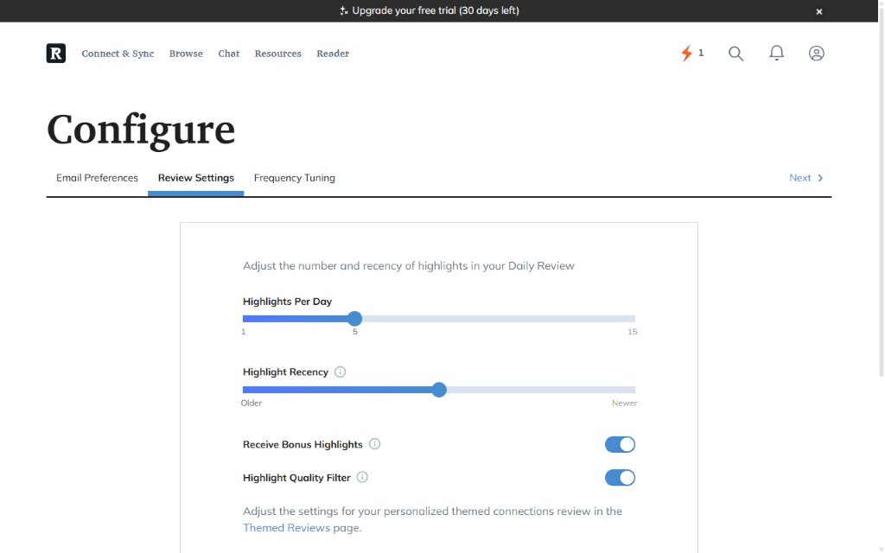

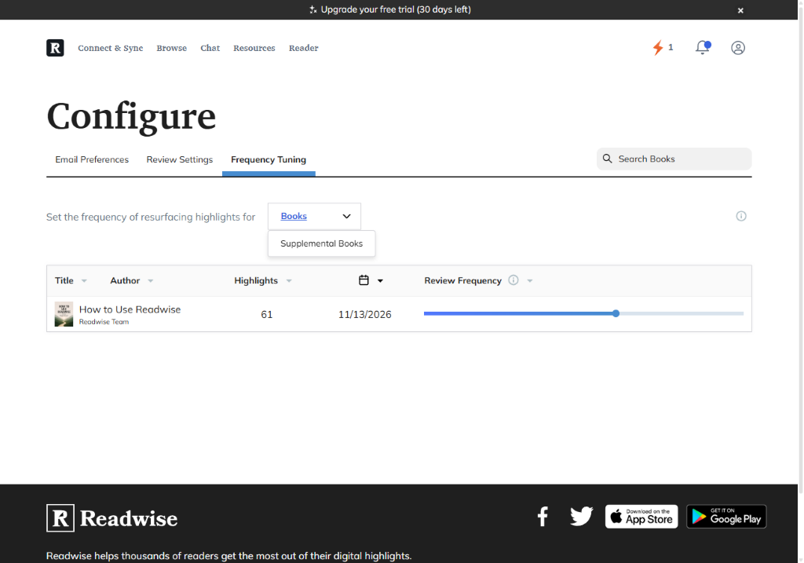

**Evidência 77 (Readwise SRS Algoritmo — Issue #82): Painel `Review Settings` (`Highlights Per Day`, `Highlight Recency` slider, `Bonus Highlights`)**

**Evidência 78 (Readwise SRS Tuning — Issue #83): Tela `Frequency Tuning` (`/configure/tune/books`) com slider de prioridade para cada fonte/disciplina**

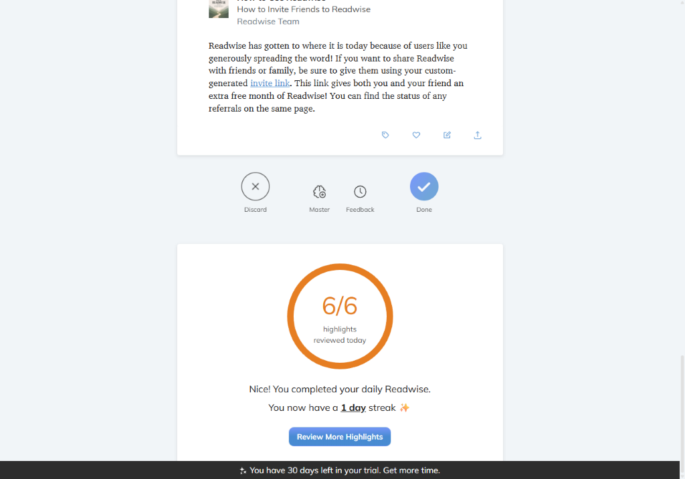

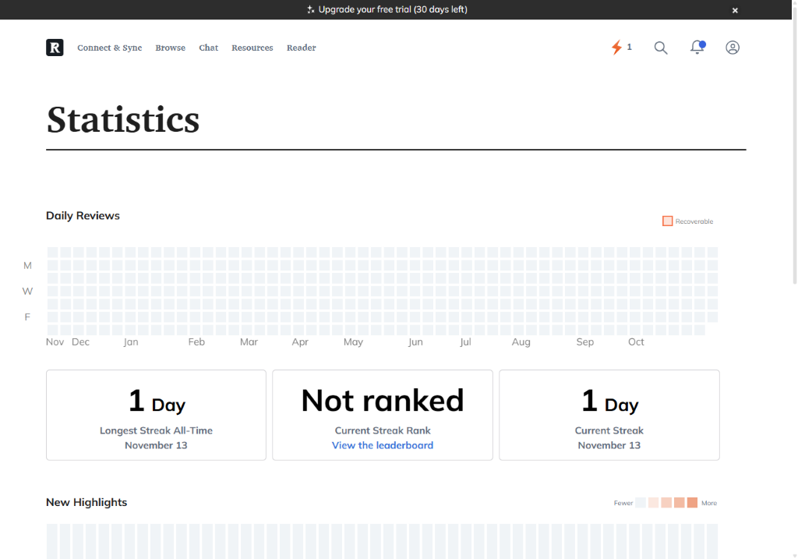

**Evidência 79 (Readwise SRS Streak — Issue #83): Tela de conclusão da Revisão Diária (`6/6 reviewed today`), badge de `Streak` e botão `Review More Highlights`**

**Evidência 80 (Readwise SRS Stats — Issue #83): Página `Statistics` (`/stats`) com Heatmap anual de revisões diárias, novos grifos e recordes de ofensiva**

## 8. Layout de três painéis (Three-Pane Workspace)
<!-- container e500 @ (3300,-1000) -->

> **Esquerda: sidebar**
> navegação global, recolhível; espaços, tipos, fixados, busca e criar
> nova opção Gráfico (abre o grafo completo, estilo Capacities)
> 
> **Centro: área principal**
> barra superior com voltar/avançar, abas independentes (histórico e estado próprios) e botão nova aba
> estados de carregando, vazio e erro
> 
> **Direita: painel contextual**
> barra própria, abas independentes e botão +
> visões: Explorar, Gráfico, Backlinks, Relacionados, Assistente de IA
> visões empilhadas e redimensionáveis; ocultar e reabrir (Ctrl+\)

> **Regras de interação**
> abrir no painel não substitui a visão principal
> Ctrl/⌘+clique: nova aba; Shift+clique: painel lateral
> Alt+←/→: histórico da aba; Alt+T nova aba; Alt+W fecha aba; Esc fecha painel
> 
> **Responsivo**
> desktop largo: três regiões
> ≤1100px: sidebar vira gaveta e o painel vira sobreposição
> ≤820px: painel vira folha inferior
> 
> Regra visual: um único ambiente integrado, não três páginas

> **Roadmap**: layout de três painéis + Gráfico na sidebar entregue na 0.1.1. Pendente: refinos de fluidez e revisão do Ian.

## Feito
<!-- container e47 @ (0,230) -->

- Leitor de PDF com sidebar, busca e menus
- Documentos com + e ⋯ no hover (estilo Capacities)
- Ordenar manual ou alfabético
- Sem % de leitura nos PDFs
- Configurações com tema e zoom
- Espaço "Concurso de TI"
- Quadro só com PDFs
- Gabarito conferido e 70 questões extraídas

## Em andamento
<!-- container e48 @ (510,230) -->

- Modelar as entidades do app (diagrama abaixo)
- Adotar "tudo é um Objeto" (tipo e propriedades)
- Decidir onde ficam as questões
- Testar as telas no celular
- Motion (Issue #128): loop do grafo agora respeita movimento reduzido, aba oculta, viewport e repouso; tokens CSS alinhados. QA visual e benchmarks ainda pendentes.

## Pendente
<!-- container e49 @ (1020,230) -->

- Questões, simulado e revisão no app
- Metas
- Documentos de leitura com % de progresso (estilo Reader e Kindle)
- Espaços: criar, excluir (30 dias) e exportar
- Guardar o progresso na conta
- Extrair os cadernos tipo 2, 3 e 4
- Mostrar as figuras da prova junto do texto

## 0.1.0
<!-- container e4 @ (0,580) -->

### Documentos

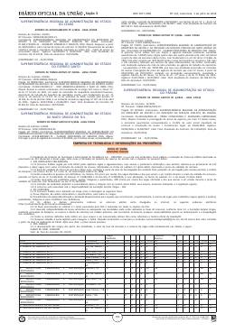 ([abrir](https://claude.ai/artifact/X3QEzX9BgrXsTjySqSBnx7#edital))

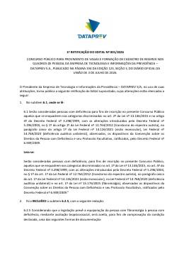 ([abrir](https://claude.ai/artifact/X3QEzX9BgrXsTjySqSBnx7#ret1))

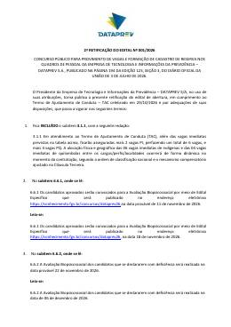 ([abrir](https://claude.ai/artifact/X3QEzX9BgrXsTjySqSBnx7#ret2))

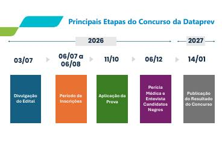 ([abrir](https://claude.ai/artifact/X3QEzX9BgrXsTjySqSBnx7#cronograma))

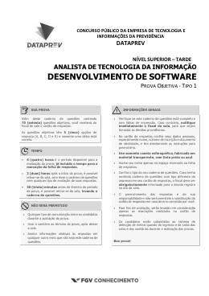 ([abrir](https://claude.ai/artifact/X3QEzX9BgrXsTjySqSBnx7#tipo1))

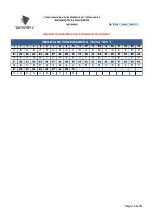 ([abrir](https://claude.ai/artifact/X3QEzX9BgrXsTjySqSBnx7#gabarito))

Edital de abertura

1ª retificação

2ª retificação

Cronograma

Caderno tipo 1

Gabarito preliminar

### Entidades

### Protótipo versão 1

> **Espaço**
> nome e ícone
> dono (conta)
> isolado: nada cruza entre espaços
> Ex.: Concurso de TI

> **Documento (PDF)**
> título
> classe: referência (fonte de verdade, sem % de leitura) ou leitura (com % de progresso, estilo Reader e Kindle)
> categoria: edital, retificação, cronograma, prova, gabarito
> arquivo
> espaço
> progresso e posição: só em leitura

 ([abrir](https://claude.ai/artifact/X3QEzX9BgrXsTjySqSBnx7))

## 0.1.1
<!-- container e149 @ (1580,580) -->

### Protótipo 0.1.1

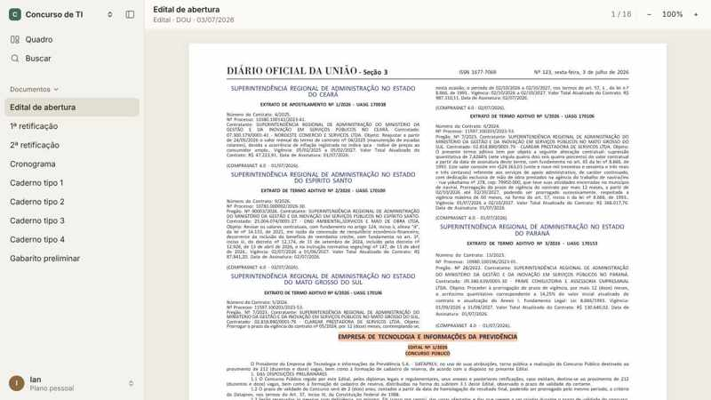 ([abrir](https://claude.ai/artifact/MeCzKuKCsr6fY4F8AGxnyC))

Tipos de Objeto na 0.1.1:
- Concurso, Órgão, Banca, Edição, Cargo
- Arquivo → Documento → PDF
- Questão, Disciplina, Simulado
Barra lateral: seções livres ou por tipo, plural por padrão, arrastar para ordenar. Fixar só pelo menu ⋯.

Filtro de questões (0.1.1): botão Filtrar com popover pesquisável, vários valores por categoria (Banca, Disciplina, Edição, Origem, Situação), chips removíveis, busca por palavra, total filtrado de total e Limpar tudo. Mesmo componente na página do tipo Questão e nas abas Questões de Concurso, Edição e Cargo.

## 1. Estrutura: Espaço, Objeto e Tipo de Objeto
<!-- container e52 @ (0,1500) -->

> **Espaço (Space)**
> nome e ícone
> dono (conta)
> isolado: sem links nem busca entre espaços
> ao_abrir: onde parei, calendário ou objeto
> excluído_em (30 dias para restaurar)
> exportação: manual ou automática

> **Objeto (Object)**
> título
> espaço
> tipo de objeto
> conteúdo (quando houver)
> propriedades padrão: aliases, descrição, ícone, etiquetas, criado_em

> **Tipo de Objeto (Object Type)**
> nome e ícone
> lista de definições de propriedade
> Pode estender outro tipo e herdar suas propriedades
> Ex.: Arquivo → Documento → PDF

> **Definição de Propriedade (Property Definition)**
> nome
> tipo de valor: texto, número, caixa, data e hora, relação
> origem: padrão do sistema ou adicional

> **Valor de Propriedade (Property Value)**
> objeto
> definição
> valor (pode ficar vazio)

## 5. Referências (de onde tiramos as informações)
<!-- container e107 @ (1580,1500) -->

## 8. Análise ExamTopics → banco de questões
<!-- container e190 @ (3200,1500) -->

Análise (sem implementação). Aproveitar: busca, filtros básicos, chips ativos, total global x filtrado, paginação, por página, ordenação, estado na URL. Melhorar: unificar as duas listas de questões em um componente. Adicionar (condicionado a dados): tipo, dificuldade (derivada do desempenho), assunto, com imagem, com explicação, filtros salvos. Descartar: votos da comunidade, discussões, gabarito por votação.

[Análise ExamTopics: funcionalidades para o banco de questões](https://claude.ai/artifact/5qJgzuASzvMgdcoLDqbXZP)

Decisões pendentes (3): listadas no fim do documento. Nada foi alterado na 0.1.1.

## 9. Análise QConcursos → banco de questões
<!-- container e400 @ (3760,1500) -->

Análise (sem implementação), coerente com a do ExamTopics. O que o QConcursos acrescenta: Cadernos (Coleção que guarda questões fixas) e Filtros salvos (Visão que guarda critérios), 5 níveis de dificuldade (derivados do desempenho do próprio usuário), exclusões (já resolvidas, em simulados, anuladas, desatualizadas), histórico (resolvidas, acertei, errei) e modalidade. Filtros: E entre categorias, OU dentro de uma; só aparecem com 2 ou mais valores. Simulado personalizado a partir de filtro ou caderno. Descartar: comentários, votos, ranking e cópia da interface.

[Análise QConcursos: funcionalidades para o banco de questões](https://claude.ai/artifact/7AZNibg2dJCUmDEZb9ScLt)

Decisões pendentes (4): listadas no fim do documento. Nada foi alterado na 0.1.1.

## QConcursos
<!-- container e108 @ (1604,1562) -->

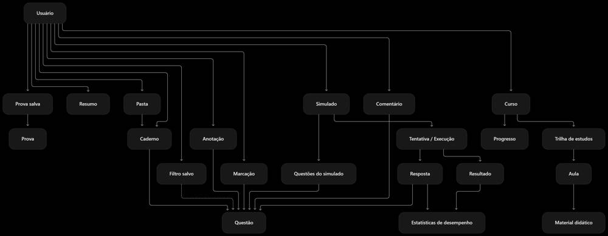

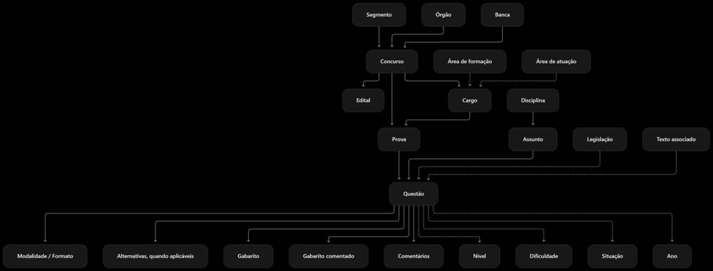

> **Estudo do usuário**
> usuário tem: prova salva, resumo, pasta, caderno, anotação,
> marcação, filtro salvo, comentário, simulado e curso
> caderno, anotação e marcação apontam para questão
> simulado → tentativa → resposta e resultado → estatísticas
> curso → progresso e trilha de estudos → aula → material didático

> **Conteúdo e questão**
> concurso: segmento, órgão e banca → edital, cargo e prova
> disciplina → assunto → questão; prova → questão
> opcionais: área de formação e de atuação, legislação, texto associado
> questão: modalidade, alternativas, gabarito, gabarito comentado,
> comentários, nível, dificuldade, situação e ano

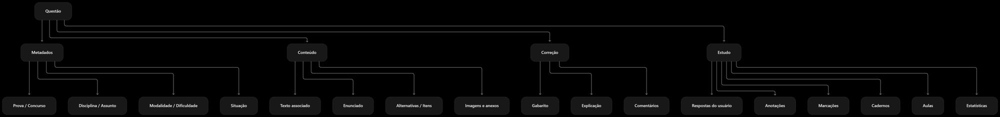

> **Questão em 4 grupos**
> metadados: prova ou concurso, disciplina e assunto, modalidade e dificuldade, situação
> conteúdo: texto associado, enunciado, alternativas ou itens, imagens e anexos
> correção: gabarito, explicação, comentários
> estudo: respostas do usuário, anotações, marcações, cadernos, aulas, estatísticas

## 2. Tipos de Objeto do app e suas relações (a seta aponta para o objeto relacionado)
<!-- container e104 @ (0,2140) -->

> **Etiqueta (Tag)**
> título (o assunto)
> sem texto livre
> objetos com a etiqueta: automático
> (vem da propriedade padrão etiquetas)

> **Edição (Edition)**
> concurso (relação)
> título e ano (ex.: Dataprev 2026)
> banca (relação)
> tipo (rótulo): concurso ou certificação
> documentos, cargos e provas: automático

> **Coleção (Collection)**
> título
> tipo de objeto (relação)
> membros: objetos desse tipo
> manual, sem aninhar
> visibilidade: privada ou pública
> Ex.: caderno de questões

> **Meta (Goal)**
> tipo: nota, % de acerto, questões, revisões em dia
> valor alvo
> período
> progresso

> **Documento (Document)**
> estende: Arquivo
> classe (rótulo): referência ou leitura
> categoria (rótulo): edital, retificação, prova...
> leitura: local, progresso e última posição
> idioma e nota do documento (conteúdo)
> edição e cargo (relações)

> **Prova (Exam Paper)**
> edição (relação)
> cargo (relação)
> ano e data de aplicação
> caderno: tipo 1, 2, 3 ou 4
> questões: automático

> **Simulado (Mock Exam)**
> edição e cargo (relações)
> ano
> questões em ordem
> tempo limite e modo: prova ou estudo
> tentativas: histórico de respostas e resultado

> **Disciplina (Subject)**
> título
> disciplina pai (relação, para o assunto)
> ordem
> questões: automático

> **Alternativa (Option)**
> título: texto da alternativa
> rótulo (letra A a E)
> imagem (opcional)
> correta (caixa)
> questão (relação)
> ordem

> **Questão (Question)**
> enunciado e instrução (conteúdo)
> formato: única, múltipla, certo/errado, lacuna
> gabarito e anulada (caixa)
> gabarito comentado (conteúdo)
> dificuldade e situação (rótulos)
> **origem (Source): Oficial, Gerada por IA ou Manual (rótulo); Oficial liga ao PDF da prova e à edição**
> ano (número)
> disciplina, banca, órgão, edição e cargo (relações)

> **Resposta (Answer)**
> questão (relação)
> simulado (relação, opcional)
> alternativa marcada
> acertou (resultado)
> respondida em

> **Cartão de revisão (Review Card)**
> questão de origem (relação)
> formato: pergunta e resposta ou lacuna
> frente e verso
> próxima revisão
> histórico: data e resposta
> resposta: esqueci, difícil, bom, fácil

> **Órgão (Agency)**
> título e sigla
> concursos: automático
> edições: automático
> (ex.: Dataprev)

> **Concurso (Contest)**
> título (ex.: Dataprev)
> órgão (relação)
> banca (relação)
> segmento (rótulo)
> edições: automático
> recorrente: uma Edição por ano

> **Banca (Exam Board)**
> título (ex.: FGV)
> concursos: automático
> edições: automático

> **Cargo (Position)**
> edição (relação)
> título (ex.: Analista de TI · Desenvolvimento de Software)
> vagas, remuneração e conteúdo
> prova e gabarito: automático

Relação é escrita em um lado só (a seta sai de quem guarda); o lado de volta é automático. Edição aponta para Concurso e Cargo aponta para Edição (setas omitidas para não cruzar). Etiqueta, Meta e Arquivo não têm seta.
Título, aliases, descrição, ícone, etiquetas e criado_em já existem em todo objeto. Verde: já é Tipo de Objeto na 0.1.1. Azul: futuro.

## ExamTopics
<!-- container e116 @ (1604,2562) -->

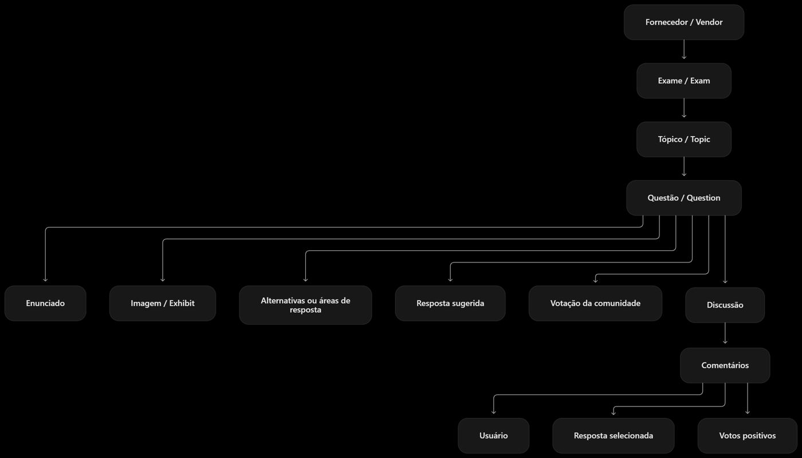

> **Fluxo de questões**
> fornecedor → exame → tópico → questão
> questão tem: enunciado, imagem (exhibit),
> alternativas ou áreas de resposta,
> resposta sugerida, votação da comunidade e discussão
> discussão → comentários
> comentário tem: usuário, resposta selecionada, votos positivos
> 
> Já temos no modelo: fornecedor em Exame, exame → tópico → questão, alternativas.

> **Questão (Question): campos da página (v109)**
> métricas calculadas das Respostas: tentativas, acertos, erros, % de acerto, sequência, última resposta, alternativa errada mais marcada, simulados que a incluíram
> situação (rótulo): nunca respondida, acertei, errei ou para revisar
> para revisar e favorita (marcações)
> anotações (conteúdo)
> gabarito oficial (letra) com link ao PDF do gabarito
> posição na lista e questões relacionadas por disciplina
> falta: tempo médio, etiquetas

## Readwise
<!-- container e119 @ (1604,3102) -->

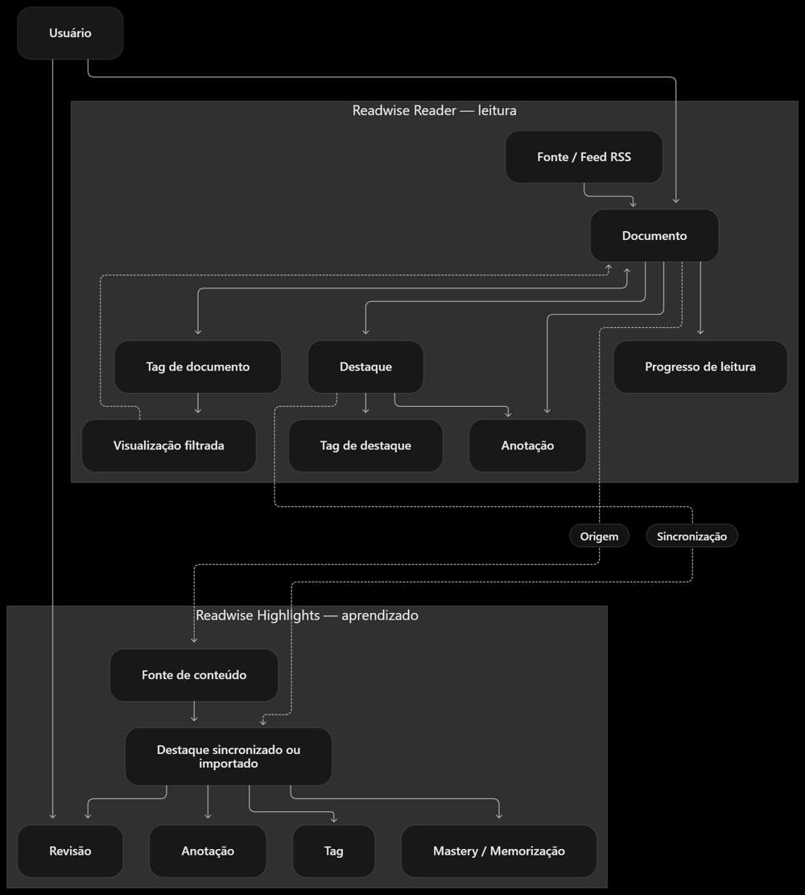

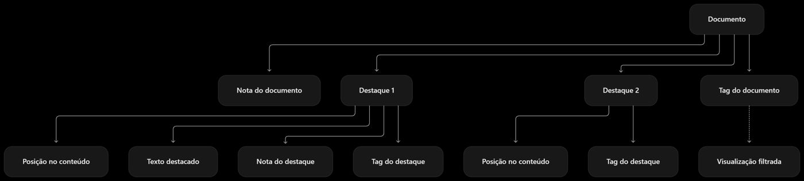

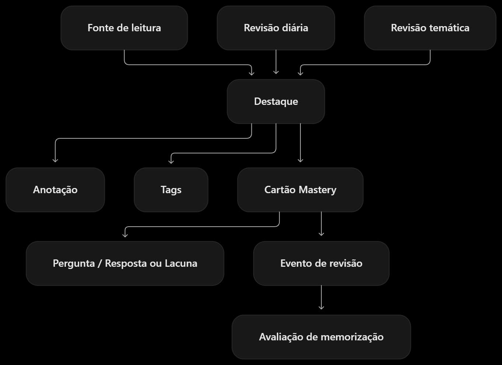

> **Readwise em 4 diagramas**
> leitura (Reader): documento, vindo de fonte ou feed RSS, tem
> tag, destaque, anotação e progresso de leitura
> destaque: posição, texto destacado, nota e tag
> aprendizado (Highlights): destaque importado → anotação, tag,
> revisão e mastery
> biblioteca: tags, visualizações filtradas (consulta) e documentos
> revisão: destaque → cartão mastery (pergunta e resposta ou lacuna)
> → evento de revisão → avaliação de memorização
> 
> Já temos: documento de leitura com progresso, cartão de revisão, etiqueta.
> Destaque fica só como referência por enquanto.

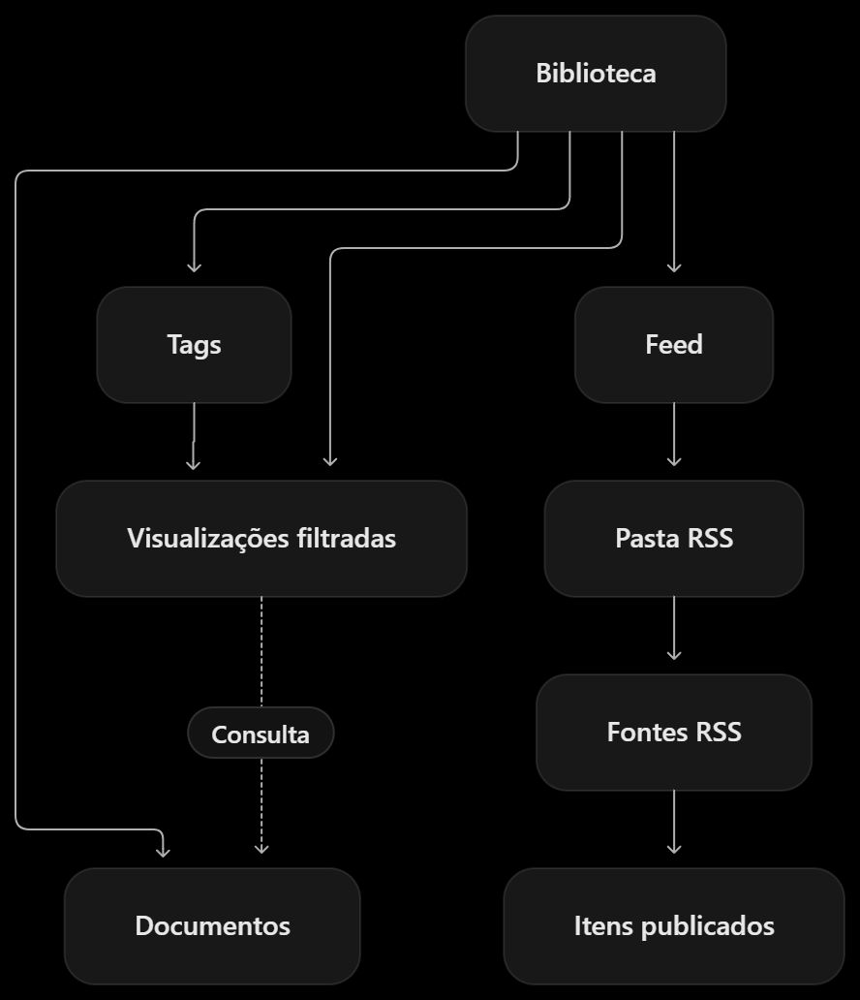

## 3. Hierarquia de tipos (herança)
<!-- container e99 @ (0,3340) -->

> **Arquivo (File)**
> título
> formato (MIME)
> tamanho
> checksum

> **Documento (Document)**
> estende: Arquivo
> classe: referência ou leitura
> categoria: edital, prova...
> progresso: só em leitura

> **PDF**
> estende: Documento
> nº de páginas
> camada de texto (busca)
> modo: original ou texto
> zoom e página atual

A seta vai do tipo base para o que o estende.
O filho herda as propriedades do pai e acrescenta as suas.
Cada objeto tem um único tipo: o mais específico (ex.: PDF).

## 4. Glossário das entidades
<!-- container e95 @ (0,3820) -->

| Termo | Significado |
| --- | --- |
| Espaço (Space) | Ambiente independente de uma conta. Nada cruza entre espaços: sem links nem busca. |
| Objeto (Object) | Unidade individual de informação: título, tipo, propriedades e conteúdo. Pertence a um Espaço. |
| Tipo de Objeto (Object Type) | Categoria do objeto (Documento, Questão, Edição...). Define quais propriedades ele tem. |
| Título (Title) | Nome principal do objeto, o que o usuário vê. |
| Conteúdo (Content) | Corpo principal do objeto, quando existe (ex.: anotações). |
| Propriedade (Property) | Característica que descreve o objeto de forma estruturada. |
| Definição de Propriedade | Diz o que a propriedade guarda (ex.: banca é texto). Compartilhada por todos os objetos do tipo. |
| Valor de Propriedade | A informação guardada em um objeto (ex.: banca = FGV). Pode ficar vazio. |
| Propriedade padrão (Default) | Fornecida pelo sistema: título, aliases, descrição, ícone, etiquetas e data de criação. |
| Propriedade adicional (Normal) | Criada para o tipo: texto, número, caixa de seleção, data e hora ou relação. |
| Relação (Relation) | Propriedade que aponta para outro objeto (ex.: Questão aponta para Edição). |
| Tipo de Objeto Básico | Predefinido pelo sistema (ex.: Documento). Oferece estrutura padrão para documentos, sem personalização. |
| Tipo de Objeto Personalizado | Criado pelo usuário conforme necessário (ex.: Questão, Concurso, Meta). Cada tipo guarda propriedades únicas. |
| Nome singular e plural | Cada tipo tem nomes singular e plural (ex.: Questão / Questões, Edição / Edições) para exibição na interface. |
| Todo Objeto possui um Tipo | Relação fundamental: cada objeto sempre pertence a exatamente um tipo, que define sua estrutura e propriedades. |
| Tipo de Propriedade | Determina como o valor é armazenado e interpretado. Tipos: Texto, Número, Caixa de Seleção (true/false), Data e Hora, Rótulo (seleção única/múltipla), Conteúdo com Blocos, Imagem de Capa, Seleção de Objetos (para relações). |
| Herança (Estende) | Um Tipo de Objeto pode estender outro e herdar suas propriedades, acrescentando as suas. Ex.: PDF estende Documento, que estende Arquivo. O objeto continua com um único tipo (o mais específico). |
| Texto (Text) | Informação textual, simples ou formatada. Endereços (URL) também ficam em Texto. Ex.: autor = Maria Silva. |
| Número (Number) | Valores numéricos: quantidades, preços, pontuações. Códigos e identificadores sem sentido de quantidade ficam em Texto. |
| Caixa de Seleção (Checkbox) | Marcado (true) ou desmarcado (false). Desmarcado ainda é um valor, não é vazio. Ex.: acertou. |
| Data e Hora (Datetime) | Uma data, data com horário ou intervalo de datas. Ex.: data da prova. |
| Rótulo (Label) | Escolha entre opções predefinidas, de seleção única ou múltipla. Ex.: dificuldade = difícil. |
| Conteúdo (Content) | Área estruturada com Blocos, não só um texto. Ex.: anotações, explicação de uma questão. |
| Seleção de Objetos (Object Select) | Propriedade que referencia outros objetos de um tipo definido. É a forma da Relação. |
| Alterar valor vs. definição | Mudar um valor afeta só aquele objeto. Mudar a definição (nome, tipo) afeta todos os objetos do tipo. |
| Etiqueta (Tag) | Palavra-chave que diz sobre o que o objeto trata (ex.: #python). É um objeto de tipo próprio, reutilizável e sem texto livre. |
| Etiqueta do objeto / do bloco | Do objeto: classifica o objeto inteiro. Do bloco: classifica um trecho do texto com #. |
| Página da Etiqueta (Tag Page) | Lista os objetos ligados à etiqueta, de qualquer tipo. É uma visão, não um documento para escrever. |
| Etiqueta vs. Tipo de Objeto | O tipo diz o que a informação é (Livro). A etiqueta diz sobre o que ela trata (Python). Aplicar etiqueta não move nem duplica o objeto. |
| Coleção (Collection) | Grupo manual de objetos de um único tipo (ex.: PDFs para Estudar). Um objeto pode estar em várias coleções, sem cópia. |
| Participação na Coleção | Liga um objeto a uma coleção. Remover o objeto da coleção não o exclui. Coleção não contém outra coleção. |
| Coleção vs. Etiqueta | Coleção: grupo manual, de um só tipo. Etiqueta: assunto, de qualquer tipo. Coleção não é propriedade do objeto. |

## 6. Decisões de modelagem (boas práticas)
<!-- container e152 @ (0,5310) -->

1. Alternativa é objeto próprio: guarda letra, texto, correta e estatística (% que marcou), como no QConcursos.
2. Resposta pode existir sem Simulado (questão resolvida avulsa ou na revisão). Simulado é opcional.
3. Cartão de revisão nasce de uma Questão ou de uma Nota. Um cartão por origem; guarda agendamento (próxima data, intervalo, facilidade).
4. Concurso → Edição → Cargo. Concurso é recorrente (Dataprev), Edição é cada ano (Dataprev 2026) e Cargo guarda prova, gabarito, vagas e conteúdo. Certificação é uma Edição (AZ-104). Prova = cada caderno do Cargo.
5. Disciplina é um tipo próprio, reaproveitado entre Edições (Português serve para vários concursos). Órgão e Banca também são tipos, não texto.
6. Meta: métrica (acerto %, nº de questões, nota em simulado, dias seguidos), alvo, período (dia/semana/mês), prazo e escopo opcional (Edição ou Disciplina).
7. Progresso de leitura fica no próprio Documento (só para categoria leitura). Referência não tem progresso.
8. Sem Destaque: trecho importante vira uma Nota que aponta para o Documento (com página/posição) e pode gerar Cartão.
9. Visualização filtrada (filtro salvo) fica para depois; Coleção já cobre o caderno manual.
10. Questão, Disciplina e Simulado já são tipos na 0.1.1 (70 questões da Dataprev).

## 7. Roadmap de versões (cada versão entrega uma camada do modelo)
<!-- container e154 @ (0,6000) -->

> **0.1.0 (feito)**
> Protótipo 1
> leitura e referência
> documentos, PDF, edital e gabarito

> **0.1.1 (feito)**
> Protótipo 2
> barra lateral com seções livres ou por tipo, nomes no plural, ordem por arrastar
> Concurso → Edição → Cargo, Órgão e Banca como tipos
> Cargo herda a Banca da Edição
> Arquivo → Documento → PDF
> Questão, Disciplina, Simulado e Resposta como tipos

> **0.2.0 (quase pronta)**
> Questões reais
> 70 questões do Dataprev 2026 como objetos, com filtros e navegador
> Simulado com tentativas e histórico
> Seção Desempenho
> Falta: gabarito por cargo

> **0.3.0**
> Organização
> Coleção (caderno) e Etiqueta
> disciplina e assunto
> listas filtradas, todo item é link

> **0.4.0**
> Estudo e revisão
> Cartão de revisão
> Meta e estatísticas

> **0.5.0**
> Leitura
> Documento de leitura com progresso %
> notas a partir do Documento
> referência sem progresso

> **1.0.0**
> Certificações e conta
> fornecedor e edição no estilo ExamTopics
> questões criadas pelo usuário
> exportar e restaurar o espaço

## 11. Camada de IA (Claude no protótipo 0.1.1)
<!-- container e410 @ (1580,6000) -->

### IA em 3 pontos do estudo

O protótipo chama o Claude direto, sem chave de API: o artefato usa a capacidade `sample`, na conta de quem abre. Se a IA não estiver disponível, os botões somem e o app segue igual.

> **Explicar com IA**
> Depois de responder: por que a certa está certa e as outras erradas, com macete. Na página da Questão.

> **Criar cartões**
> 3 cartões frente e verso a partir do conceito da questão. Dá para copiar.

> **Sugerir o que revisar**
> Lê o Desempenho e lista disciplinas (com link), motivo e ação.

**Próximos passos** (entram no roadmap, bloco 7)

> **0.4.0**
> Cartões gerados vão para a Revisão; assistente de estudo com a meta do dia.

> **0.5.0**
> Destaque em documento vira nota ou cartão; resumo do Documento.

> **1.0.0**
> Sugerir Disciplina e Assunto; gerar questões do próprio Documento.

## 8. Diretrizes de UI/UX (aplicadas na 0.1.1)
<!-- container e162 @ (0,6500) -->

> **Ordem de prioridade**
> 1. Organização visual
> 2. Acessibilidade (WCAG AA)
> 3. Densidade e espaçamento compactos
> 4. Estados: carregando, vazio, erro com nova tentativa
> 5. Manter todas as funções
> Resumo completo: referencias/diretrizes-ui-ux-2026.md

> **Feito na 0.1.1**
> Contraste ajustado nas cores de texto
> Link de pular para o conteúdo e rótulos de navegação
> Migalhas no lugar de caixas repetidas
> Navegação de seções fixa no topo
> Botão Continuar leitura (página x de y)
> PDF com limite de tempo e botão Tentar de novo
> Movimento reduzido respeitado
> **Falta:** banco de questões, filtros e simulados (ainda não existem)

> **2ª diretriz: estados, feedback e erros**
> Nem todo estado é erro (vazio, sem resultados, lento)
> Mensagem: o que houve, impacto, o que fazer
> Toast só para evento curto; erro tem ação de recuperar
> Sempre timeout, nunca carregamento infinito
> Resumo: referencias/diretrizes-estados-feedback-erros.md

> **Feito na 0.1.1**
> Carregando com aviso de demora e cancelar
> Erro de PDF explica causa e mantém o ponto de leitura
> Tentar de novo ou ir ao Quadro
> Documento não encontrado (link errado)
> Busca sem resultados com dica
> Aviso de sem conexão e de conexão de volta
> Toasts de erro ficam mais tempo
> **Falta:** erro inline em formulários, confirmação com diálogo próprio, estado desatualizado

> **3ª diretriz: componentes e padrões de interação**
> Escolher componente pela finalidade, não pela aparência
> Página, dialog, alert dialog, drawer, tabs vs navegação
> Ação destrutiva usa alert dialog com consequência clara
> Não mexer no código só porque o documento existe
> Resumo: referencias/diretrizes-componentes-interacao.md

> **Revisão das 3 diretrizes na 0.1.1 (feita)**
> Confirmações com alert dialog, foco seguro no cancelar e foco devolvido
> Erro de campo inline com aria-invalid
> Chips de filtros ativos nas questões, com contagem anunciada
> Teclado de árvore na barra lateral
> Contraste do botão principal e alvos de 24 px corrigidos
> Idioma pt-BR declarado
> **Falta:** role=tree completo, textos e datas com Intl, skeleton de carregamento

## 9. Prints do Ian e feedback (cada imagem com legenda e versão)
<!-- container e300 @ (0,7700) -->

### Redesign das páginas de objeto: antes e depois (0.1.1)

Prints em /mnt/project-files/prints/redesign-paginas-objeto/

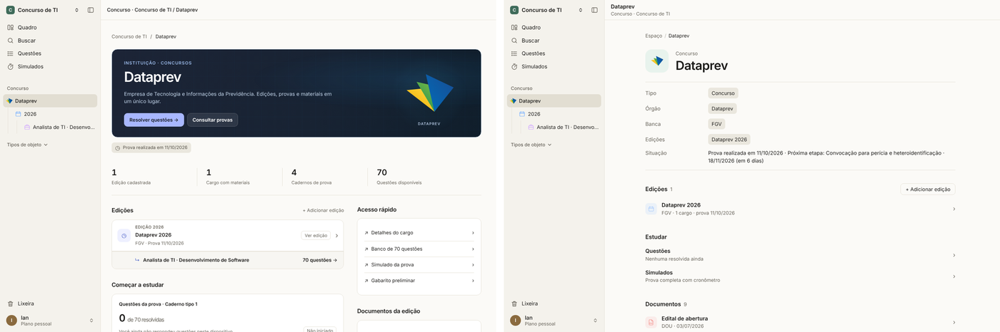

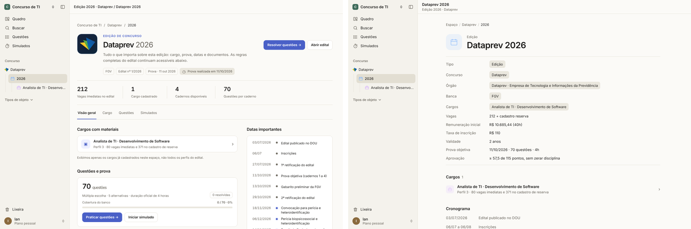

Capturas enviadas por Ian durante a revisão da 0.1.1, em 12 e 13/11.

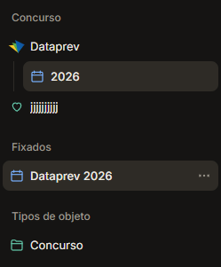

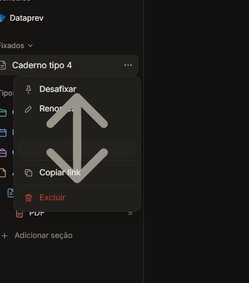

**0.1.1:** Arquivo, Documento e PDF na árvore, com contagem.

**Referência:** item fixado com pin e ⋯ ao passar o mouse.

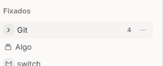

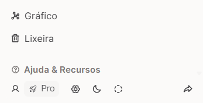

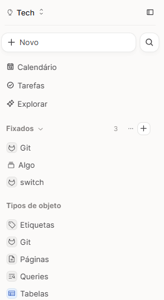

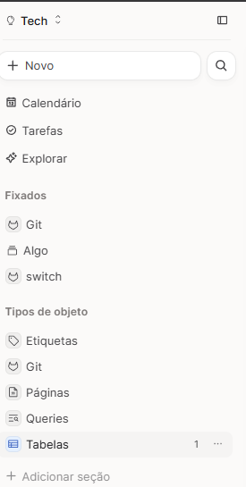

**Capacities:** Fixados com ⋯ no hover.

**Capacities:** Lixeira fixa no rodapé. Ian prefere assim.

**Capacities:** sidebar completa.

**Capacities:** sidebar, hover nos itens.

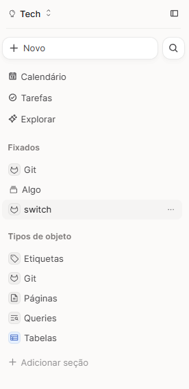

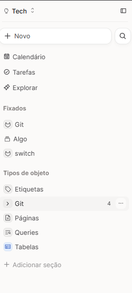

**Capacities:** sidebar, item aberto.

**Capacities:** sidebar, ações no hover.

### Artefatos e Board (antes da 0.1.0)

Capturas da fase em que o Ian pediu um artefato só para o protótipo e outro para o Board.

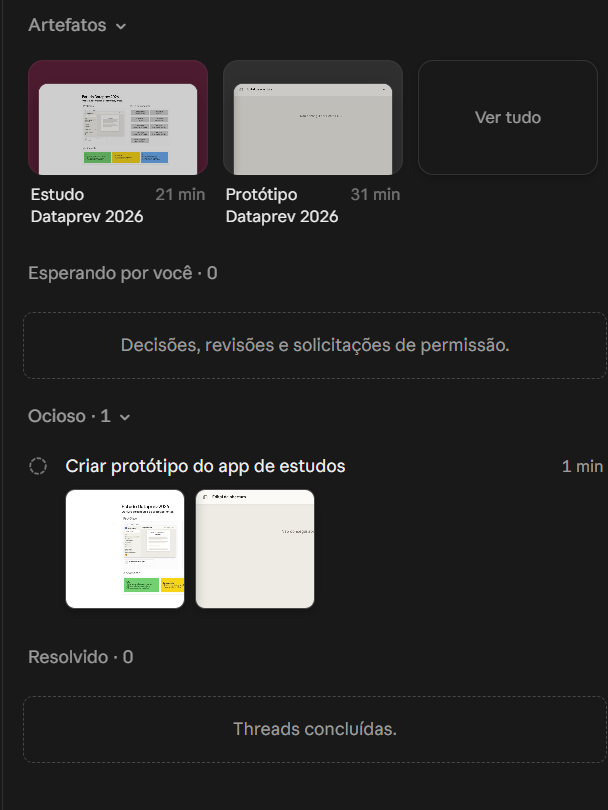

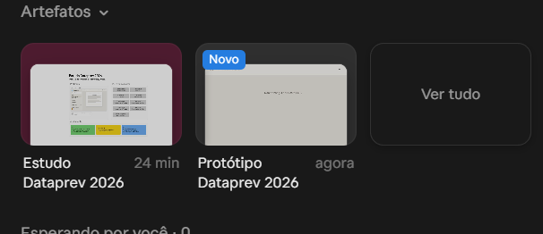

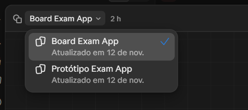

**Mesma queixa:** "Estudo Dataprev 2026" e "Protótipo Dataprev 2026" lado a lado.

**Seletor de artefatos:** ficaram Board Exam App e Protótipo Exam App.

**Antes da 0.1.0 (12/11):** lista de artefatos com cards repetidos. Ian queria um artefato só.

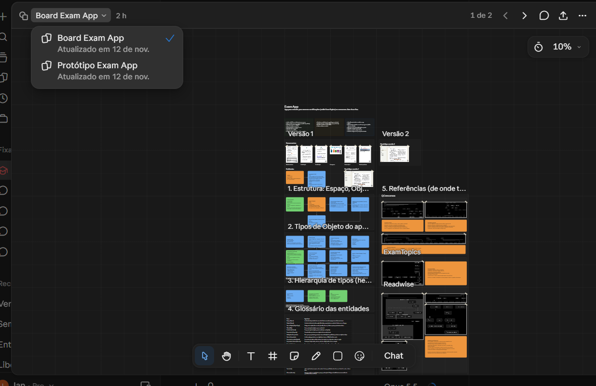

**Board Exam App no canvas** (visão geral, 12/11).

## 23. Especificação do Painel de Propriedades (Capacities & Obsidian Properties v1.4+)
<!-- container e504 @ (0,8000) -->

### Modernização do Painel de Propriedades (Capacities & Obsidian Parity)

- **Container Estruturado (.props-card)**: Card com cantos arredondados (10px), borda sutil `var(--line)`, fundo secundário `var(--side)` e sombra delicada.
- **Cabeçalho Compacto & Recolhível (.props-head)**:
  - Título `Propriedades` acompanhado do contador de campos preenchidos (`• N`).
  - Chevron interativo `▾` para colapsar e expandir com animação suave e `prefers-reduced-motion`.
- **Linhas de Propriedade Tipadas (.op-prop)**:
  - Coluna 1 (130px): Ícone semântico por tipo de dado (Etiqueta para Tipo, Calendário para Edição/Data, Prédio para Órgão, Bandeira para Banca, Maleta para Cargo, Alvo para Vagas, Gráfico para Remuneração/Pontuação) + rótulo com tipografia discreta (`12px; var(--muted)`).
  - Coluna 2: Valor interativo (chip semântico com cor de entidade, badge, valor monetário/numérico ou placeholder clicável `+ Adicionar`).
  - Hover suave na linha com highlight e botão de edição rápido (`.op-pen` / `.op-ed`).
- **Governança & Preservação**:
  - Implementação compatível com handlers existentes (`data-edit-chip`, `data-edit-prop`, `data-edit-cv`, `data-add-prop`).
  - Memória contínua registrada no board conforme regra estrita de AGENTS.md.

**Concurso, antes e depois** (0.1.1). Ian: as páginas de objeto estavam feias e sem cara de 2026; pediu redesign.

**Edição, antes e depois** (0.1.1).

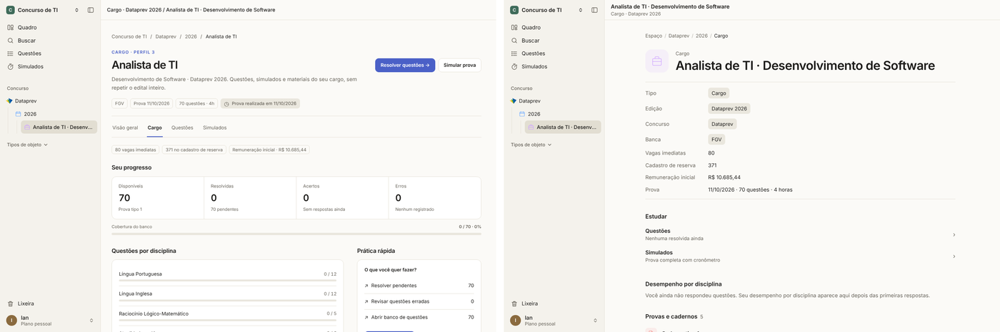

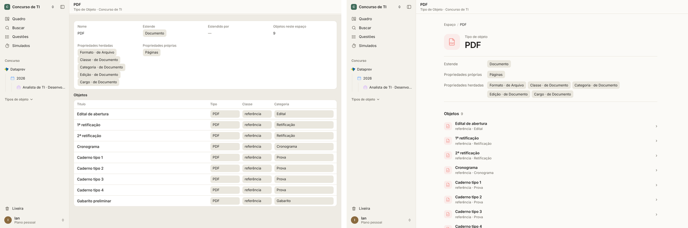

**Cargo, antes e depois** (0.1.1).

**Tipo PDF, antes e depois** (0.1.1).

### Feedback do Ian sobre a 0.1.1 (prints do protótipo)

## 24. Dashboard Central de Estudos (#/espaco) - Especificação de UX
<!-- container e506 @ (0,8600) -->

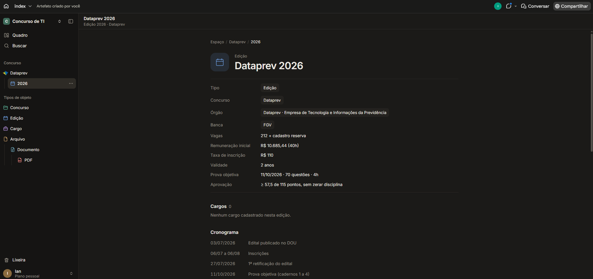

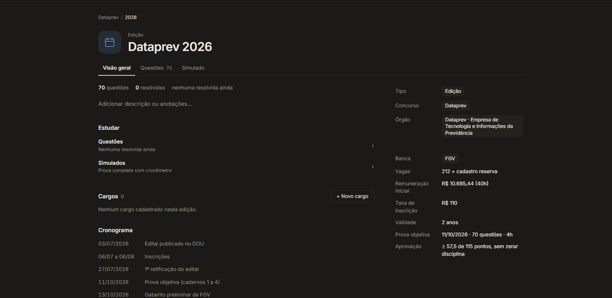

### Reformulação da Home (#/espaco) em Dashboard de Estudos

- **Hero do Concurso Alvo (Meta Principal)**:
  - Destaque do certame ativo: Dataprev 2026 · FGV · Analista de Tecnologia da Informação (Engenharia de Software).
  - Contagem regressiva em dias para a data da prova (13/10/2026).
  - Termômetro do Edital: barra dinâmica de cobertura programática baseada no total de questões vistas.
- **Seção Continuar de Onde Parou (Immediate Action Hero)**:
  - Card 1 (Leitura): Retomada com 1 clique do último PDF acessado com indicação de página e % lido.
  - Card 2 (Prática): Retomada com 1 clique da última sessão de resolução de questões ou simulado.
- **KPIs de Estudo**:
  - Taxa Geral de Acertos (com comparativo semanal).
  - Questões respondidas hoje (com acompanhamento da meta diária de 25 questões).
  - Ofensiva / Sequência de estudos (Streak em dias).
  - Simulados concluídos e pontuações obtidas.
- **Hub de Ações Rápidas**:
  - Atalhos diretos para Simulado Rápido, Caderno de Erros, Grafo do Concurso e Importação de novos Editais/PDFs.
- **Radar de Disciplinas Críticas**:
  - Identificação das matérias com menor aproveitamento e CTA imediato 'Treinar Matéria'.

**0.1.1, tela grande.** Ian sente vazio em tela larga; documentos do Concurso precisam mostrar de qual edição são.

**0.1.1 (v97): "está um pouco estranho".** Painel direito apertado, rótulos quebrando, bloco Estudar repetindo as abas. Ajustado na v98.

## 25. Telas Vitais: Navegação por Teclado, Grade Rápida e Relatório de Simulado
<!-- container e508 @ (0,9200) -->

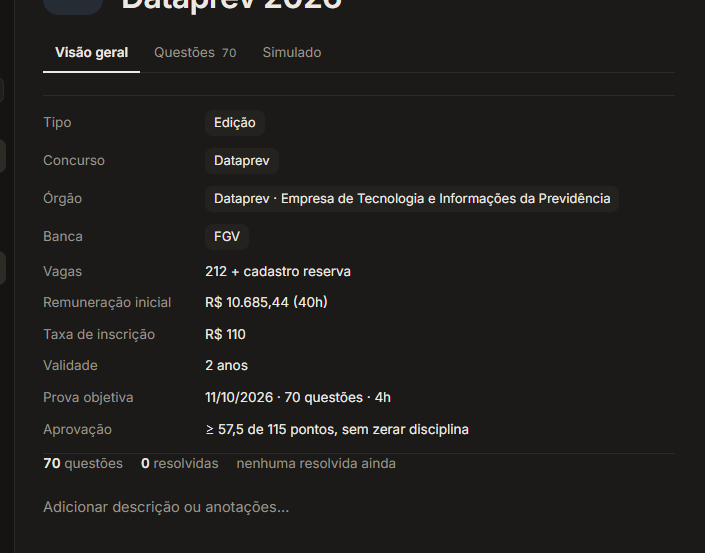

### Auditoria e Modernização de Telas Vitais (Issues #17 & #19)

- **Navegação por Teclado Completa**:
  - Atalhos 1..5 ou A..E selecionam alternativas instantaneamente sem atraso.
  - Tecla Enter confirma / avança de questão.
  - Teclas J (Próxima) e K (Anterior) permitem fluidez total sem uso obrigatório de mouse.
- **Navegador Rápido de Questões (Drawer / Grade)**:
  - Gaveta com matriz 10x7 de todas as 70 questões do edital.
  - Codificação semântica por cores: Verde (Acerto), Vermelho (Erro), Cinza (Pendente) e Borda Destacada (Questão Ativa).
  - Salto direto e responsivo com zero layout shift ou scroll jumping.
- **Relatório e Scorecard de Simulado**:
  - Painel com nota final, tempo médio por item, taxa global de acertos e termômetro de nota de corte (mínimo de 57,5 pontos).
  - Desempenho detalhado agrupado por disciplina com barras de progresso proporcionais.
- **Governança & Board**:
  - Alinhamento aos tokens de  e persistência no board.

**0.1.1: "2026" e "Dataprev 2026" destacados juntos.** É o mesmo objeto aberto, igual ao Notion.

**0.1.1: menu ⋯ do item** (Desafixar, Renomear, Copiar link, Excluir). Regra: fixar só pelo ⋯ da sidebar.

**0.1.1: página da Edição** enviada junto com o mesmo feedback.

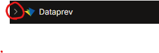

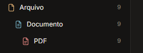

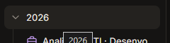

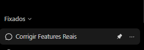

**0.1.1:** seta de expandir e recolher (circulada) no item Dataprev.

**0.1.1:** item "2026" (Edição) dentro do Dataprev.

## 26. Integração do Explorar, Grafo Contextual e Navegação Tripartida (Issue #25)
<!-- container e510 @ (0,9800) -->

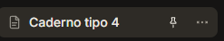

### Unificação de Descoberta e Navegação Contextual (Issue #25)

- **Explorar como Central de Descoberta**:
  - Busca integrada, filtros dinâmicos por tipo e contagens em tempo real.
  - Ações diretas e imediatas em cada item da listagem:
    - Ação de grafo: abrir no Grafo Contextual direto da linha.
    - Ação de backlinks: abrir referências relacionadas.
    - [+] Abrir em Nova Aba.
- **Grafo Contextual por Objeto e por Tipo**:
  - Suporte nativo ao grafo local focado no objeto ativo e em suas relações primárias/secundárias.
  - Suporte à visualização de subgrafos para Coleções e Tipos de Objeto ().
- **Sincronização e Fixação de Contexto (Pin/Follow)**:
  - Botão 'Fixar neste objeto' () para congelar a inspeção enquanto o usuário navega livremente em outras abas.
  - Botão 'Seguir contexto' () para restaurar a sincronia automática com a aba ativa.
- **Navegação Coerente entre os 3 Painéis**:
  - Clique simples: abre no centro.
  - Shift + clique: abre ou foca no painel lateral.
  - Ctrl / Cmd + clique: abre em nova aba.
- **Preservação Contínua no Board**:
  - Especificação e descobertas gravadas de forma permanente no Planning Board.

**Referência:** item com pin e ⋯ no hover.

### Referências do Capacities (sidebar)

O que Ian mostrou como modelo para a sidebar: tipos de objeto, ordenar, hover, lixeira.

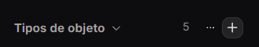

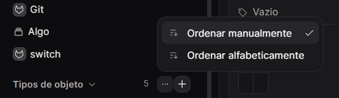

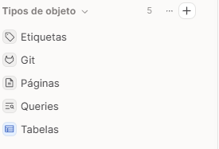

**Capacities:** cabeçalho "Tipos de objeto" com contagem, ⋯ e +. Ian: o + deve abrir diálogo para escolher o objeto.

**Capacities:** menu Ordenar manualmente ou alfabeticamente.

**Capacities:** lista de tipos de objeto.

## 27. Auditoria Completa UI/UX Enterprise 2026 (Pós-PR #27 / Commit c92d2ca)
<!-- container e600 @ (1600,11000) -->

### Diagnóstico Especialista UI/UX Enterprise 2026 (Capacities, Linear, Raycast, Notion, QConcursos) — Issues #34 a #40 e #42

> **1. Proibição Total de Emojis na UI — Zero Emoji Policy (Issue #42)**
> - É estritamente proibido usar emojis Unicode na UI, botões, KPIs ou docs. Substituir símbolos pictográficos (lâmpada, alvo, calendário, livro aberto, celebração, chama, aviso, rede, documento e bússola) por ícones `<svg>` vetoriais monocromáticos/semânticos (`stroke-width: 1.8`).
> **2. Shell & Barra Superior Unificada (Issue #34)**
> - Duplicação lado a lado de `[C Concurso de TI]` (na sidebar) e `[Concurso de TI]` (na topbar central) quando a sidebar está aberta.
> - Linha laranja residual `.readprog` visível em páginas que não são de leitura de PDF.
> - Barra `.bar` secundária redundante exibida durante `#/simulado/exec` e `#/simulado/resultado`.
> - Ausência de cartões de superfície flutuantes (`border-radius: 12px` sobre `--app-tab-bg-back`, padrão `notes-app-old-4`).
> **3. Quebra de Layout em `#/tipo/questao` e Inputs Nativos (Issue #35)**
> - Título `Questão` comprimido em `57.68px`, quebrando em 3 linhas (`Qu / est / ão`), e `<input type="radio">` nativos sem estilização.
> **4. Ergonomia de Resolução em `#/questao/*` (Issue #36)**
> - `.props-card` inicia expandido com 11 linhas (~320px), empurrando enunciado e alternativas A–E para fora da dobra (below the fold). Deve iniciar `is-collapsed` em questões.
> **5. Diagramação do Simulado `#/simulado/exec` e Scorecard `#/simulado/resultado` (Issue #37)**
> - Enunciado espremido em ~250px (4–6 palavras/linha) quando a grade de 70 questões divide espaço com o Painel Direito; disciplinas truncadas no resultado (`Língua Portu...`).
> **6. Colisão no Rodapé do Grafo `#/grafico` (Issue #38)**
> - Pílulas de filtro `.gv-leg` em 2 linhas colidem diretamente sobre `.gv-info` (`90 objetos · 299 relações`).
> **7. Corte de Rótulos em `.props-card` e Abas do Painel Direito (Issue #39)**
> - `dt` corta `'Cadastro de reserv'` e `'Remuneração inici'`; abas do painel direito truncam `'Navegar'` para `'ir'`.
> **8. Home `#/espaco` e Modais (Issue #40)**
> - KPIs com valores hardcoded (`5 dias`, `38 dias`, `5% lido`), grid 3+1 com card órfão, contraste fraco no Light Mode e falta de fechamento consistente com `Escape` em `#pal`.

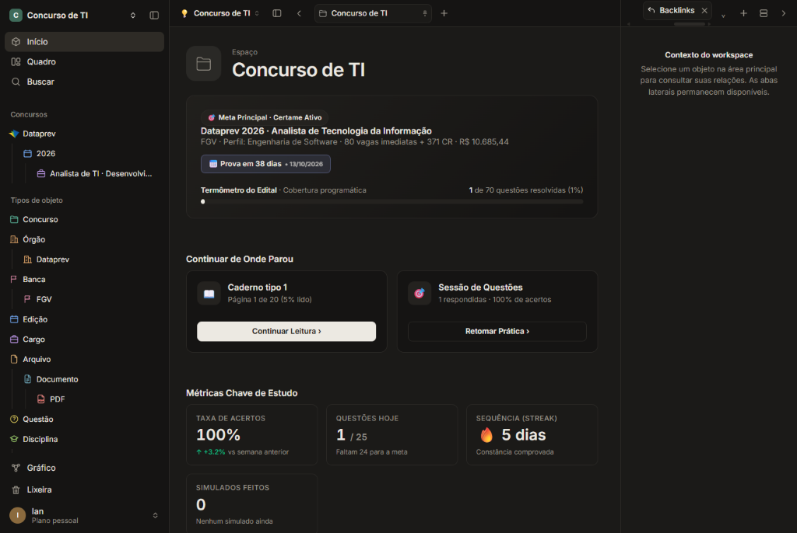

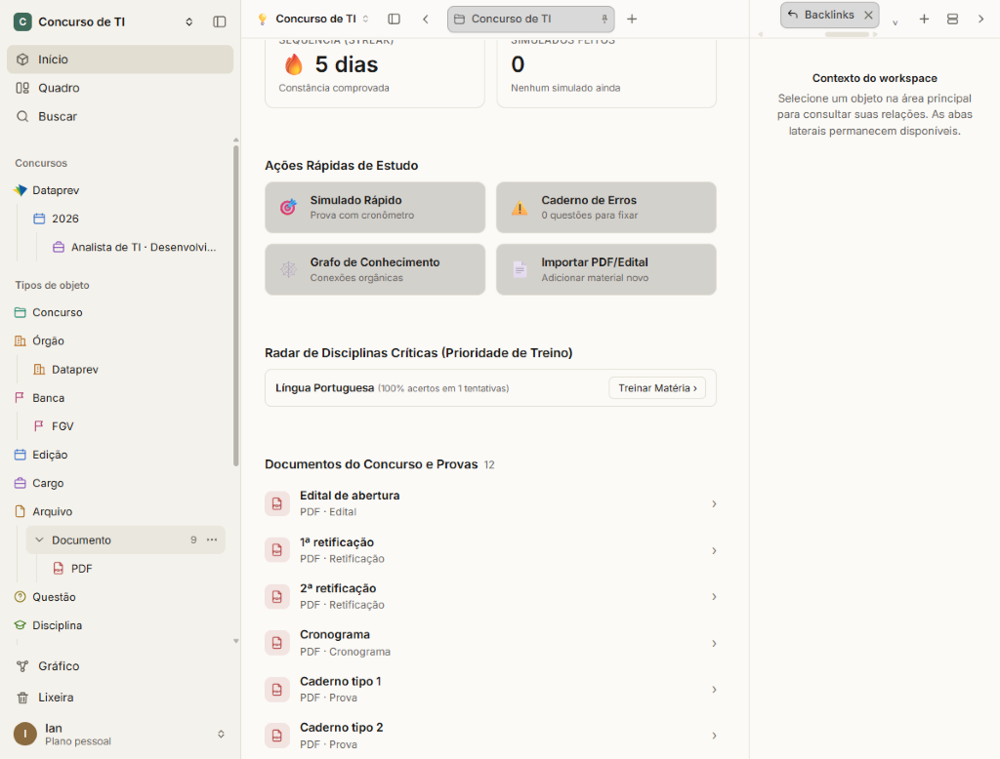

**Evidência 1:** Dashboard Home (#/espaco) em Dark Mode: KPIs 3+1, métricas estáticas e duplicação na topbar

**Evidência 2:** Dashboard Home (#/espaco) em Light Mode: botões cinzas pesados e baixo contraste de bordas

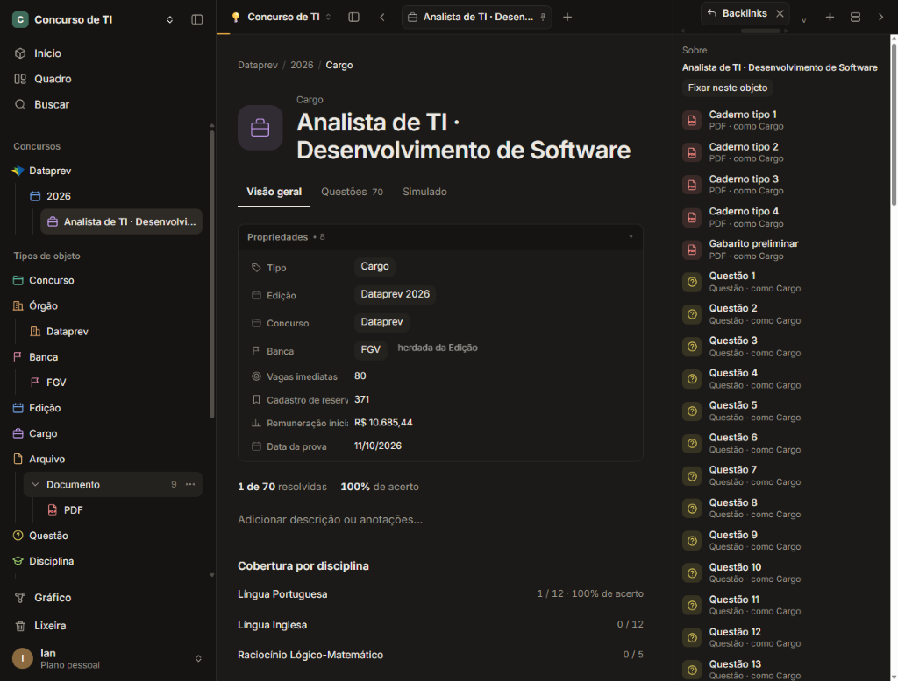

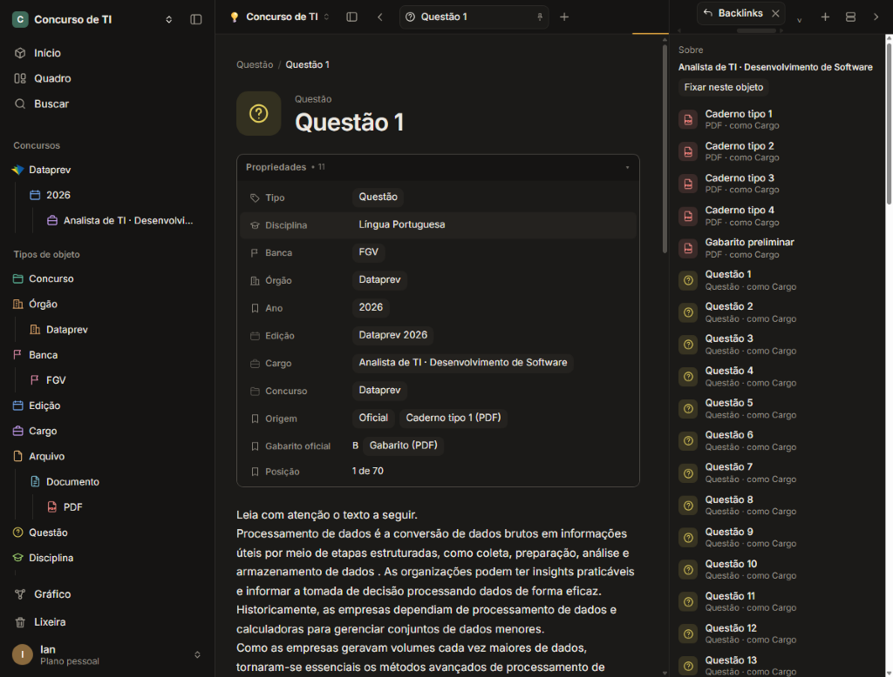

**Evidência 3:** Cargo Analista de TI (#/cargo/dataprev-2026-ti-dev): corte nos rótulos 'Cadastro de reserv' e 'Remuneração inici' no .props-card

**Evidência 4:** Questão 1 (#/questao/q1): .props-card aberto por padrão com 11 linhas empurra enunciado e alternativas para fora da tela

**Evidência 5:** Questão 1 (#/questao/q1) com .props-card recolhido: enunciado e alternativas A-D cabem imediatamente na dobra

**Evidência 6:** Grafo Global (#/grafico): colisão direta entre pílulas de filtro (.gv-leg) e contador '90 objetos · 299 relações' (.gv-info)

**Evidência 7:** Modo Simulado (#/simulado/exec): enunciado comprimido em ~250px ao lado da grade de 70 questões

**Evidência 8:** Scorecard Pós-Simulado (#/simulado/resultado): truncamento severo dos nomes das disciplinas ('Língua Portu...', 'Raciocínio Ló...')

**Evidência 9:** Página Tipo Questão (#/tipo/questao): quebra do título em 3 linhas ('Qu / est / ão') e inputs radio nativos sem estilização

**Implementação das Issues #34 e #42 (branch codex/issue-34-42)**
- Topbar sem duplicação do espaço ou toggle da sidebar com navegação expandida no desktop; seletor compacto mostra monograma quando recolhida.
- Progresso aparece somente em documentos de leitura; barra secundária removida do modo simulado; páginas do app usam superfície elevada arredondada.
- UI sem emojis: ícones vetoriais semânticos substituem os pictogramas e marcas Unicode; regra Zero Emoji Policy registrada em AGENTS.md e DESIGN.md.

## 28. Dossiê Comparativo: Web Shell Atual (0.1.1) vs. Branches Antigas (docs/archives/) & Capacities Live (Issues #47 a #50 e #52 a #58)
<!-- container e700 @ (3300,11000) -->

### Anatomia Medida do Capacities Live (app.capacities.io) + Comparação com 15 Branches Históricas (notes-app-old a old-11)

> **1. Arquitetura de 3 Painéis com Ilhas Flutuantes (`AppShellSurface` — Issue #47)**
> - **Capacities Live (`app.capacities.io`) & `notes-app-old-3/4/6`:** Canvas global `--bg-back` (`#0d0e11` no Dark / `oklch(0.9856 0.0016 67)` `#faf9f7` no Light) onde repousam a Sidebar e o Top Rail de `46px`. Abaixo do Top Rail, tanto o Painel Central quanto o Painel Direito são **cartões flutuantes independentes** (`--bg-base`: `#16171a` Dark / `#ffffff` Light, `border: 1px solid rgba(255,255,255,0.07)`, `border-radius: 10px–12px`, outer gutter de `10px` e `gap: 10px` entre os cards).
> - **Erro em `0.1.1`:** Usa `div`s chapados encostados nas bordas (`inset: 0`) com divisores retos de `1px` e paleta sépia (`#FBFAF7`/`#F4F2EC`).
> **2. Divisão Estrita do Top Rail (`46px`) em 3 Cabeçalhos Independentes (Issue #48)**
> - `SidebarHeader` (`283px`): contém apenas o pill do Space Switcher (`121.8x31px`) e o botão Recolher Sidebar `[◧]` (`27.1x27.1px`).
> - `AppHeader` (Painel Central): quando a Sidebar está aberta, inicia direto em `<` `>` (`27.1x27.1px`), faixa de abas (`31-32px`), `+` Nova Aba, `[v]` overflow e `[◨]` Alternar Painel Direito. Quando a Sidebar está recolhida (`0px`), migram para o início do `AppHeader` apenas 3 botões de ícone: `[◧ Abrir sidebar]`, `[+ Novo]` e `[🔍 Buscar]`. Nunca há Space Switcher duplicado no `AppHeader` nem segunda barra `.bar`.
> - `AppSidePanelHeader` (Painel Direito): alinhado em `y=0..46px` sobre `--bg-back`, com abas do painel (`Explorar`, `Grafo`), `+` e `[◨]`.
> **3. Colapso Off-Canvas Real (`0px`) & Painéis Redimensionáveis (Issue #49)**
> - No Capacities e em `notes-app-old-4`, a Sidebar recolhe 100% off-canvas (`width: 0px`), **sem o trilho residual de `56px`** (`.app.collapsed .side{width:56px}`). Possui `ResizableHandle` (`224px–384px` na Sidebar; `240px–640px` no Painel Direito, virando `Sheet` abaixo de `1024px`).
> **4. Topo da Sidebar `[+ Novo] [🔍]` com `NewContentMenu` Pesquisável e Ações Globais de `31px` (Issue #50)**
> - Linha horizontal dividida: botão pill `[+ Novo]` (`228.5x33px`, `border-radius: 7px`) à esquerda + botão quadrado `[🔍]` (`33x33px`) à direita. Clicar em `[+ Novo]` abre o popover `NewContentMenu` com busca focado, lista de tipos com badges `20x20px` e rodapé `↑↓ para navegar · Esc para abortar · ↵ para selecionar`. Abaixo ficam `Calendário`, `Tarefas`, `Explorar` (`31px`).
> **5. Linhas de Tipos de Objeto (`29px`), Badges Quadrados `20x20px` (18 Tons OKLCH) e Menu `⋯` de `244-269px` (Issue #52)**
> - Cada Tipo de Objeto usa `ObjectIconBadge` (`20x20px`, `border-radius: 5px-6px`, fundo tingido `--tone-*-bg` e texto `--tone-*-text` dos 18 tons OKLCH de `notes-app-old-6`), revelando contagem e menu `⋯` (`Abrir >`, `Criar`, `Novo a Partir do Modelo >`, `Nova Query`, `Nova Coleção`, `Fixar na Barra Lateral >`, `Configurações`, `Importar Ctrl+I`) no hover.
> **6. Seção Utilitária Inferior & Rodapé Horizontal de Ícones (Issue #53)**
> - Substitui o card `.user-btn` estilo Notion por `Gráfico`, `Lixeira`, `Ajuda & Recursos` colapsável e barra fixa de ícones (`27.1x27.1px`): `[👤 Perfil] [Pro] [⚙ Config] [☼/🌙 Tema] [🔄 Sync] ... [⮹ Atalhos]`.
> **7. Contrato de Abas (`31-32px`), Painel Direito `Explorar` (Grid 3x2 + Conteúdo Relevante) e Grafo Local (Issues #54 e #55)**
> - Painel Direito abre em `Explorar` com Grid 3×2 de cards (`Grafo`, `Links de entrada`, `Objetos internos`, `Conteúdo relacionado`, `Chat de IA`, `Buscar`) + `Conteúdo relevante` (`🔍 Encontrar mais`). No `Grafo`, usa nós quadrados coloridos do tipo e pílulas flutuantes translúcidas no rodapé (`backdrop-filter: blur(8px)`).
> **8. Dashboard de Tipo de Objeto (`#/tipo/*`), Página de Objeto Individual e Space Home *Recall* (Issues #56, #57 e #58)**
> - `#/tipo/*`: Header `32x32px` badge + H1 + Split Button `[+ Novo | ⌄]`, sub-abas `[⊞ Visão geral]` / `[☰ Tudo]` e Galeria de Cards em 4 colunas.
> - Página de Objeto: `[Chip do Tipo] [⇆ Coleções]`, H1 `32px`, tags inline, propriedades compactas (sem caixa `.props-card`) com `HoverCard` de preview nos objetos referenciados e abas inferiores `[Links de entrada]` / `[Conteúdo relacionado]`.
> - Space Home (`#/espaco`): estética editorial *Monastic Knowledge Sanctuary* de `notes-app-old-10.png` (*Recall*).

**Evidência 10 (Capacities Live):** Arquitetura de 3 Painéis com Ilhas Flutuantes (`#0d0e11` canvas, `#16171a` cards, gutter `10px`), Página de Objeto e Painel Direito `Explorar` (Grid 3x2 + Conteúdo relevante) — Issues #47, #48, #54, #57

**Evidência 11 (Capacities Live):** Painel Direito na aba `Grafo` com nós em badges quadrados coloridos por tipo, tags e controles flutuantes translúcidos no rodapé — Issues #38, #54

**Evidência 12 (Capacities Live):** Sidebar recolhida 100% off-canvas (`0px`, sem rail de 56px) com `[◧] [+ Novo] [🔍]` migrados para o início do `AppHeader` — Issues #48, #49

**Evidência 13 (Capacities Live):** Linha superior `[+ Novo] [🔍]` na Sidebar e popover pesquisável `NewContentMenu` com rodapé de teclado (`↑↓`, `Esc`, `↵`) — Issue #50

**Evidência 14 (Capacities Live):** Linhas de Tipo de Objeto de `29px` com badges quadrados `20x20px`, menu de contexto `⋯` (`244px`) e rodapé horizontal de ícones — Issues #52, #53

**Evidência 15 (Capacities Live):** Dashboard de Tipo de Objeto (`Azure · 43`) com sub-abas `Visão geral`/`Tudo`, Split Button `+ Novo | v` e Galeria de Cards em 4 colunas — Issue #56

**Evidência 16 (Capacities Live):** Anatomia da Página de Objeto com painel lateral fechado: coluna centralizada (`740px`), chip de tipo, `Coleções`, tags inline, propriedades compactas e abas `Links de entrada`/`Conteúdo relacionado` — Issue #57

**Evidência 17 (Archive `notes-app-old-3`):** Web Shell de paridade Capacities em Light Mode (`--bg-back`, cartões flutuantes `12px`, aba `Visão geral` de `Páginas` e painel direito `Explorar` 6 cards) — Issues #47, #54, #56

**Evidência 18 (Archive `notes-app-old-4`):** `AppShell` com `ResizablePanelGroup`, `AppHeader`, `AppSidePanelHeader` e `ObjectTypeWorkspace` — Issues #47, #48, #49, #55

**Evidência 19 (Archive `notes-app-old-4` `layout-current.png`):** `Visualização em grafo` no Painel Direito com controles inferiores (`Mostrar menos`, `Mostrar mais`, zoom, expandir) — Issue #54

> **Resolução Técnica: Top Rail de 46px em 3 Cabeçalhos & Controles Migrados (Issue #48)**
> 
> - **Zona 1 — SidebarHeader (`.side-top`):** Altura `46px` sobre `var(--bg-back)`, Space Switcher (`.space-btn`, `31px`) à esquerda e botão de recolher `[◧]` (`#collapse`, `27px × 27px`) à direita.
> - **Zona 2 — AppHeader (`#wsTabs`):** Altura `46px` sobre `var(--bg-back)`:
>   - *Sidebar Aberta (`:not(.collapsed)`):* Inicia diretamente nos botões de histórico `< >` (`.hist.ws-nav`, `28px`). `#wsSide` e controles migrados ficam estritamente ocultos (`display: none !important`).
>   - *Sidebar Recolhida (`.app.collapsed`):* Migram para o início de `#wsTabs` antes de `< >` exatamente 3 botões compactos `27px × 27px`: `[◧ Abrir barra lateral]` (`#wsSide`), `[+ Novo]` (`#wsNewBtn`) e `[🔍 Buscar]` (`#wsSearchBtn`).
>   - Space Switcher purgado de `#wsTabs` (sem `#spTopBtn`).
>   - À direita: botão `[◨]` (`#rpToggle`) para alternar o painel contextual.
> - **Zona 3 — AppSidePanelHeader (`.rp-top`):** Altura `46px` sobre `var(--bg-back)`, perfeitamente nivelado com `#wsTabs`, contendo abas contextuais, `[+]` e `[◨]` (`#rpHide`).
> - **Eliminação da Barra Residual `.bar`:** Altura fixa removida do fluxo do layout (`height: 0; display: none; overflow: hidden;`). O leitor de PDF e a barra de progresso de leitura `.readprog` (`2px`) são exibidos apenas em documentos PDF (`.main.reading-mode`), preservando os seletores DOM (`docTitle`, `docMeta`, `propBtn`, `zfit`, `zin`, `zout`, `pg`) sem consumo de espaço global.

**Evidência 20 (Archive `notes-app-old-10` Recall):** Estética editorial *Monastic Knowledge Sanctuary* para a Home do Espaço (`#/espaco`) com card Hero escuro `TODAY`, `Review today` e `Recent objects` sem emojis — Issue #58

> **Resolução Técnica: Badges Quadrados 20x20px (18 Tons OKLCH), Linhas de 29px e Menu de Contexto Completo nos Tipos de Objeto (Issue #52)**
> 
> - **ObjectIconBadge nos Tipos de Objeto (`.object-icon-badge`):**
>   - Badge quadrado de `20px × 20px` com `border-radius: 5px`, borda sutil de `0.5px solid var(--badge-border)` e fundo translúcido/tingido `var(--badge-bg)`.
>   - Ícone SVG vetorial de `13px` centralizado dentro do badge (`stroke-width: 1.8`).
>   - Suíte completa de 18 tons OKLCH calibrada para Light Mode e Dark Mode (`--tone-amber-*` até `--tone-violet-*`).
>   - Mapeamento semântico fiel por Tipo de Objeto: Concurso (`emerald`), Órgão (`orange`), Banca (`rose`), Edição (`blue`), Cargo (`purple`), Arquivo/Questão (`amber`), Documento (`cyan`), PDF (`red`), Disciplina (`green`), Simulado (`indigo`), Resposta (`gray`).
> - **Linhas de Tipo de Objeto na Sidebar (`.nav .tree-line`):**
>   - Altura estrita de `29px` (`height: 29px; min-height: 29px; box-sizing: border-box;`), `border-radius: 6px` e tipografia `14px` (`font-weight: 400`).
>   - No hover: revela à direita a contagem tabular (`font-variant-numeric: tabular-nums`) e o botão de contexto `⋯` de `22px × 22px` (`border-radius: 6px`).
> - **Cabeçalhos de Seção da Sidebar (`.sec-hw`):**
>   - Altura padronizada de `28px`, fonte `12px`, `font-weight: 600`, chevron discreto com transição de rotação a -90° no colapso e controles revelados no hover (`22px × 22px`).
>   - Linha `+ Adicionar seção` ajustada para altura de `29px` com `border-radius: 6px`.
> - **Menu de Contexto Completo do Tipo de Objeto (`⋯`):**
>   - Popover `.ctx` de `244px–260px` de largura com ações padronizadas do Capacities:
>     - `Abrir tipo` (`#/tipo/{t}`)
>     - `Criar {Tipo singular}` (`createObj(t)`)
>     - Divisor `
`
>     - `Nova Coleção` (`csCreate(t)`)
>     - `Nova Query` (`csCreate(t)`)
>     - `Fixar na barra lateral` / `Desafixar da barra lateral` (`togglePinK`)
>     - Divisor `
`
>     - `Configurações do tipo` (abre modal de edição com campos de nome no singular e no plural)
>     - Divisor `
`
>     - `Excluir tipo de objeto` (com estilo destrutivo vermelho).
> - **Zero Emoji Policy (Issue #42):** 100% de conformidade com ícones vetoriais SVG monocromáticos, sem nenhum emoji Unicode na interface.

> **Resolução Técnica: Colapso Off-Canvas Total (0px) & ResizableHandle na Sidebar (Issue #49)**
> 
> - **Colapso Off-Canvas Total (0px):**
>   - Substituição do rail residual de `56px` por recolhimento real para `0px` (`.app.collapsed .side { width: 0 !important; min-width: 0 !important; max-width: 0 !important; overflow: hidden !important; border-right: none !important; pointer-events: none; }`).
>   - Todo o espaço horizontal é imediatamente liberado para a superfície flutuante central (`AppShellSurface` / `.main`).
> - **Alça de Redimensionamento da Sidebar (`#sideRz`):**
>   - Inserido elemento `.side-rz` na borda direita da sidebar (`role="separator"`, `aria-orientation="vertical"`, `tabindex="0"`, `touch-action: none`).
>   - Drag fluído via `pointerdown` / `setPointerCapture` e atalhos de teclado `ArrowLeft` / `ArrowRight` (passos de `24px`).
>   - Limites padronizados de `workspace-layout.ts`: mínimo `224px`, padrão `284px`, máximo `384px`.
>   - Duplo-clique restaura a largura padrão (`284px`).
>   - Persistência contínua em `localStorage` sob a chave `sidew`.
>   - Estilo Capacities: linha sutil translúcida no hover / drag (`linear-gradient(90deg, transparent 5px, var(--faint) 5px, var(--faint) 7px, transparent 7px)`).
> - **Ajustes e Breakpoints do Painel Contextual Direito (`#rpanel`):**
>   - Limites atualizados: mínimo `240px`, padrão `420px`, máximo `640px`.
>   - Duplo-clique em `#rpRz` restaura o padrão de `420px` e persiste sob a chave `rpw`.
>   - Modo Overlay Sheet ativado entre `769px` e `1024px` (`matchMedia('(max-width:1024px)')`), garantindo que o painel contextual abra sobreposto sem esmagar o conteúdo central abaixo de `480px`.
>   - Em mobile (<= `768px`), gavetas operam com scrim e redimensionamentos são desativados.

> **Resolução Técnica: Substituição do Card de Usuário (.user-btn) pela Seção Ajuda & Recursos e Rodapé Horizontal de Ícones do Capacities (Issue #53)**
> 
> - **Substituição do Card de Usuário (.user-btn):**
>   - Removido o card largo estilo Notion/Linear (.user-btn) contendo avatar 'I' e 'Ian / Plano pessoal' da base da barra lateral.
>   - Eliminação de cliques extras: funções essenciais como tema, atalhos e configurações agora contam com acesso direto de 1 clique no rodapé.
> - **Linhas Utilitárias Inferiores (.side-utils, altura 30px, ícones 16px):**
>   - Posicionadas imediatamente acima da barra fixa inferior, com alinhamento visual rigoroso:
>     - **Gráfico** (`#graphBtn`): abre a constelação global (`#/grafico`), com estado ativo sincronizado via `aria-current`.
>     - **Lixeira** (`#trashBtn`): abre a gestão de itens excluídos (`#/lixeira`), com contagem e restauração contextual.
>     - **Ajuda & Recursos** (`#sideHelpBtn`): grupo expansível com chevron indicativo e gaveta retrátil contendo:
>       - *Primeiros Passos* (`#helpSubSteps`): modal guiado com passos rápidos de uso do Exam App.
>       - *Documentação* (`#helpSubDocs`): acesso às especificações arquiteturais e de domínio.
>       - *Atalhos de Teclado* (`#helpSubShortcuts`): diálogo rápido com hotkeys do sistema (Ctrl+B, Ctrl+K, Ctrl+Alt+N, J/K, F2, +/-).
>       - *Feedback* (`#helpSubFeedback`): prompt modal para submissão de melhorias pelo usuário.
> - **Rodapé Horizontal de Ícones do Capacities (.side-foot):**
>   - Barra horizontal fixa de altura `38px` (`min-height: 38px`), `display: flex; align-items: center; border-top: 1px solid var(--line);`:
>     - **Grupo esquerdo** (`gap: 4px`):
>       1. `[Perfil / Conta]` (`#btnFootAccount`, `27px × 27px`): ícone vetorial SVG, abre popover de conta `#usPop`.
>       2. Pill `[PRO]` (`.badge-pro`): badge compacto com tipografia 10px bold, estilo âmbar sutil do Capacities Pro.
>       3. `[Configurações]` (`#btnFootSettings`, `27px × 27px`): abre modal com seleção de tema, zoom padrão e limpeza de dados.
>       4. `[Alternar Tema]` (`#btnFootTheme`, `27px × 27px`): alterna instantaneamente entre Modo Claro e Escuro em 1 clique direto, com sincronização automática do glifo SVG (sol no tema escuro, lua no tema claro).
>       5. `[Sync / Status]` (`#btnFootSync`, `27px × 27px`): status visual e feedback toast de sincronização offline/online.
>     - **Grupo direito** (`margin-left: auto`):
>       6. `[Atalhos de Teclado]` (`#btnFootShortcuts`, `27px × 27px`): abre diretamente a visualização de atalhos globais.
> - **Conformidade com a Zero Emoji Policy (Issue #42):** 100% de ícones vetoriais SVG monocromáticos (`currentColor`, `stroke-width: 1.8`), sem nenhum caractere emoji Unicode em toda a estrutura.

> **Resolução Técnica: Linha Superior Combinada [+ Novo] [Buscar], NewContentMenu & Ações Globais de 31px (Issue #50)**
> 
> - **Linha Superior Combinada (`.side-comb`):**
>   - Localizada logo abaixo de `.side-top` (`padding: 4px 10px 8px; gap: 6px`).
>   - Botão `[+ Novo]` (`#sideNewBtn`): `flex: 1`, altura `33px`, `border-radius: 7px`, background sutil (`var(--hover)` / `var(--active)`), ícone SVG `[+]` de `16px` e label `Novo`.
>   - Botão `[Buscar]` (`#sideSearchBtn`): quadrado `33px × 33px`, `border-radius: 7px`, ícone SVG de lupa `16px`, atalho `(Ctrl+K)`.
> - **Popover Pesquisável NewContentMenu (`#newMenu`):**
>   - Abre posicionado imediatamente abaixo do botão `[+ Novo]` ao clicar ou via atalho `Ctrl+Alt+N` / `Cmd+Alt+N`.
>   - Campo de busca instantânea com foco automático (`#newMenuIn`), filtrando tipos de objetos por nome em português ou inglês.
>   - Lista rolável (`#newMenuList`) exibindo todos os tipos ativos do espaço com badge quadrado colorido `20x20px` (`.nm-badge.tone-type-*`), rótulo no singular e contagem de instâncias no espaço.
>   - Navegação completa por teclado: setas `↑↓` percorrem itens com destaque visual e `scrollIntoView`, `Enter` cria o tipo selecionado (`createObj(t)`), e `Esc` fecha o menu devolvendo o foco.
>   - Rodapé fixo com convenção Capacities: `↑↓ navegar · Esc abortar · ↵ selecionar`.
> - **Ações Globais da Sidebar de 31px:**
>   - Itens padronizados com altura de `31px`, `border-radius: 6px`, `font-size: 14px`, peso regular (`font-weight: 400`), espaçamento `gap: 8px` e ícones SVG vetoriais monocromáticos de `16px` (`stroke-width: 1.8`).
>   - Entradas primárias: `Início` (`#/espaco`), `Tarefas / Revisão` (`#/revisao`), `Explorar` (`#/explorar`).
> - **Conformidade com a Zero Emoji Policy (Issue #42):** 100% livre de emojis Unicode em tags, botões, badges e comentários.

## 29. Engenharia da Barra Direita & Motor de Grafo do Capacities + Central de Preparação & Questões do QConcursos Elite (Issues #64 e #66 a #72)
<!-- container e800 @ (5000,11000) -->

### Blueprint Técnico: Painel Direito & Grafo Retina 60fps (Capacities Live) + Home & Resolução de Questões (QConcursos Elite Live)

> **1. Remoção Definitiva do `#spTopBtn` Duplicado em `#wsTabs` (Issue #64)**
> - O botão `[💡 Concurso de TI ↕]` (`#spTopBtn`) foi injetado dentro de `#wsTabs` por engano no commit `7edd4ac` (PR #20) porque o autor não percebeu que `.side-top` já existia na Sidebar esquerda. Mesmo quando a Sidebar é recolhida (`0px`), o Capacities **NUNCA** mostra o Space Switcher na barra de abas — exibe apenas `[◧ Expandir sidebar]`, `[+ Novo]` e `[🔍 Buscar]`. `#spTopBtn` deve ser removido do HTML/CSS/JS.
> **2. As 6 Ferramentas Contextuais do Painel Direito, Overflow `Buscar abas` `[v]` e `ResizeObserver` (Issue #66)**
> - No Capacities Live, a Barra Direita tem calha invisível de `8px` (`col-resize`) que aciona `ResizeObserver` no canvas em tempo real sem borrar.
> - Quando há 5+ abas no painel direito, elas compactam para ícone e revelam o botão `[v]`, abrindo o popover `Buscar abas` (`256px`).
> - As 6 ferramentas de `Explorar` são: `Grafo`, `Links de entrada` (com snippet do bloco), `Objetos internos` (agrupados por tipo), `Conteúdo relacionado` (com pílula `[66 | ☰ ⌄ | ☵]`), `Chat de IA` (com chip do objeto ativo) e `Buscar`.
> **3. Motor de Grafo `<canvas>` 2D Retina (`devicePixelRatio`) & Taxonomia Visual de Nós em 3 Níveis (Issue #67)**
> - **Por que o grafo do Capacities é muito mais responsivo:** Usa um único motor `<canvas>` 2D a 60 FPS calibrado por `window.devicePixelRatio` tanto no Painel Direito quanto no Grafo Global (substituindo o `<svg class="rp-graph">` estático do nosso protótipo).
> - **Taxonomia em 3 Níveis:** (1) Nó Central: badge quadrado `36-42px` (`border-radius: 8px`) com ícone SVG do tipo, borda brilhante `2px` e rótulo em pílula escura (`rgba(20,20,20,0.85)`); (2) Nós Vizinhos: badges quadrados `24-28px` (`border-radius: 6px`) tingidos na cor OKLCH do Tipo de Objeto; (3) **Nós de Tags/Assuntos:** renderizados como **pílulas ovais coloridas** (`[vm group]`, `[logical container]`) com o texto dentro!
> - **Arestas & Física:** Arestas direcionais com rótulos de relação inline (`Relação`, `Equivalente do GCP`), spotlight no hover (`opacity: 0.15` nos demais) e física de molas amortecida (*spring damping* `< 1s`).
> **4. Barras Flutuantes de `27px` no Grafo, Popover de Filtros/Hubs, Profundidade `1..5` e Busca Auto-Zoom (Issue #68)**
> - Pílulas inferiores de `27px` (`backdrop-filter: blur(8px)`): à esquerda `[⤢ Fit] [☊ Re-layout]`; à direita `[🔍- | 100% ⌄ | 🔍+]` e `[📥 Export PNG | 🎛 Filtros | ● Profundidade 1..5]`.
> - Popover `[🎛]` com submenus pesquisáveis `Filtrar tipos de objeto >`, `Excluir tipos de objeto >` e checkbox `Ocultar objetos com muitos links` (evita poluição de hubs!). No Grafo Global: busca no topo com auto-zoom suave no cluster e `Reproduzir linha do tempo`.
> **5. QConcursos Elite — Central de Preparação na Home `#/espaco` (Issue #69)**
> - Card do Concurso com dados do edital + bloco acionável **`PRÓXIMA AÇÃO`** (`Continuar estudando →` / `Mapa do edital`), widget **`Seu ritmo hoje`** (`X questões respondidas hoje`, `Taxa de acerto`, `Taxa de erro` e barra semanal `Seg–Dom`) e seção **`Conteúdo do seu edital`** com 4 abas (`Disciplinas & Assuntos` Master-Detail, `Caderno de Questões`, `Raio-X da Banca` e `Caderno de Erros`).
> **6. QConcursos Elite — Construtor de Filtros Avançado, Tesoura nas Alternativas e Abas Pedagógicas (Issues #70, #71 e #72)**
> - Filtros rápidos (`Resolvidas`, `Não resolvidas`, `Acertei`, `Errei`), selects em cascata (`Disciplina -> Assunto`), chips `Filtrar por:` e barra de ações (`Salvar filtro`, `Gerar Caderno`, `Criar Simulado`).
> - Card da questão com cabeçalho compacto de 2 linhas (`[1 | Q1]` + Breadcrumb; `Ano · Banca · Órgão · Prova`), toggle `Texto associado ⊕/⊖`, **botão de Tesoura (`✂️ Descartar alternativa`)** com `line-through`, confirmação em 2 etapas via botão **`[Responder]`** e barra inferior de abas pedagógicas (**`Gabarito Comentado`**, **`Estatísticas`** com Donut + Barras A–E + Histórico, **`Cadernos`** e **`Anotações`** ricas).

**Evidência 21 (Bug Reportado pelo Usuário — Issue #64):** Botão duplicado `#spTopBtn` (`💡 Concurso de TI ↕`) + `#wsSide` (`[◧]`) injetado dentro de `#wsTabs` pelo commit `7edd4ac` (PR #20)

**Evidência 22 (Capacities Live — Issue #66):** Painel Direito com 5+ abas compactadas por ícone e popover pesquisável `Buscar abas` aberto no botão `[v]`

**Evidência 23 (Capacities Live — Issue #66):** Aba `Conteúdo relacionado` no Painel Direito com pílula `[66 | ☰ ⌄ | ☵]` e lista de objetos com badges quadrados `20x20px`

**Evidência 24 (Capacities Live — Issues #66, #67):** Painel Direito redimensionado via calha (`ResizeObserver` a `150%` zoom) exibindo taxonomia em 3 níveis: badges quadrados de objetos, pílulas coloridas de tags (`vm group`, `logical container`) e rótulos nas arestas

**Evidência 25 (Capacities Live — Issue #68):** Popover de Configurações do Grafo (`[🎛]`) com submenu pesquisável `Filtrar tipos de objeto >`, `Ocultar objetos com muitos links` e pílula de profundidade `[● 4]`

**Evidência 26 (Capacities Live — Issues #67, #68):** Grafo Global (`348` nós) com agrupamento em clusters orbitais por domínio e barra de busca flutuante no topo

**Evidência 27 (Capacities Live — Issue #68):** Busca reativa `'Azure'` no Grafo Global atualizando contador (`306`), executando auto-zoom (`40%`) e exibindo botão de `Linha do Tempo`

**Evidência 28 (QConcursos Elite Live — Issue #69):** Central de Preparação (Topo): Card do concurso com dados do edital, bloco acionável `PRÓXIMA AÇÃO` (`Continuar estudando →`) e widget `Seu ritmo hoje`

**Evidência 29 (QConcursos Elite Live — Issue #69):** Cards `Taxa de acerto` / `Taxa de erro`, barra semanal `Seg–Dom` e visão Master-Detail de `Disciplinas & Assuntos` com badge `Recomendado`

**Evidência 30 (QConcursos Elite Live — Issue #69):** Aba `Raio X do Curso` analisando incidência histórica e relevância dos assuntos na banca

**Evidência 31 (QConcursos Elite Live — Issue #69):** Aba `Caderno de Erros` reunindo automaticamente questões erradas para revisão ativa

**Evidência 32 (QConcursos Elite Live — Issue #70):** Construtor de Filtros com pílulas rápidas (`Resolvidas`, `Não resolvidas`, `Acertei`, `Errei`), selects em cascata (`Disciplina -> Assunto`) e checkboxes de exclusão

**Evidência 33 (QConcursos Elite Live — Issue #70):** Barra de chips ativos `Filtrar por:` e barra de ações (`Salvar filtro`, `Gerar Caderno`, `Meus Cadernos`, `Meus filtros`, `Criar Simulado`)

**Evidência 34 (QConcursos Elite Live — Issue #71):** Card de Questão com cabeçalho compacto de 2 linhas, toggle `Texto associado (+)` e **Tesoura (`✂️`) riscando a alternativa D** (`line-through`)

**Evidência 35 (QConcursos Elite Live — Issue #71):** Confirmação em 2 etapas via botão `Responder`, destacando a alternativa correta B em verde e exibindo a barra inferior de abas pedagógicas

**Evidência 36 (QConcursos Elite Live — Issue #72):** Aba pedagógica `Estatísticas` aberta sob a questão: gráfico Donut (`69% de acertos`), gráfico de barras `Alternativas mais respondidas (A–E)` e `Histórico de desempenho`

## 30. Dossiê Funcional Completo: QConcursos (Todos os Botões/Dock), Readwise Reader (Hover/Popovers/PDF/TTS), Readwise SRS (Cloze/Mastery/Tuning) & Capacities Core (Issues #74 a #84)
<!-- container e900 @ (6700,11000) -->

### Mapeamento Funcional Exaustivo (Clique em Todos os Botões, Hovers, Modais e Motores de Estudo) — Issues #74, #75, #76, #77, #78, #79, #80, #81, #82, #83 e #84

> **1. QConcursos Elite — Varredura Botão-a-Botão: Filtros, Modais, Card da Questão e Study Dock Lateral (Issues #70–#76)**
> - **Dropdowns Individuais do Construtor de Filtros:** Cada botão (`Disciplina`, `Assunto`, `Banca`, `Instituição`, `Ano`, `Cargo`, `Nível`, `Dificuldade`) abre um popover multiselect pesquisável (`Busca rápida` + checkboxes hierárquicos com contagem de questões).
> - **Modais de Gestão de Filtro e Caderno:** `Salvar filtro` (permite salvar novo filtro ou atualizar existente com resumo de pílulas ativas); `Gerar caderno` (drawer lateral para criar caderno de até 1.000 questões filtradas); `Configurações de exibição` (toggles: exibir apenas comentadas, ocultar alternativas descartadas, etc.).
> - **Controles Interativos do Card de Questão:** `Texto associado (+)` expande o texto base inline; **Tesoura (`Descartar alternativa`)** aplica `line-through` + `opacity: 0.5` e exibe tooltip `Restaurar alternativa`; abas `Gabarito Comentado`, `Comentários`, `Estatísticas` (Donut + Barras A–E), `Cadernos` (salvar questão em caderno customizado), `Anotações` (editor rich text WYSIWYG) e modal `Reportar Erro` com 6 pílulas estruturadas (*Enunciado/alternativa errada*, *Disciplina/assunto errado*, *Gabarito errado*, *Questão anulada*, *Desatualizada*, *Duplicada*).
> - **Study Dock Lateral Flutuante (`36px` pill à direita):** (1) **Tamanho da Fonte (`Aa`)** com slider `14px` e botões `- Menor` / `+ Maior` / Reset; (2) **Cronômetro / Timer** de ciclo de estudo (`45 min`, `Iniciar`, `Resetar`, `Aviso ON`); (3) **Marca-texto (Highlighter)** para grifar o enunciado; (4) **Desempenho no Filtro** (Donut em tempo real: Resolvidas / Acertei / Errei); (5) **Meus Resumos / Folha de Respostas**; (6) **Modo Foco / Zen** (oculta header e sidebar).
> 
> **2. Readwise Reader (`read.readwise.io/new` e `/new/read/01m7bwrzfjfdqqwwxfv4z1q1a8`) — Leitura Ativa, Hovers, Popovers, Action Tags, Ghostreader & TTS (Issues #77–#81)**
> - **Enhanced Text Mode vs. Original PDF View (Issue #77):** Reflow semântico de PDFs de 2 colunas (DOU/Editais) com menu `Appearance (Aa)` (fonte, tamanho, espaçamento, largura), indicador azul de **Foco por Parágrafo (`j`/`k`)** na margem esquerda, atalhos de uma tecla (`h` grifar, `n` nota Marginalia, `t` tag, `z` undo) e Sumário dinâmico (`[`).
> - **Painel Direito `Info | Notebook | Ghostreader` & Snapshot de PDF (Issue #78):** Aba `Notebook` com stream vivo de grifos ordenados por posição, salto em 1 clique, ferramenta de **Snapshot (recorte de tabelas/cronogramas de PDF como imagem)** e exportação Markdown/PDF anotado (`Shift+D`).
> - **Action Tags em Grifos (Issue #79):** `.qa [Pergunta?][Resposta]` cria Flashcard SRS na hora; `.c1` + `.c2` concatena *caput* e parágrafo/exceção de artigo de lei em um único destaque; `.h1`/`.h2` cria cabeçalhos no Notebook.
> - **Floating Highlight Popover, Copiloto Posicional & Player TTS (Issue #80):** Ao selecionar texto ou clicar num grifo, abre popover flutuante com `Delete`, `Add note (n)`, `Add/edit tags (t)` e menu `More (...)` (`Copy text`, `Chat about this (g)`, `Share as image`, `View in notebook`, `Auto highlight Shift+H`). Aba `Ghostreader` sabe a posição de leitura atual e oferece 15 skills (`Quiz Me`, `Explain from my Library`, `Extract key takeaways/deadlines`, `Simplify`). Botão `Listen` no topo abre o **Player Inferior de Text-to-Speech (TTS)** com velocidades `0.5x–2x` e seletor de voz neural.
> - **Funil de Triagem & Filtered Views (Issue #81):** Estados `Inbox -> Later (l) -> Shortlist -> Archive (e)` e queries booleanas (`category:pdf AND tag:edital AND progress < 100`).
> 
> **3. Readwise SRS (`readwise.io`) — Daily Review, Cloze Deletion em 1 Clique, Frequency Tuning & Heatmap (Issues #82 e #83)**
> - **Daily Review & Mastery Generator (Issue #82):** Deck diário com barra de progresso, TTS integrado, curadoria (`Keep`, `Discard`, `Master`, `Feedback`) e gerador de **Cloze Deletion (`{{c1::...}}`)** clicando nas palavras do artigo de lei + **Q&A** (`Use highlight text as Answer`), avaliado com 4 níveis (`Never`, `Soon`, `Later`, `Someday`).
> - **Frequency Tuning, Edição Não-Destrutiva & Heatmap (Issue #83):** Sliders por livro/disciplina (`/configure/tune/books`) para priorizar matérias de Peso 2 ou com alto índice de erro; modal `Edited vs Original Highlight` + Chat Semântico entre fontes; página `/stats` com Heatmap estilo GitHub e contador de `Streak`.
> 
> **4. Capacities Functional Core — Object-Oriented PKM (Issue #84)**
> - **Templates por Tipo de Objeto**, **Queries Dinâmicas Construtoras**, **Propriedades Tipadas Bidirecionais**, **Transclusão / Live Embed de Questões e Blocos** dentro de notas e **Diário de Estudo (`Daily Notes`)**.

**Evidência 37 (QConcursos Botões — Issue #70): Dropdown `Disciplina` aberto com busca rápida e árvore de checkboxes**

**Evidência 38 (QConcursos Botões — Issue #70): Dropdown `Assunto` em cascata hierárquica com contadores de questões**

**Evidência 39 (QConcursos Botões — Issue #70): Dropdown `Banca` aberto (FGV, Cebraspe, FCC, VUNESP) com busca instantânea**

**Evidência 40 (QConcursos Botões — Issue #70): Dropdown `Dificuldade` (`Muito Fácil` a `Muito Difícil`) e modal `Salvar Filtro`**

**Evidência 41 (QConcursos Botões — Issue #75): Modal `Salvar Filtro` (novo ou atualizar existente) com resumo de pílulas ativas**

**Evidência 42 (QConcursos Botões — Issue #75): Drawer `Gerar Caderno` a partir do filtro ativo (limite de até 1.000 questões)**

**Evidência 43 (QConcursos Botões — Issue #70): Drawer `Configurações de Exibição` (mostrar apenas comentadas, ocultar alternativas descartadas)**

**Evidência 44 (QConcursos Botões — Issue #71): `Texto associado (+)` expandido inline acima do enunciado da questão**

**Evidência 45 (QConcursos Botões — Issue #71): Alternativa A descartada com a **Tesoura** (`line-through`, `opacity: 0.5` e tooltip `Restaurar alternativa`)**

**Evidência 46 (QConcursos Botões — Issues #72, #75): Aba `Cadernos` dentro da questão para adicionar o item a um caderno de estudo**

**Evidência 47 (QConcursos Botões — Issue #72): Aba `Anotações` com editor rich text WYSIWYG aberto na questão**

**Evidência 48 (QConcursos Botões — Issue #72): Modal `Reportar Erro` com 6 pílulas estruturadas de classificação do problema**

**Evidência 49 (QConcursos Study Dock — Issue #74): Ferramenta `Tamanho do texto (Aa)` aberta no dock lateral flutuante (`14px`, `- Menor`, `+ Maior`)**

**Evidência 50 (QConcursos Study Dock — Issue #74): Ferramenta `Cronômetro` aberta no dock lateral (`45 min`, `Iniciar`, `Resetar`, `Aviso ON`)**

**Evidência 51 (QConcursos Study Dock — Issue #74): Ferramenta `Marca-texto` ativa no dock lateral para grifar trechos do enunciado**

**Evidência 52 (QConcursos Study Dock — Issue #74): Popover `Desempenho no Filtro` no dock lateral (Donut 39% acertos / 61% erros)**

**Evidência 53 (QConcursos Study Dock — Issue #74): `Modo Foco / Zen` ativado ocultando barras globais e maximizando a leitura**

**Evidência 54 (QConcursos Abas — Issue #72): Aba `Gabarito Comentado` com análise estruturada alternativa por alternativa**

**Evidência 55 (Readwise Reader `/new` — Issue #81): Interface de 3 painéis na `Inbox` (`/new`) com lista de triagem, metadados laterais e atalhos**

**Evidência 56 (Readwise Reader `/home` — Issue #81): Dashboard Home configurável com seções `Continue Reading`, `Recently Added` e `Shortlist`**

**Evidência 57 (Readwise Reader — Issue #81): Motor de `Filtered Views` com gramática de queries booleanas (`category:pdf AND tag:edital`)**

**Evidência 58 (Readwise Reader `/new/read/...` — Issue #77): Leitura em 3 painéis com Sumário à esquerda, foco por parágrafo e aba `Info` à direita**

**Evidência 59 (Readwise Reader Hover/Teclado — Issue #77): Indicador azul de **Foco por Parágrafo** na margem esquerda navegável via teclas `j`/`k`**

**Evidência 60 (Readwise Reader Popover — Issue #80): **Floating Highlight Popover** acima do grifo amarelo (`Delete`, `Add note`, `Add/edit tags`, `...`)**

**Evidência 61 (Readwise Reader Popover — Issue #80): Menu `More (...)` do grifo (`Copy text`, `Chat about this`, `Share as image`, `View in notebook`, `Auto highlight`)**

**Evidência 62 (Readwise Reader Marginalia — Issues #77, #79): Gaveta inline `Add note (n)` acoplada ao grifo com suporte a Action Tags (`.qa`, `.c1`)**

**Evidência 63 (Readwise Reader Tags — Issue #80): Popover pesquisável `Add/edit tags (t)` sobre o destaque**

**Evidência 64 (Readwise Reader Notebook — Issue #78): Aba `Notebook` no painel direito listando todos os grifos em ordem com salto em 1 clique e `Export`**

**Evidência 65 (Readwise Reader Ghostreader — Issue #80): Copiloto IA posicional (`Ghostreader`) com as 15 skills de estudo (`Quiz Me`, `Explain from Library`, etc.)**

**Evidência 66 (Readwise Reader `Aa` — Issue #77): Menu `Appearance (Aa)` com controle de tipografia, tamanho, espaçamento e largura de coluna**

**Evidência 67 (Readwise Reader TTS — Issue #80): Player inferior persistente de **Text-to-Speech (`Listen`)** com scrubber e pulo de 15s**

**Evidência 68 (Readwise Reader TTS — Issue #80): Seletor de velocidade de leitura (`0.5x` a `2x`) e vozes neurais no player TTS**

**Evidência 69 (Readwise Reader PDF — Issues #77, #78): Documentação oficial do `Enhanced Text Mode` para PDFs e ferramenta de `Snapshotting` de tabelas**

**Evidência 70 (Readwise SRS — Issue #82): Deck de `Daily Review` (`/dailyreview`) com barra de progresso, player TTS e botões `Discard`, `Master`, `Feedback`, `Keep`**

**Evidência 71 (Readwise SRS — Issue #82): Modal de calibração `Feedback` (`Never`, `Soon`, `Later`, `Someday`) para ajuste fino do intervalo**

**Evidência 72 (Readwise SRS Mastery — Issue #82): Gerador de **Cloze Deletion (`{{c1::...}}`)** em 1 clique selecionando palavras-chave do texto**

**Evidência 73 (Readwise SRS Mastery — Issue #82): Gerador de **Flashcard Q&A** com botão `Use highlight text as Answer`**

**Evidência 74 (Readwise SRS Active Recall — Issue #82): Cartão Cloze apresentando a lacuna `_____ (5 words)` e botão `Reveal Keyphrase`**

**Evidência 75 (Readwise SRS Grading — Issue #82): Resposta revelada no cartão Cloze com os 4 botões de estabilidade (`Never`, `Soon`, `Later`, `Someday`)**

**Evidência 76 (Readwise SRS Edit — Issue #83): Modal de edição não-destrutiva (`Edited Highlight` vs `Original Highlight`) e campo `NOTE`**

## 31. Low-Chrome — Issue #97: evidências antes/depois por tema, largura e estado dos painéis
<!-- container e993 @ (8500,11000) -->

#97 BEFORE | light | 1366px | sidebar aberta | contexto aberto

#97 AFTER | light | 1366px | sidebar aberta | contexto aberto

#97 BEFORE | light | 1366px | sidebar aberta | contexto fechado

#97 AFTER | light | 1366px | sidebar aberta | contexto fechado

#97 BEFORE | light | 1366px | sidebar fechada | contexto aberto

#97 AFTER | light | 1366px | sidebar fechada | contexto aberto

#97 BEFORE | light | 1366px | sidebar fechada | contexto fechado

#97 AFTER | light | 1366px | sidebar fechada | contexto fechado

#97 BEFORE | dark | 1366px | sidebar aberta | contexto aberto

#97 AFTER | dark | 1366px | sidebar aberta | contexto aberto

#97 BEFORE | dark | 1366px | sidebar aberta | contexto fechado

#97 AFTER | dark | 1366px | sidebar aberta | contexto fechado

#97 BEFORE | dark | 1366px | sidebar fechada | contexto aberto

#97 AFTER | dark | 1366px | sidebar fechada | contexto aberto

#97 BEFORE | dark | 1366px | sidebar fechada | contexto fechado

#97 AFTER | dark | 1366px | sidebar fechada | contexto fechado

#97 BEFORE | light | 1024px | sidebar aberta | contexto aberto

#97 AFTER | light | 1024px | sidebar aberta | contexto aberto

#97 BEFORE | light | 1024px | sidebar aberta | contexto fechado

#97 AFTER | light | 1024px | sidebar aberta | contexto fechado

#97 BEFORE | light | 1024px | sidebar fechada | contexto aberto

#97 AFTER | light | 1024px | sidebar fechada | contexto aberto

#97 BEFORE | light | 1024px | sidebar fechada | contexto fechado

#97 AFTER | light | 1024px | sidebar fechada | contexto fechado

#97 BEFORE | dark | 1024px | sidebar aberta | contexto aberto

#97 AFTER | dark | 1024px | sidebar aberta | contexto aberto

#97 BEFORE | dark | 1024px | sidebar aberta | contexto fechado

#97 AFTER | dark | 1024px | sidebar aberta | contexto fechado

#97 BEFORE | dark | 1024px | sidebar fechada | contexto aberto

#97 AFTER | dark | 1024px | sidebar fechada | contexto aberto

#97 BEFORE | dark | 1024px | sidebar fechada | contexto fechado

#97 AFTER | dark | 1024px | sidebar fechada | contexto fechado

#97 BEFORE | light | 768px | sidebar aberta | contexto aberto

#97 AFTER | light | 768px | sidebar aberta | contexto aberto

#97 BEFORE | light | 768px | sidebar aberta | contexto fechado

#97 AFTER | light | 768px | sidebar aberta | contexto fechado

#97 BEFORE | light | 768px | sidebar fechada | contexto aberto

#97 AFTER | light | 768px | sidebar fechada | contexto aberto

#97 BEFORE | light | 768px | sidebar fechada | contexto fechado

#97 AFTER | light | 768px | sidebar fechada | contexto fechado

#97 BEFORE | dark | 768px | sidebar aberta | contexto aberto

#97 AFTER | dark | 768px | sidebar aberta | contexto aberto

#97 BEFORE | dark | 768px | sidebar aberta | contexto fechado

#97 AFTER | dark | 768px | sidebar aberta | contexto fechado

#97 BEFORE | dark | 768px | sidebar fechada | contexto aberto

#97 AFTER | dark | 768px | sidebar fechada | contexto aberto

#97 BEFORE | dark | 768px | sidebar fechada | contexto fechado

#97 AFTER | dark | 768px | sidebar fechada | contexto fechado

## 32. Dossiê Exaustivo Zero-Information-Loss: Readwise SRS & Readwise Reader — Todas as Telas, Hovers, Modais, Templates Jinja2, Schemas CSV, Action Tags, Fontes de Import/Export e Evidências de Texto (73 Capturas Verificadas)
<!-- container e1090 @ (10200,11000) -->

### Especificação Técnica Completa para Leitura por IA (Zero-Information-Loss antes do término do Trial) — Complementado por READWISE_DOSSIER.md (241 KB de DOM/Texto Bruto)

> **1. Especificação Estrutural e Textual Completa — Readwise SRS (`https://readwise.io`)**
> - **Catálogo Completo de Importação (`https://readwise.io/welcome/sync`):**
>   - *Suggested:* `Kindle` (extensão 1-click), `Instapaper`, `Twitter/X`.
>   - *Connected:* `Supplemental Books` (`/supp_library` / `/quick`), `Readwise Reader` (sincronização bidirecional automática).
>   - *Connect & Sync (20 integrações de leitura):* `Apple Books` (Mac desktop app), `Medium`, `Hypothesis`, `Goodreads`, `Library` (BETA), `Diigo` (BETA), `Snipd` (podcasts iOS/Android), `Shortform`, `Kobo` (BETA), `BOOX`, `CrossPoint`, `Feedly` (BETA), `Raindrop.io` (BETA), `Command` (iOS browser), `BookFusion`, `Moon+ Reader`, `Inoreader`, `Refind`, `Web Highlighter`, `Voicenotes` (áudio/transcrições), `ChatGPT` (BETA).
>   - *Import & Upload (12 métodos de entrada):* `My Clippings.txt` (Kindle USB), `Email Import` (`add@readwise.io`), `CSV Import` (`/import_bulk`), `Freeform Input` (`/add`), `Paper Books` (OCR via câmera), `Kobo Device import` (October project), `Readwise Discord Bot`, `PDF` (BETA), `Scribd`, `O'Reilly Learning`, `Google Play Books`, `Model Context Protocol (MCP)`.
> - **Especificação do Importador CSV (`https://readwise.io/import_bulk`):**
>   - Requer linha de cabeçalho (ordem das colunas irrelevante):
>     - `Highlight` (**obrigatório**): texto literal do grifo.
>     - `Title` (opcional): nome do livro ou artigo.
>     - `Author` (opcional): autor do livro ou artigo.
>     - `URL` (opcional): URL original do artigo.
>     - `Note` (opcional): nota vinculada ao grifo (**processa Inline Action Tags** como `.h1`, `.c1`, `.qa`).
>     - `Location` (opcional): inteiro indicando posição na obra (se omitido, assume a ordem das linhas no arquivo).
>     - `Date` (opcional): timestamp no formato `YEAR-MONTH-DAY HOUR:MINUTE:SECOND`.
> - **Catálogo Completo de Exportação (`https://readwise.io/export`):**
>   - *Auto-Sync PKMs (16 destinos):* `Notion` (Official API), `Obsidian`, `Apple Notes`, `Craft`, `Evernote`, `NotebookLM` (via Google Docs), `Logseq`, `Tana`, `Reflect`, `Heptabase`, `RemNote`, `Mailbrew`, `OneNote`, `Roam` (Append API), `Workflowy`, `Capacities`.
>   - *Arquivos e Protocolos (4 formatos):* `CSV`, `Markdown` (templates Jinja2 customizáveis para YAML Frontmatter, Título, Header e Highlights), `Model Context Protocol (MCP)` e `CLI`.
> - **Visualização de Livro (`https://readwise.io/bookreview/<id>`) & Chat Semântico:**
>   - Botão `+ Add Document Tags` aplica tags ao documento inteiro; cada card de highlight possui no rodapé: `Tag` (ícone etiqueta), `Favorite` (coração), `Edit/Note` (lápis/quadrado) e `Share` (seta upload).
>   - No canto superior direito de cada card de highlight há 2 controles: **Ícone de Balões de Chat** (abre `https://readwise.io/chat` com o prompt automático: *"Please help me find conceptually similar highlights to the following text, across different documents (do not include quotes from the same document unless there are no options): '<texto>' (<Autor>, <Livro>)"*) e **Chevron Down (`v`)** para ações secundárias.
> - **Configurações de Revisão (`https://readwise.io/preferences`):**
>   - *Email Preferences:* `Account Email Address`, `Email Frequency` (`once per day` / `never` / custom), `Send Time` (`12:00am`..`11:00pm` com timezone `GMT -03:00`), toggle `Use the legacy email design`.
>   - *Review Settings:* Slider `Highlights Per Day` (`1` a `15`, padrão `5`), slider `Highlight Recency` (`Older` ↔ `Newer`), toggles `Receive Bonus Highlights` e `Highlight Quality Filter`, link para `Themed Reviews`.
>   - *Frequency Tuning:* Seletor de entidade (`Books`, `Supplemental Books`, `Articles`, `Tweets`, `Highlight Tags`) + busca rápida + tabela com colunas `Title`, `Author`, `Highlights`, `Last Highlighted` e slider contínuo `Review Frequency`.

> **2. Especificação Estrutural, Atalhos, Queries e Templates Jinja2 — Readwise Reader (`https://read.readwise.io`)**
> - **Dashboard Home (`https://read.readwise.io/home`) & Botão `Configure`:**
>   - Exibe carrosséis horizontais baseados em Filtered Views (`📥 Recently added`, `⏱️ Quick reads`, `✨ New in Feed`, `Continue reading`) com capas, domínio, autor, indicador circular de progresso e tempo estimado (`6min`, `1min`).
> - **Tabela Completa de `Filtered Views` Padrão (`https://read.readwise.io/views` — 14 Views Nativas e Suas Queries Exatas):**
>   1. `PDFs` — Query: `category:pdf` (Uploaded PDFs)
>   2. `Books` — Query: `category:epub` (Uploaded EPUBs)
>   3. `Emails` — Query: `category:email` (Forwarded newsletters and one-off emails)
>   4. `Tweets` — Query: `category:tweet` (Twitter threads and tweets)
>   5. `Videos` — Query: `category:video` (YouTube videos manually saved)
>   6. `Articles` — Query: `category:article` (Articles saved using extension or mobile)
>   7. `Podcasts` — Query: `category:podcast` (Podcast episodes)
>   8. `⭐️ Shortlist` — Query: `tag:shortlist AND (in:inbox OR in:later)`
>   9. `⏳ Long reads` — Query: `minutes__gt:30 AND (in:inbox OR in:later)`
>   10. `✨ New in Feed` — Query: `feed:true` (Unseen in the Feed section)
>   11. `⏱️ Quick reads` — Query: `minutes__lt:10 AND (in:inbox OR in:later)`
>   12. `📥 Recently added` — Query: `saved__gt:"1 week ago" AND (in:inbox OR in:later)`
>   13. `📖 Continue reading` — Query: `progress__gt:5 AND last_opened__after:"1 week ago"`
>   14. `💎 Recently highlighted` — Query: `has:highlights AND last_opened__gt:"1 week ago"`
> - **Atalhos Globais da Command Palette (`Ctrl+K` / `?`):**
>   - `Ctrl K` (`Open command palette`), `T` (`Add / Edit tags for document`), `Shift N` (`Add a document note`), `F` (`Add to favorites`), `S` (`Add to shortlist`), `Shift A` (`Add/remove RSS subscriptions`), `Shift B` (`Apply bulk actions`), `B` (`Bump document to top`), `Shift X` (`Collapse/Expand all items in sidebar`), `Shift L` (`Copy Reader URL`), `Shift C` (`Copy URL`), `Shift Alt C` (`Copy annotations to clipboard`), `Shift Alt D` (`Download annotations as markdown`), `Shift D` (`Download annotated PDF`), `Shift M` (`Edit metadata`), `Shift 1` (`Open Notebook`), `G` (`Invoke Ghostreader`), `H` (`Highlight`), `N` (`Add highlight note`), `Z` (`Undo`).
> - **Motor de Prompts Jinja2 do Ghostreader (Variáveis, Subrotinas e Template Oficial de Sumarização):**
>   - *Modelo padrão:* `GPT-5 Mini` (configurável por prompt em Preferences; alternar `Fast` / `Thinking` no chat altera apenas perguntas de follow-up).
>   - *Variáveis Jinja2:* `{{ document.author }}`, `{{ document.category }}`, `{{ document.content }}`, `{{ document.domain }}`, `{{ document.length }}`, `{{ document.title }}`, `{{ document.source }}`, `{{ document.summary }}`, `{{ document.tags }}`, `{{ document.note }}`, `{{ document.language }}`, `{{ document.progress }}`, `{{ document.highlights }}`, `{{ document.html }}`, `{{ document.key_sentences }}`, `{{ selection }}`, `{{ selection.sentence }}`, `{{ selection.paragraph }}`.
>   - *Template Jinja2 Oficial deControle de Janela de Contexto:*
>     `{{ document.html | central_paragraphs | join('\n\n') }}{{ document.content | central_sentences | join('\n\n') }}{{ document.content }}`
> - **Especificação Completa de Inline Action Tags (Sincronização Reader → Readwise Highlights):**
>   - `.h1`, `.h2`, `.h3` em nota de grifo → converte o texto grifado em cabeçalho de seção no Notebook e gera Table of Contents lateral no Readwise Highlights.
>   - `.c1`, `.c2`, `.c3`... → concatena fragmentos separados (ex.: *caput* e parágrafo único ou trechos entre páginas de PDF) em um único highlight unido por `…`.
>   - `.qa [PERGUNTA?][RESPOSTA]` → cria instantaneamente um cartão Q&A de Mastery no Readwise.
>   - `Shift + Enter` após qualquer Action Tag permite anexar uma nota explicativa normal abaixo da diretiva.

**Evidência 81 (Readwise Reader `/home` Carregado — Issue #81):** Dashboard Home completo com widgets `Recently added` e `Quick reads`, capas de documentos, tempo de leitura (`6min`, `1min`) e botão `Configure` no topo direito

**Evidência 82 (Readwise Reader `/new` Inbox — Issue #81):** Lista da `Library > INBOX` carregada com hover de ações rápidas (`Archive`, `Later`, `More`), aba direita `Info` com `SUMMARY` por Ghostreader e `METADATA` completo

**Evidência 83 (Readwise Reader `Ctrl+K` / `?` — Issue #77):** Command Palette (`Search a command`) e menu flutuante de ajuda (`Help documentation`, `Keyboard shortcuts ?`, `Get browser extension`, `Get desktop app`)

**Evidência 84 (Readwise Reader `/views` — Issue #81):** Tabela `Filtered views` completa com todas as 14 views nativas, coluna `QUERY` com a sintaxe exata (`category:pdf`, `minutes__lt:10`, etc.), contador de documentos e botões de editar/fixar/excluir

**Evidência 85 (Readwise Reader Docs — Issue #80):** Documentação oficial `Default Ghostreader Prompts` detalhando o modelo padrão (`GPT-5 Mini`) e prompts `Word-Level` (`Dictionary definition`, `Encyclopedia lookup`, `Internal x-ray`)

**Evidência 86 (Readwise Reader Docs — Issue #80):** Documentação `Ghostreader Prompt Customization` explicando os 4 escopos (`Document`, `Paragraph`, `Word/phrase`, `Automatic`) e anatomia do prompt de sumarização

**Evidência 87 (Readwise Reader Docs — Issue #80):** Referência oficial `Ghostreader References` com todas as 18 variáveis Jinja2 (`document.title`, `selection.sentence`, etc.) e subrotinas (`num_tokens`, `central_sentences`)

**Evidência 88 (Readwise Reader PDF Docs — Issues #77, #78):** Especificação oficial de `PDFs` no Reader: `Edit Metadata (Shift + M)`, zoom (`Ctrl/Cmd + +/-`), `Snapshotting` de tabelas/figuras, `Enhanced text mode` e download anotado (`Shift + D`)

**Evidência 89 (Readwise Reader Exporting Docs — Issue #78):** Documentação oficial de exportação do `Notebook`: `Copy to clipboard (Shift + Option + C)`, `Download annotations (Shift + Option + D)` como Markdown e geração de CSV/OPML

**Evidência 90 (Readwise Reader Leitura + TTS + Notebook — Issues #77, #78, #80):** Artigo aberto com foco azul no parágrafo, 2 grifos sincronizados na aba `Notebook 2`, botões `Export` / `Open` e barra inferior de TTS (`Arthur`, `1x`)

**Evidência 91 (Readwise SRS `/welcome/sync` Topo — Issue #82):** Página `Import Highlights` mostrando fontes `Suggested` (`Kindle`, `Instapaper`, `Twitter`) e `Connected` (`Supplemental Books`, `Readwise Reader`)

**Evidência 92 (Readwise SRS `/welcome/sync` Meio 1 — Issue #82):** Grade `Connect & Sync` com `Apple Books`, `Medium`, `Hypothesis`, `Goodreads`, `Library`, `Diigo`, `Snipd`, `Shortform`, `Kobo`, `BOOX`, `CrossPoint` e `Feedly`

**Evidência 93 (Readwise SRS `/welcome/sync` Meio 2 — Issue #82):** Continuação de `Connect & Sync` com `Raindrop.io`, `Command`, `BookFusion`, `Moon+ Reader`, `Inoreader`, `Refind`, `Web Highlighter`, `Voicenotes` e `ChatGPT`

**Evidência 94 (Readwise SRS `/welcome/sync` Rodapé — Issue #82):** Seção `Import & Upload` com `My Clippings.txt`, `Email Import`, `CSV Import`, `Freeform Input`, `Paper Books`, `Kobo Device`, `Discord Bot`, `PDF`, `Scribd`, `O'Reilly`, `Google Play` e `MCP`

**Evidência 95 (Readwise SRS `/import_bulk` — Issue #82):** Tela `CSV Highlights` com zona de drag-and-drop (`Upload a csv file`) e especificação completa das colunas (`Highlight`, `Title`, `Author`, `URL`, `Note`, `Location`, `Date`)

**Evidência 96 (Readwise SRS `/export` Topo — Issue #83):** Tela `Export Highlights` com conectores automáticos para `Notion`, `Obsidian`, `Apple Notes`, `Craft`, `Evernote`, `NotebookLM`, `Logseq`, `Tana`, `Reflect`, `Heptabase`, `RemNote` e `Mailbrew`

**Evidência 97 (Readwise SRS `/export` Rodapé — Issue #83):** Continuação de `Export Highlights` com `OneNote`, `Roam`, `Workflowy`, `Capacities` e exportadores diretos `CSV`, `Markdown`, `Model Context Protocol (MCP)` e `CLI`

**Evidência 98 (Readwise SRS `/bookreview/65206299` — Issue #83):** Tela de revisão do livro `Deep Work` (`Cal Newport`) com `+ Add Document Tags`, cards de highlights, ícone de Chat semântico no topo direito do card e barra inferior de ações

**Evidência 99 (Readwise SRS `/chat` — Issue #83):** Copiloto `Ask your highlights anything` com seletor de modelo (`Fast` vs `Thinking`), sugestões contextuais de perguntas e busca semântica em todos os destaques

**Evidência 100 (Readwise SRS Semantic Chat Prompt — Issue #83):** Disparo do botão de chat dentro de um highlight de `Deep Work`, enviando automaticamente o prompt de busca de highlights conceitualmente similares entre documentos diferentes

**Evidência 101 (Readwise SRS `/preferences` Email — Issue #82):** Aba `Email Preferences` em `Configure` com endereço de e-mail, frequência (`once per day`), horário (`12:00am GMT -03:00`) e toggle `Use the legacy email design`

**Evidência 102 (Readwise SRS `/preferences` Review Settings — Issue #82):** Aba `Review Settings` com sliders `Highlights Per Day` (`1–15`) e `Highlight Recency` (`Older–Newer`), toggles `Receive Bonus Highlights` / `Highlight Quality Filter` e `Themed Reviews`

**Evidência 103 (Readwise SRS `/configure/tune/books` — Issue #83):** Aba `Frequency Tuning` com dropdown de categoria aberto (`Books` / `Supplemental Books`), filtro de busca e slider individual `Review Frequency` por obra

**Evidência 104 (Readwise SRS Inline Tagging Guide — Issue #79):** Guia oficial `How to Tag Your Highlights While You Read` detalhando o funcionamento de `inline tagging` e categorização em tempo de leitura

## 33. Matriz de Decisões de Produto Extraída dos Sites (14 Perguntas) & Índice Mestre de Rastreabilidade de Evidências (Adotar / Adaptar / Descartar)
<!-- container e1150 @ (12000,11000) -->

### Extração Direta das 4 Referências (QConcursos, Capacities, Readwise Reader/SRS e ExamTopics) Cruzada com a Arquitetura do Exam App (Perguntas 1 a 14)

> **Respostas Extraídas dos Sites e do Modelo do Board (Perguntas 1 a 14)**
> 
> **1. QConcursos — "Caderno" como Coleção fixa de questões (sem pastas nesta fase):**
> - **No site (`elite.qconcursos.com`):** Possui `Gerar Caderno` (a partir do filtro ativo, até 1.000 questões) e a aba `Cadernos` dentro de cada questão (`+ Criar novo caderno` ou dropdown `Encontrar caderno`), além de `Caderno de Erros` automático na Central de Preparação. No QConcursos legado existiam Pastas, mas na interface moderna Elite o fluxo é plano.
> - **Decisão no Exam App (Seções 2 e 6 do Board):** **SIM, definitivamente.** O Caderno é uma **Coleção (`Collection`)** manual de objetos do tipo `Questão`, **plana e sem aninhamento (sem pastas)** (`"Coleção não contém outra coleção"` — linha 464). Entregar na versão `0.3.0`.
> 
> **2. Filtros Salvos — Objeto próprio (`Visão`) na sidebar vs. Lista dentro do banco de questões:**
> - **Nos sites:**
>   - *QConcursos:* Fica dentro da barra de ações do banco de questões (`Salvar filtro` e `Meus filtros` lado a lado com `Gerar Caderno`).
>   - *Readwise Reader (`/views`) e Capacities (`Queries`):* São objetos `Filtered Views` com página de gestão (`/views`) e opção de `Pin` (`Fixar na barra lateral`).
> - **Decisão no Exam App (Seções 6, 9 e 28):** Na fase atual (MVP / `0.2.0`–`0.3.0`), funciona como **lista rápida no banco de questões** (`Salvar filtro` / `Meus filtros` + estado na URL), enquanto no modelo de domínio equivale a uma **Visão / Query salva** (que guarda critérios de filtro, diferente da `Coleção` que guarda IDs fixos) e pode ser **fixada opcionalmente na sidebar** via menu `⋯` sem obrigar página própria no MVP.
> 
> **3. Simulado — Nascer de filtro/coleção (quantidade e tempo configuráveis) vs. Criado manualmente do zero:**
> - **No site (`elite.qconcursos.com`):** Nasce diretamente do botão `Criar Simulado` na barra de ações do filtro ativo (ou de um Caderno), sorteando `N` questões dos critérios selecionados com tempo configurável, além das Provas Oficiais fechadas (`Prova: SELECON - 2026`).
> - **Decisão no Exam App (Seções 2 e 9):** Nasce de **duas formas sem cadastro manual questão-por-questão do zero**: (A) **A partir de um Filtro ou Coleção (Caderno)** definindo quantidade, tempo limite e modo (`prova` ou `estudo`); ou (B) **Diretamente de uma Prova Oficial (`Exam Paper` — ex.: Dataprev 2026 Tipo 1)** com suas 70 questões na ordem oficial.
> 
> **4. Resolução — Quais recursos do QConcursos entram no MVP além de responder e corrigir:**
> - **Extraído do Card de Questão e do Study Dock (`elite.qconcursos.com`):**
>   1. **Texto associado (`+` expansível inline):** **ENTRA NO MVP (`P0`)** — indispensável para provas da FGV/Cebraspe onde 5 a 10 questões compartilham um texto-base.
>   2. **Eliminar alternativa (`Tesoura` / `line-through`):** **ENTRA NO MVP (`P0`)** — já modelado na UI (`opacity: 0.5` + riscado) e essencial na resolução.
>   3. **Cronômetro e Modo Foco:** **ENTRAM NO MVP (`P1`)** — o Cronômetro já existe no modo Simulado e o Modo Foco equivale a recolher a Sidebar (`0px`, `[`) e o Painel Direito (`Ctrl+\`).
>   4. **Folha de Respostas (Navegador 10×7) e Relatório de Desempenho (Scorecard):** **ENTRAM NO MVP (`P0` — entregues na Seção 25 / Issue #19)** — matriz 10×7 codificada por cores e scorecard pós-simulado por disciplina.
>   5. **Anotações da Questão e Marca-texto no enunciado:** *Anotações pessoais* entram como campo `Conteúdo` da Questão (`0.3.0`); *Marca-texto multicor inline no enunciado* fica como evolução pós-MVP (`P2`).
> 
> **5. Comentários comunitários, aulas em vídeo e gabarito comentado de professores:**
> - **Nos sites:** Tanto QConcursos (`Aulas 3`, `Comentários`) quanto ExamTopics (`Discussion`, `Community Vote`) possuem abas comunitárias e videoaulas.
> - **Decisão no Exam App (Seções 8 e 9 do Board):** **Comentários comunitários, votos da comunidade, rankings e videoaulas (`Aulas`) continuam EXPLICITAMENTE FORA DO ESCOPO (Descartados).** Já o campo **`gabarito comentado`** existe no modelo da `Questão` (Seção 2, linha 306) apenas como **explicação própria do usuário ou gerada sob demanda via IA (`Explicar com IA` — Seção 11)**, sem rede social nem professores terceiros.
> 
> **6. Capacities — "Tipos de objeto", grafo, relações e painel direito: infraestrutura interna vs. criação livre pelo aluno:**
> - **No site (`app.capacities.io`):** PKM genérico onde o usuário cria qualquer tipo de objeto do zero.
> - **Decisão no Exam App (Seção 1, 2 e UX Contract Regra #1):** Os Tipos de Objeto do domínio de concursos (`Concurso`, `Edição`, `Cargo`, `Órgão`, `Banca`, `Disciplina`, `Prova`, `Questão`, `Simulado`, `Resposta`, `Documento/PDF`, `Coleção`, `Etiqueta`, `Cartão de Revisão`, `Meta`) vêm **pré-configurados como infraestrutura nativa do Exam App** (para que o aluno estude imediatamente sem precisar modelar banco de dados, cumprindo a Regra #1 do `AGENTS.md`). A criação/edição customizada de tipos pelo menu `⋯` permanece disponível como recurso avançado secundário, nunca como pré-requisito.
> 
> **7. Grafo — Qual tarefa concreta resolve para o aluno (prioridade vs. recurso secundário):**
> - **No site (`app.capacities.io`):** Possui **Grafo Local no Painel Direito** (centrado no objeto aberto, com filtro de tipos e profundidade `1..4`) e **Grafo Global (`#/grafico`)** com busca e clusters.
> - **Decisão no Exam App (Seção 26 / Issue #25):** Resolve **ambas as tarefas em níveis diferentes**:
>   1. **Grafo Local no Painel Direito (Mais útil no dia a dia):** Permite ver imediatamente todas as questões, provas, cargos e documentos ligados a uma `Disciplina` ou `Edição` sem sair da tela atual.
>   2. **Grafo Global (`#/grafico`):** Recurso **secundário de exploração visual** da estrutura do concurso (já entregue na `0.1.1`), subordinado às fluxos primários (`Questões`, `Simulados` e `Revisão`).

> **Continuação das Respostas Extraídas dos Sites (Perguntas 8 a 14)**
> 
> **8. Readwise — O que a "Revisão Diária" revisa no nosso produto:**
> - **No site (`readwise.io/dailyreview`):** Revisa Highlights de livros/artigos e cartões de Mastery (`Cloze Deletion` e `Q&A`).
> - **Decisão no Exam App (Seções 2, 6 e 11 do Board):** Revisa uma **combinação focada em aprovação**, unificada na fila de revisão:
>   1. **Questões erradas (`situação = errei` / Caderno de Erros)** e **Questões marcadas `para revisar`** (Seção ExamTopics v109, linha 372).
>   2. **Cartões de Revisão (`Review Card` — Pergunta/Resposta ou Lacuna/Cloze)** gerados a partir de uma **Questão** ou de uma **Nota de Documento/PDF** (`"Cartão de revisão nasce de uma Questão ou de uma Nota"` — Seção 6, item 3).
>   *(Highlights puros de PDF não entram soltos: conforme Seção 6 item 8, trecho importante vira Nota que pode gerar Cartão).*
> 
> **9. SRS — Primeira versão simples (`0.4.0`) vs. Frequência adaptativa completa do Readwise:**
> - **No site (`readwise.io`):** Tem botões de avaliação de 4 níveis (`Never/Esqueci`, `Soon/Difícil`, `Later/Bom`, `Someday/Fácil`), `Highlights Per Day (1–15)`, `Streak` + `Heatmap (/stats)` e `Frequency Tuning` por fonte.
> - **Decisão no Exam App (Seções 2, 7 e 32):**
>   - **Fase 1 (`0.4.0` — MVP da Revisão):** Fila diária simples + 4 botões de avaliação no `Cartão de Revisão` (`esqueci`, `difícil`, `bom`, `fácil` — já modelados na Seção 2, linha 325) + filtro rápido `Revisar erradas` + `Streak` e estatísticas.
>   - **Fase 2 (Evolução):** `Frequency Tuning` (sliders de prioridade por Disciplina/Peso no Edital) entra como evolução posterior quando o aluno já tiver volume de cartões.
> 
> **10. Leitura de PDF — Incorporar highlights, notas e exportação vs. Focar em consulta à prova/editais nesta etapa:**
> - **No site (`read.readwise.io`):** Leitor completo com highlights, `Notebook` lateral, `Action Tags` (`.qa`, `.c1`, `.h1`), `Snapshot` de tabelas e exportação Markdown.
> - **Decisão no Exam App (Seções 3, 6 e 7 do Board):** O modelo já separa claramente em **2 classes de Documento (`0.1.0` vs `0.5.0`)**:
>   - **Agora (`0.1.1` / `0.2.0`):** Foco em **Documentos de Referência** (Edital, Retificações, Prova, Gabarito) — consulta rápida, busca textual, zoom e vínculo direto com as questões (sem % de leitura e sem complexidade de highlights).
>   - **Na versão `0.5.0` (Camada de Leitura):** Entram os **Documentos de Leitura** com `% de progresso`, criação de **Notas vinculadas à página do PDF** e conversão em **Cartão de Revisão** (`Seção 6, itens 7 e 8`).
> 
> **11. IA — Quais capacidades entram no escopo:**
> - **Nos sites:** Readwise tem `Ghostreader` (15 skills Jinja2 + Chat RAG); QConcursos tem gabarito comentado.
> - **Decisão no Exam App (Seção 11 do Board — "IA em 3 pontos do estudo"):** Entram **exatamente 3 capacidades cirúrgicas** (usando `sample` do Claude quando disponível, e ocultando os botões graciosamente quando offline/sem IA):
>   1. **Explicar questão (`Explicar com IA`):** Pós-resposta, explica por que a correta está certa e por que as outras estão erradas, com macete.
>   2. **Gerar flashcards (`Criar cartões`):** Gera 3 cartões frente/verso ou Cloze a partir do conceito da questão.
>   3. **Recomendar revisão (`Sugerir o que revisar`):** Analisa o `Desempenho` e aponta as disciplinas críticas com link direto para treinar.
>   *(Classificar assunto e gerar questões a partir do PDF ficam apenas para a `1.0.0` — linha 551).*
> 
> **12. Importação/Exportação — Sincronizar Anki/Notion/Obsidian/Capacities vs. Exportar dados próprios (CSV/Markdown/JSON):**
> - **No site (`readwise.io/welcome/sync` e `/export`):** Possui 32 conectores de importação e 16 de exportação OAuth porque é um hub intermediário.
> - **Decisão no Exam App (Seções 1 e 7 do Board):** **NÃO criar conectores OAuth com terceiros (Anki/Notion/Obsidian).** Basta **exportar e restaurar o próprio Espaço** em formatos abertos (**JSON / CSV / Markdown** — previsto na `1.0.0`, linha 525), que o próprio usuário já consegue importar no Anki ou Obsidian se desejar.
> 
> **13. ExamTopics — Atender certificações desde o lançamento vs. Foco inicial em concurso brasileiro (Dataprev 2026):**
> - **Decisão no Exam App (Seção 6 item 4 e Seção 7 Roadmap):**
>   - **No modelo de dados:** Já é compatível desde o dia 1 porque `Edição` possui o rótulo `tipo: concurso | certificação` (ex.: `Dataprev 2026` vs `AZ-104`) e `Questão` suporta múltipla escolha (`Seção 2, linhas 249 e 304`).
>   - **No lançamento e conteúdo (`0.2.0` a `0.5.0`):** O **foco inicial prático é 100% Concurso Brasileiro / Dataprev 2026** (70 questões reais da FGV, edital, cargos e provas). O pacote específico de **Certificações TI (estilo ExamTopics)** fica agendado para a **`1.0.0`** (Seção 7, linha 521).
> 
> **14. Criação do Índice Mestre de Rastreabilidade de Evidências no Board (`App | Captura | URL | Data | Ação Observada | Decisão | Status`):**
> - **SIM — Implementado imediatamente abaixo (`Tabela e1154`)** neste próprio container do `board.json` e compilado em `BOARD.md`, eliminando 100% da falta de rastreabilidade entre os prints capturados e as decisões de produto.

| App / Origem | Captura (`assets/`) | URL / Rota | Data | Ação Observada na Interface | Decisão que Informa no Exam App | Status |
| --- | --- | --- | --- | --- | --- | --- |
| QConcursos Elite | qconcursos_live_home_proxima_acao.png | elite.qconcursos.com (Home) | 2026-11-13 | Hero do concurso alvo + CTA "PRÓXIMA AÇÃO: Continuar estudando" e ritmo diário | Home (#/espaco) com retomada em 1 clique do último estudo/PDF e meta diária (Seção 24) | Adotar |
| QConcursos Elite | qconcursos_live_home_caderno_erros.png | elite.qconcursos.com (Caderno de Erros) | 2026-11-13 | Agrupamento automático de questões erradas por disciplina para repetição imediata | Atalho "Revisar erradas" na Home e no Banco aplicando filtro real (situação = errei) | Adotar |
| QConcursos Elite | qconcursos_filter_disciplina_open.png | elite.qconcursos.com/questoes | 2026-11-14 | Dropdown multiselect pesquisável com contagem por Disciplina e cascata para Assunto | Filtro unificado com busca, chips removíveis, E entre categorias e OU na mesma categoria | Adotar |
| QConcursos Elite | qconcursos_live_filter_actions_bar.png | elite.qconcursos.com/questoes | 2026-11-14 | Barra de ações do filtro: Salvar filtro, Gerar Caderno, Meus Cadernos, Meus filtros, Criar Simulado | Caderno = Coleção fixa plana (sem pastas); Filtro salvo = Visão/Query; Simulado nasce do filtro/coleção | Adaptar |
| QConcursos Elite | qconcursos_texto_associado_expanded.png | elite.qconcursos.com/questoes (Q1) | 2026-11-14 | Expansão inline do "Texto associado (+)" acima do enunciado sem sair da questão | Incluir toggle Texto Associado no MVP da resolução de questões (P0) | Adotar |
| QConcursos Elite | qconcursos_alternative_scissors_struck.png | elite.qconcursos.com/questoes (Q1) | 2026-11-14 | Clique na Tesoura risca alternativa descartada (line-through + opacity 0.5) | Manter eliminação de alternativa por clique/atalho no MVP da resolução (P0) | Adotar |
| QConcursos Elite | qconcursos_live_question_tab_estatisticas.png | elite.qconcursos.com/questoes (Aba Estatísticas) | 2026-11-13 | Gráfico Donut de % de acerto e barras A-E após clicar em Responder | Exibir estatísticas e histórico do próprio usuário na questão; descartar ranking comunitário | Adaptar |
| QConcursos Elite | qconcursos_question_cadernos_tab.png | elite.qconcursos.com/questoes (Aba Cadernos) | 2026-11-14 | Adicionar questão individual a um Caderno existente ou "+ Criar novo caderno" | Permitir salvar questão em Coleção (Caderno) direto da tela de resolução (0.3.0) | Adotar |
| QConcursos Elite | qconcursos_question_anotacoes_editor.png | elite.qconcursos.com/questoes (Aba Anotações) | 2026-11-14 | Editor de anotações pessoais vinculado exclusivamente à questão | Guardar anotações pessoais no campo Conteúdo da Questão (0.3.0) | Adotar |
| QConcursos Elite | qconcursos_dock_fonte_aa_active.png | elite.qconcursos.com/questoes (Study Dock) | 2026-11-14 | Dock flutuante direito com Fonte Aa, Cronômetro, Desempenho, Modo Foco e Marca-texto | Adotar Cronômetro, Modo Foco (colapso dos painéis) e controle tipográfico; postergar marca-texto multicor | Adaptar |
| QConcursos / ExamTopics | inline-e117.jpg | examtopics.com / elite.qconcursos.com | 2026-11-12 | Abas de Comentários da comunidade, votação de gabarito e videoaulas (Aulas 3) | Manter comentários comunitários, votos e videoaulas explicitamente fora do escopo | Descartar |
| Capacities Live | capacities_live_main_and_local_graph.png | app.capacities.io (3-Pane Workspace) | 2026-11-13 | Shell de 3 painéis com ilhas flutuantes, Top Rail 46px e Painel Direito contextual | Usar tipos pré-definidos como infraestrutura nativa (sem exigir modelagem prévia pelo aluno) | Adaptar |
| Capacities Live | capacities_live_local_graph_expanded.png | app.capacities.io (Grafo Local) | 2026-11-13 | Grafo local no painel direito focado no objeto ativo com filtro de tipo e profundidade | Priorizar Grafo Local para navegar relações da Disciplina/Edição; Grafo Global como secundário | Adotar |
| Readwise Reader | readwise_reader_home_dashboard.png | read.readwise.io/home | 2026-11-14 | Dashboard com carrosséis Continue Reading, Recently Added e Quick Reads | Usar padrão de retomada imediata de leitura com barra de progresso % em Documentos de Leitura | Adotar |
| Readwise Reader | readwise_reader_manage_views_table.png | read.readwise.io/views | 2026-11-14 | Tabela de 14 Filtered Views baseadas em queries booleanas e fixáveis na sidebar | Modelar Filtros Salvos como queries reutilizáveis sobre o banco de questões | Adaptar |
| Readwise Reader | readwise_reader_doc2_loaded.png | read.readwise.io/new/read/... | 2026-11-14 | Leitura em 3 painéis com foco por parágrafo (j/k), Notebook lateral e menu Aa | Manter leitor de PDF focado em consulta (0.1.1/0.2.0) e adicionar Notas/Progresso na 0.5.0 | Adaptar |
| Readwise Reader | readwise_reader_ghostreader_skills.png | read.readwise.io (Ghostreader) | 2026-11-14 | 15 skills de IA com templates Jinja2 (Quiz Me, Summarize, Explain) | Restringir IA no Exam App a 3 ações: Explicar questão, Criar cartões e Sugerir revisão (Seção 11) | Adaptar |
| Readwise SRS | readwise_srs_daily_review_deck.png | readwise.io/dailyreview | 2026-11-13 | Fila diária de revisão com barra de progresso e 4 níveis (Never, Soon, Later, Someday) | Revisão Diária (0.4.0) combina Questões Erradas/Marcadas + Cartões gerados com 4 botões de avaliação | Adotar |
| Readwise SRS | readwise_srs_mastery_cloze_creator.png | readwise.io/dailyreview (Mastery) | 2026-11-13 | Conversão de destaque em cartão Cloze Deletion (lacuna) ou Q&A (Pergunta/Resposta) | Suportar formato Pergunta/Resposta e Lacuna no tipo Cartão de Revisão (Seção 2) | Adotar |
| Readwise SRS | readwise_srs_frequency_tuning_by_source.png | readwise.io/configure/tune/books | 2026-11-13 | Sliders individuais de frequência de ressurgimento por livro/fonte | Deixar ajuste fino de frequência por disciplina para fase 2 do SRS (começar com fila diária simples) | Adaptar |
| Readwise SRS | readwise_srs_statistics_heatmap.png | readwise.io/stats | 2026-11-13 | Heatmap anual de revisões diárias e contador de Streak (ofensiva) | Incluir Streak e estatísticas de consistência na Home e página de Desempenho | Adotar |
| Readwise SRS | readwise_srs_export_highlights_top.png | readwise.io/export & /welcome/sync | 2026-11-14 | 32 conectores de importação e 16 integrações de exportação OAuth (Obsidian, Notion, etc.) | Descartar integrações OAuth com terceiros; fornecer exportação/backup próprio em CSV/Markdown/JSON | Descartar |
| QConcursos Elite | qconcursos_criar_simulado_config_modal.png | elite.qconcursos.com/simulados/criar | 2026-11-14 | Drawer de criação de simulado: nome, quantidade (stepper), tempo/duração e modo Real vs Prática | Fluxo unificado de Simulado: modal com tempo, quantidade e alternância entre Modo Simulado e Modo Prática (Pergunta 3) | Adotar |
| QConcursos Elite | qconcursos_filter_assunto_tree_open.png | elite.qconcursos.com/questoes | 2026-11-14 | Popover do filtro Assunto aberto com campo Busca rápida e árvore hierárquica de 3 níveis com contadores | Filtro cascata Assunto com busca rápida interna e seleção atômica de nós sem selecionar disciplina inteira | Adotar |
| QConcursos Elite | qconcursos_highlighter_applied.png | elite.qconcursos.com/questoes | 2026-11-14 | Seleção de texto no enunciado abrindo paleta flutuante de 4 cores e persistindo <mark> amarelo no DOM | Marca-texto flutuante direto no enunciado com persistência nas anotações do aluno (Pergunta 4) | Adotar |
| QConcursos Elite | qconcursos_dock_resumos_paywall_modal.png | elite.qconcursos.com/questoes | 2026-11-14 | Botão Meus Resumos no dock acionando modal de paywall e upgrade de plano Pro/Ilimitado | Resumos ricos desvinculados do MVP inicial; manter apenas anotações simples por questão (Pergunta 4) | Descartar |
| QConcursos Elite | qconcursos_desempenho_top_overview.png | elite.qconcursos.com/meu-desempenho?scope=all | 2026-11-14 | Rota global de desempenho com abas de escopo, seletor de período (Hoje, 7d, 15d, 30d, Tudo) e KPIs consolidados | Dashboard Central de Desempenho (#/espaco) com períodos pré-fixados e taxa global de aproveitamento (Pergunta 9) | Adotar |
| QConcursos Elite | qconcursos_desempenho_charts_and_table.png | elite.qconcursos.com/meu-desempenho?scope=all | 2026-11-14 | Gráfico diário de evolução e tabela de disciplinas com barra de taxa de acerto e botão de expandir assuntos | Visualização analítica de evolução e detalhamento disciplinar no perfil de estudos | Adotar |
| Capacities | capacities_global_graph_search_dropdown_open.png | app.capacities.io/?section=graph | 2026-11-14 | Busca secundária no topo direito do Grafo Global abrindo popover Buscar objetos com lista de resultados | Busca integrada com dropdown no grafo de entidades e tópicos do concurso (Pergunta 6/7) | Adotar |
| Capacities | capacities_global_graph_search_node_nav.png | app.capacities.io/?section=graph | 2026-11-14 | Clique no resultado disparando transição animada de zoom (39% para 175%) centralizando o nó focalizado em branco | Centralização animada no grafo ao buscar ou navegar entre entidades de estudo | Adotar |
| ExamTopics | examtopics_az104_question_card.png | examtopics.com/exams/microsoft/az-104/view/ | 2026-11-14 | Card da questão pública de certificação com barra de progresso (1-10 de 606), enunciado de cenário e botões de ação | Módulo de Certificações Internacionais com suporte a Case Study e formato de itens de TI (Pergunta 13) | Adaptar |
| ExamTopics | examtopics_az104_solution_reveal.png | examtopics.com/exams/microsoft/az-104/view/ | 2026-11-14 | Botão Reveal Solution exibindo resposta correta com badge Most Voted e barra de votação comunitária (98% C) | Exibição de gabarito com percentual de concordância / confiança da IA ou estatísticas de candidatos | Adaptar |
| Readwise SRS | readwise_srs_bookreview_highlight_actions_menu.png | readwise.io/bookreview/65206299 | 2026-11-14 | Menu secundário com 6 ações: Copy, Edit metadata, Add tags, Show more often, Show less often, Never show again | Menu de ações de cada item do SRS permitindo ao aluno acelerar ou suspender a frequência de repetição (Pergunta 9) | Adotar |

## 32. Questões e Simulados — Issue #100: unificação dos fluxos e evidência E2E
<!-- container e1155 @ (15000,11000) -->

Fonte: Playwright Chromium 1366×900 (DPR 1), comparação da dev anterior e da branch de PR. Screenshots produzidos por tests/study-unification.e2e.mjs. Testes: busca oficial+manual, resposta, reload, lista contextual, criar simulado pelo filtro, quantidade/tempo e status de erros. Não representam inspeção do QConcursos, Capacities ou conformidade WCAG.

ANTES: fluxo global separado da lista de objetos | PNG real: assets/issue100_before_global.png

DEPOIS: banco unificado com filtros e status rápidos | PNG real: assets/issue100_after_global.png

ANTES: busca de questão manual sem resultados na prática global | PNG real: assets/issue100_before_manual.png

DEPOIS: questão manual encontrada e renderizada no mesmo fluxo | PNG real: assets/issue100_after_manual.png

ANTES: configurador restrito à prova oficial Dataprev | PNG real: assets/issue100_before_simulado.png

DEPOIS: banco completo, quantidade, tempo e ordem configuráveis | PNG real: assets/issue100_after_simulado.png

DEPOIS: resposta da questão manual, feedback e persistência | PNG real: assets/issue100_after_answer.png

DEPOIS: mesma questão manual e filtro no contexto do concurso | PNG real: assets/issue100_after_contexto.png

DEPOIS: simulado criado a partir do filtro da questão manual | PNG real: assets/issue100_after_manual_simulado.png

DEPOIS: atalho de erros inclui resposta manual incorreta | PNG real: assets/issue100_after_erros.png

## 34. PDF.js — diagnóstico de texto, canvas, DPR e zoom (#111 #112)
<!-- container e1177 @ (18000,11000) -->

Evidência nativa do Exam App: Playwright Chromium, PDF da segunda retificação edital-2a-retificacao.pdf. Capturas reais no mesmo documento e DPR 2 (100%/200%), antes e depois do PR. Canvas fornece pixels; textLayer fornece seleção/cópia. Este teste não prova paridade com Readwise nem visualizador nativo, e não substitui Firefox/Edge. Métricas por cenário em pdf112_diagnostic.json.

ANTES: página e camada de texto, DPR 2 / 100% | assets/pdf112_before_dpr2_zoom1.png

DEPOIS: página e camada de texto, DPR 2 / 100% | assets/pdf112_after_dpr2_zoom1.png

ANTES: página e camada de texto, DPR 2 / 200% | assets/pdf112_before_dpr2_zoom2.png

DEPOIS: página e camada de texto, DPR 2 / 200% | assets/pdf112_after_dpr2_zoom2.png

> **Medições reais de canvas/textLayer**
> before DPR=1 zoom=1 página=1 canvas=754×1066 CSS=754.0×1077.0 ratio=1.00 textSpans=157 status=untracked
> before DPR=1 zoom=1.5 página=1 canvas=754×1066 CSS=754.0×1616.0 ratio=1.00 textSpans=157 status=untracked
> before DPR=1 zoom=2 página=1 canvas=754×1066 CSS=754.0×2155.0 ratio=1.00 textSpans=157 status=untracked
> before DPR=2 zoom=1 página=1 canvas=1508×2132 CSS=754.0×1077.0 ratio=2.00 textSpans=157 status=untracked
> before DPR=2 zoom=1.5 página=1 canvas=1508×2132 CSS=754.0×1616.0 ratio=2.00 textSpans=157 status=untracked
> before DPR=2 zoom=2 página=1 canvas=1508×2132 CSS=754.0×2155.0 ratio=2.00 textSpans=157 status=untracked
> after DPR=1 zoom=1 página=1 canvas=754×1066 CSS=754.0×1077.0 ratio=1.00 textSpans=157 status=ready
> after DPR=1 zoom=1.5 página=1 canvas=754×1066 CSS=754.0×1616.0 ratio=1.00 textSpans=157 status=ready
> after DPR=1 zoom=2 página=1 canvas=754×1066 CSS=754.0×2155.0 ratio=1.00 textSpans=157 status=ready
> after DPR=2 zoom=1 página=1 canvas=1508×2132 CSS=754.0×1077.0 ratio=2.00 textSpans=157 status=ready
> after DPR=2 zoom=1.5 página=1 canvas=1508×2132 CSS=754.0×1616.0 ratio=2.00 textSpans=157 status=ready
> after DPR=2 zoom=2 página=1 canvas=1508×2132 CSS=754.0×2155.0 ratio=2.00 textSpans=157 status=ready

## 35. Cadernos e Queries de Questões — Issue #75: jornadas E2E
<!-- container e1188 @ (20000,11000) -->

Origem: testes Playwright Chromium em tests/notebooks-saved-filters.e2e.mjs. Caminhos testados: filtro -> gerar caderno, meta 80%, progresso independente das respostas globais, zerar, refazer erros, associar questão individual, Queries do Tipo Questão, filtros persistidos, retorno à primeira pendente e mobile 390px. Não representa teste moderado com usuários nem compara com QConcursos Live.

ANTES — Banco de questões sem ação de Cadernos

DEPOIS — Questão manual filtrada, pronta para Gerar Caderno

DEPOIS — Novo Caderno criado com meta de 80%

DEPOIS — Resposta correta dentro do caderno; progresso 1/1

DEPOIS — Refazer somente questões erradas sem apagar histórico geral

DEPOIS — Inclusão avulsa da Questão 1 via painel Cadernos

DEPOIS — Filtro salvo aparece nas Queries do Tipo Questão

DEPOIS — Retomada na primeira questão pendente do caderno

DEPOIS — Gerenciador de Cadernos em mobile 390px

## 36. Filtros avançados — Issue #70: cascata, exclusões, URL, Queries e mobile
<!-- container e1208 @ (22000,11000) -->

Evidência real: Chromium 1366×900 e mobile 390×800; Playwright tests/advanced-question-filters.e2e.mjs, branch de PR. Seletores Disciplina→Assunto, exclusões de cadernos e anuladas, estado codificado na URL, recarga, Queries e simulado filtrado. A base oficial de 70 questões não possui classificação de Assunto; o teste usa questões manuais etiquetadas, sem inventar metadados da FGV. Sem inferência de conformidade WCAG ou testes com participantes.

ANTES: banco de questões sem construtor de filtros avançados

DEPOIS: painel com facetas estruturais e regras de inclusão/exclusão

DEPOIS: Disciplina ativa Assunto, seleção aplicada e URL navegável

DEPOIS: exclusão de questões já incluídas em caderno

DEPOIS: critérios persistidos após recarregar a página

DEPOIS: conjunto de filtros salvo como Query de Questão

DEPOIS: simulado criado com a seleção filtrada

DEPOIS: limpar filtros restaura exclusão padrão de anuladas

DEPOIS: filtros avançados adaptados a 390px

## 37. Seletores nativos — Issue #120: temas e testes Windows Chromium
<!-- container e1228 @ (24000,11000) -->

Capturas reais de Chromium headless executado no runner Windows. O teste valida color-scheme computado em html e select, escolha na interface, modo automatico, quatro opcoes (1/5/10/20), foco via teclado e viewport de 390px. LIMITACAO: o popup nativo do sistema pode nao aparecer em screenshots Playwright. Nao comprova contraste visual do popup no Windows; verificar manualmente antes de fechar #120.

Sistema escuro: tema automatico segue color-scheme escuro

Tema claro escolhido na UI, mesmo com sistema escuro

Tema escuro escolhido na UI

Retorno ao tema automatico, sem reload

Alternancia pelo botao do rodape, sem reload

Viewport estreita de 390px com select nativo

Sistema claro: tema automatico segue color-scheme claro

Tema escuro escolhido, mesmo com sistema claro

Retorno ao automatico com sistema claro

## 38. Infraestrutura de agentes — correção MCP (Codex, Claude e Antigravity)
<!-- container e1248 @ (26000,11000) -->

### Diagnóstico P1 e correção verificável — 2026-11-14

> **Escopo:** Codex, Claude Desktop e Antigravity no workspace `C:\Users\ianma\workspace\exams\dev`. Sem captura visual: evidência é a saída textual de `agents` e os arquivos de configuração materializados.
> **Causas confirmadas (P1):**
> 1. O projeto declarava somente `fetch`, `filesystem` e `git`; Serena não estava no conjunto MCP.
> 2. `fetch` e `git` dependiam de `uvx`, disponível apenas no PATH da sessão.
> 3. O Codex não confiava no projeto, podendo ignorar `.codex/config.toml`.
> 4. CodeGraph não possui índice neste repositório (a pasta `.codegraph/` contém apenas `.gitignore`); a indexação permanece decisão explícita.
> **Correção aplicada:**
> - Serena foi registrado na fonte compartilhada para Codex, Claude, Claude Desktop, Gemini e Antigravity.
> - Overrides locais chamam os caminhos absolutos de `uvx.exe` e `serena.exe` através de `cmd.exe`, mantendo a fonte versionada portátil.
> - `agents sync` materializou `.codex/config.toml`, `.mcp.json`, `.agents/mcp_config.json`, `.gemini/settings.json` e a configuração global do Claude Desktop.
> - O projeto foi marcado como `trusted` na configuração global do Codex.
> **Aceite verificado:** `agents mcp test` aprovou `fetch`, `filesystem`, `git` e `serena`; `agents sync --check` não encontrou divergências; status registra quatro servidores e Codex `trusted`.
> **Limite de teste:** os CLIs de Codex, Claude e Antigravity não estão no PATH, logo a introspecção de runtime dos apps GUI não é automatizável. Reiniciar os três apps carrega a configuração; no Claude Desktop os nomes recebem o prefixo gerenciado `agents__5c84344337b9__`.

## 39. Fechamento Integral dos 7 Gaps de Referência (Evidências Visuais e DOM de QConcursos Elite, Capacities Graph, ExamTopics e Readwise SRS)
<!-- container e1300 @ (28000,11000) -->

### Visão Geral da Auditoria de Fechamento de Gaps
Todos os 7 gaps de produto e de fluxo identificados na sessão anterior foram auditados ao vivo no navegador, sem CAPTCHAs, com extração de hierarquia de DOM e gravação de evidências de alta resolução no diretório ssets/. Todas as decisões de produto agora contam com base empírica visual e documental.

### Gap 1 (P1) — QConcursos Elite: Fluxo de Criação de Simulado
**Ação Observada**: Abertura do drawer/modal lateral de configuração de simulados (/simulados/criar) acionado a partir da busca filtrada de questões.
**Parâmetros de UI**: Permite configurar Nome do Simulado, Quantidade de Questões (input com stepper/máximo permitido pelo filtro), Tempo / Duração (em minutos ou sem limite) e chave de alternância entre Modo Simulado Real (sem gabarito imediato, cronômetro regressivo) e Modo Prática (feedback imediato a cada questão respondida). Validação de questões mínimas bloqueia envio caso filtro resulte em zero itens.

*(imagem vetorial e1303)*

**Evidência 105 (QConcursos Criar Simulado Modal):** Configuração completa de simulado com título, quantidade de questões, tempo limite e modo de execução.

### Gap 4 (P2) — QConcursos Elite: Filtro Assunto em Árvore Hierárquica
**Ação Observada**: Clique no seletor de Assunto após filtrar Disciplina: Direito Constitucional.
**Parâmetros de UI**: Popover suspenso contendo barra de Busca rápida interna e árvore hierárquica expansível de 3 níveis de profundidade, com checkboxes individuais e indicadores numéricos de volume de questões por nó (e.g., Direitos Individuais (1.240)). Permite seleção atômica de sub-tópicos sem selecionar a disciplina inteira.

*(imagem vetorial e1306)*

**Evidência 106 (QConcursos Filtro Assunto Tree Open):** Árvore hierárquica aberta com busca rápida, expansão de nós e checkboxes com contagem de questões.

### Gap 5 (P2) — QConcursos Elite: Marca-Texto no Enunciado & Paywall Meus Resumos
**Ação Observada**: Seleção de trecho de texto no enunciado da questão e inspeção do botão Meus Resumos no dock inferior direito.
**Parâmetros de UI**: Ao selecionar texto no enunciado, surge uma paleta flutuante (bubble toolbar) com 4 cores vibrantes (Amarelo, Verde, Rosa, Azul) e ícone de lixeira para remover marcação. A marcação amarela é aplicada diretamente na tag <mark> do DOM. O botão Meus Resumos abre modal de paywall exigindo plano Pro/Ilimitado, confirmando que resumos ricos não são do plano básico.

*(imagem vetorial e1309)*

**Evidência 107 (QConcursos Marca-Texto Aplicado):** Trecho do enunciado destacado em amarelo com paleta flutuante ativa.

*(imagem vetorial e1311)*

**Evidência 108 (QConcursos Meus Resumos Paywall):** Modal de bloqueio de plano para criação e edição de resumos integrados às questões.

### Gap 2 (P1) — QConcursos Elite: Painel Global de Desempenho (/meu-desempenho?scope=all)
**Ação Observada**: Acesso à rota consolidada de desempenho com escopo geral e filtros temporais.
**Parâmetros de UI**: Topo com abas de escopo (Geral, Disciplinas, Bancas, Órgãos), seletor de período (Hoje, Últimos 7 dias, Últimos 15 dias, Últimos 30 dias, Desde o início), KPIs agregados (Total resolvidas, Acertos, Erros, % de Aproveitamento), gráfico de evolução temporal (spline chart diário) e tabela hierárquica por disciplina com barras de acerto/erro e botão de expansão de assuntos.

*(imagem vetorial e1314)*

**Evidência 109 (QConcursos Desempenho Top KPIs):** Cartões de métricas consolidadas, taxa de acerto global e seletor de período temporal.

*(imagem vetorial e1316)*

**Evidência 110 (QConcursos Desempenho Gráficos e Tabela):** Gráfico de evolução de estudos e tabela de disciplinas com taxa de aproveitamento.

*(imagem vetorial e1318)*

**Evidência 111 (QConcursos Desempenho Disciplina Expandida):** Detalhamento de assuntos e tópicos internos com percentual de acertos individual.

### Gap 7 (P2) — Capacities: Busca no Grafo Global & Navegação / Foco por Nó
**Ação Observada**: Execução de busca no Grafo Global (?section=graph) e clique em nó do resultado.
**Parâmetros de UI**: O Grafo Global roda em WebGL Canvas. A busca secundária no canto superior direito abre o popover Buscar objetos com lista de nós correspondentes (Azure Virtual Machine Scale Sets, etc.). Ao clicar no item, o menu se fecha, a viewport realiza uma transição suave animada de pan e zoom (indo de 39% para 175%), centralizando o nó focalizado em branco com seu anel de cor de tipo (verde-azulado/teal) e rótulo permanente.

*(imagem vetorial e1321)*

**Evidência 112 (Capacities Grafo Dropdown de Busca):** Popover Buscar objetos aberto com lista de entidades do espaço de trabalho.

*(imagem vetorial e1323)*

**Evidência 113 (Capacities Grafo Nó Centralizado com Zoom):** Transição de zoom para 175% centralizando o nó alvo e destacando conexões de 1º grau.

### Gap 3 (P1) — ExamTopics: Estrutura da Prova AZ-104, Solução Revelada & Discussões
**Ação Observada**: Auditoria da página pública de certificação Microsoft AZ-104 (/exams/microsoft/az-104/view/).
**Parâmetros de UI**: Sem CAPTCHA. Cabeçalho com paginação (Página 1 de 61, Questões 1-10 de 606) e barra de progresso. Card da questão com barra de título azul (Question #1 Topic 1), enunciado do cenário e alternativas com letras. Botão Reveal Solution abre a resposta correta (Correct Answer: C) com badge Most Voted e barra de distribuição da votação da comunidade (B: 2%, C: 98%). Botão Discussion 126 abre modal completo com votos dos membros (Selected Answer: C) e argumentos técnicos detalhados.

*(imagem vetorial e1326)*

**Evidência 114 (ExamTopics Header & Paginação):** Cabeçalho da certificação AZ-104 com paginação, progresso de questões e menu.

*(imagem vetorial e1328)*

**Evidência 115 (ExamTopics Question Card Inicial):** Card da questão com enunciado, alternativas e botões Reveal Solution e Discussion.

*(imagem vetorial e1330)*

**Evidência 116 (ExamTopics Solution Reveal com Voto Comunitário):** Resposta revelada com badge Most Voted e barra comparativa de 98% da comunidade.

*(imagem vetorial e1332)*

**Evidência 117 (ExamTopics Discussion Modal):** Discussão comunitária com justificativas técnicas, votos por alternativa e upvotes.

### Gap 6 (P2) — Readwise SRS: Menu de Ações do Highlight & Formulário Freeform
**Ação Observada**: Abertura do menu de contexto de 3 pontos do highlight em /bookreview/65206299 e auditoria da tela de importação manual /import_freeform.
**Parâmetros de UI**: O menu secundário do highlight expõe exatamente 6 ações: Copy highlight text, Edit document metadata, Add document tags, Show this doc more often, Show this doc less often e Never show this doc again. A tela /import_freeform oferece formulário em duas colunas para inserção rápida de destaques sem arquivo (Quote, Page, Notes, Tags).

*(imagem vetorial e1335)*

**Evidência 118 (Readwise SRS Highlight Actions Menu):** Menu suspenso de 6 ações de ajuste de frequência, metadados e tags do destaque.

*(imagem vetorial e1337)*

**Evidência 119 (Readwise SRS Freeform Manual Import Form):** Formulário de inserção manual de citações e anotações para o motor de SRS.

## 40. Responsividade Home — Issue #132: eliminar undefined e validar CTA em 12 larguras
<!-- container e1339 @ (30000,11000) -->

Causa comprovada por inspeção do código: UIICON.timer era referenciado, mas não declarado, criando 'undefined' no slot de ícone. Correção: SVG inline e grid com reflow em 320px. E2E Chromium verifica 12 larguras, ícone, rótulos, bounds e navegação ao simulado. Evidência real da branch do PR, não de dispositivo Android físico. Cobertura PARCIAL de #132: não equivale a auditoria completa dos painéis, PDF e grafo.

ANTES: a Home exibia o texto literal 'undefined' no lugar do SVG do simulado, em 390px

DEPOIS: 320px, ícone SVG restaurado; CTA refluindo no grid

DEPOIS: 390px, ícone SVG sem sobreposição de texto

DEPOIS: 768px, ações primárias preservadas

DEPOIS: 1280px, alinhamento do CTA no desktop

## 10. Arquivos do projeto (Dataprev 2026 e referências)
<!-- container e363 @ (0,12666) -->

| Arquivo | O que é | Pasta do projeto |
| --- | --- | --- |
| Edital de abertura (DOU 03/07/2026) | Edital oficial do concurso Dataprev 2026 (FGV) | concursos/dataprev-2026/edital-dou-03-07-2026.pdf |
| 1ª e 2ª retificações do edital | Mudanças no edital de abertura | concursos/dataprev-2026/edital-1a-retificacao.pdf, edital-2a-retificacao.pdf |
| Cronograma | Datas do concurso | concursos/dataprev-2026/cronograma.pdf |
| Edital completo (89 MB) | PDF que o Ian usou como referência do fluxo de prova | edital_concurso_dataprev_2026_0.pdf |
| Provas do Analista de TI, Desenvolvimento, tipos 1 a 4 | Caderno de questões, 70 questões cada | concursos/dataprev-2026/prova-objetiva-2026-analista-ti-dev/ |
| Gabarito preliminar FGV (13/10/2026) | PDF oficial, mais versão extraída em JSON e Markdown | concursos/dataprev-2026/gabarito/ |
| 70 questões extraídas (tipo 1) | Enunciados, alternativas e gabarito em JSON; já usadas na 0.1.1 | concursos/dataprev-2026/questoes/dataprev-2026-analista-ti-dev-tipo1.json |
| QConcursos, ExamTopics, Readwise e Reader | Modelos de entidades dos concorrentes (ver bloco 5) | referencias/qconcursos.md, examtopics.md, readwise-reader.md |
| Diretrizes de UI/UX 2026 | Leis de UX, estados e erros, componentes (ver bloco 8) | referencias/diretrizes-ui-ux-2026.md, diretrizes-estados-feedback-erros.md, diretrizes-componentes-interacao.md |
| Fonte do protótipo 0.1.1 | HTML do app e cópia antes do redesign das páginas | recuperado/prototipo-dataprev-2026/ e recuperado/versao-0.1.1-antes-redesign-paginas/ |
| Prints do redesign (antes e depois) | 4 imagens, também no bloco 9 | prints/redesign-paginas-objeto/ |

Fora do Board: 2 arquivos zip com o código do protótipo (enviados em 12/11, já publicados como 0.1.1; fonte em recuperado/), e duas cópias idênticas dos PDFs de prova na pasta de uploads.

## Relações (setas)

- **Espaço** nome e ícone dono (conta) isolado: nada cruza entre espaços → **Documento (PDF)** título classe: referência (fonte de verdade, sem %
- **Espaço (Space)** nome e ícone dono (conta) isolado: sem links nem bu → **Objeto (Object)** título espaço tipo de objeto conteúdo (quando houv
- **Objeto (Object)** título espaço tipo de objeto conteúdo (quando houv → **Tipo de Objeto (Object Type)** nome e ícone lista de definições de p
- **Objeto (Object)** título espaço tipo de objeto conteúdo (quando houv → **Valor de Propriedade (Property Value)** objeto definição valor (pode
- **Tipo de Objeto (Object Type)** nome e ícone lista de definições de p → **Definição de Propriedade (Property Definition)** nome tipo de valor:
- **Valor de Propriedade (Property Value)** objeto definição valor (pode → **Definição de Propriedade (Property Definition)** nome tipo de valor:
- **Documento (Document)** estende: Arquivo classe (rótulo): referência  → **Edição (Edition)** concurso (relação) título e ano (ex.: Dataprev 20
- **Prova (Exam Paper)** edição (relação) cargo (relação) ano e data de  → **Edição (Edition)** concurso (relação) título e ano (ex.: Dataprev 20
- **Simulado (Mock Exam)** edição e cargo (relações) ano questões em ord → **Edição (Edition)** concurso (relação) título e ano (ex.: Dataprev 20
- **Simulado (Mock Exam)** edição e cargo (relações) ano questões em ord → **Questão (Question)** enunciado e instrução (conteúdo) formato: única
- **Disciplina (Subject)** título disciplina pai (relação, para o assunt → **Edição (Edition)** concurso (relação) título e ano (ex.: Dataprev 20
- **Alternativa (Option)** título: texto da alternativa rótulo (letra A  → **Questão (Question)** enunciado e instrução (conteúdo) formato: única
- **Questão (Question)** enunciado e instrução (conteúdo) formato: única → **Prova (Exam Paper)** edição (relação) cargo (relação) ano e data de 
- **Questão (Question)** enunciado e instrução (conteúdo) formato: única → **Documento (Document)** estende: Arquivo classe (rótulo): referência 
- **Questão (Question)** enunciado e instrução (conteúdo) formato: única → **Disciplina (Subject)** título disciplina pai (relação, para o assunt
- **Resposta (Answer)** questão (relação) simulado (relação, opcional) a → **Simulado (Mock Exam)** edição e cargo (relações) ano questões em ord
- **Resposta (Answer)** questão (relação) simulado (relação, opcional) a → **Questão (Question)** enunciado e instrução (conteúdo) formato: única
- **Cartão de revisão (Review Card)** questão de origem (relação) format → **Questão (Question)** enunciado e instrução (conteúdo) formato: única
- **Concurso (Contest)** título (ex.: Dataprev) órgão (relação) banca (r → **Órgão (Agency)** título e sigla concursos: automático edições: autom
- **Concurso (Contest)** título (ex.: Dataprev) órgão (relação) banca (r → **Banca (Exam Board)** título (ex.: FGV) concursos: automático edições
- **Arquivo (File)** título formato (MIME) tamanho checksum → **Documento (Document)** estende: Arquivo classe: referência ou leitur
- **Documento (Document)** estende: Arquivo classe: referência ou leitur → **PDF** estende: Documento nº de páginas camada de texto (busca) modo:
